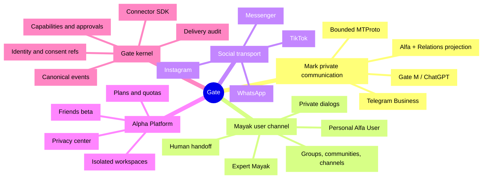

# Gate product platform

> Status: current product definition and target architecture  
> Owner decision: [Gate #277](https://github.com/markmalina/gate/issues/277)  
> Captured: 2026-07-22  
> Repository baseline: `80751280521baa6f0a259032f5093d1161da2363`

## 1. Product purpose

Gate is the safe omnichannel communication platform of Alpha V.

It connects external provider accounts and conversations to the correct scoped product
context, accepts communication facts durably, exposes only authorized context, performs
only authorized external actions, and records a terminal transport receipt.

Gate is the sensory and delivery layer. It is deliberately not the intelligence,
relationship master, learning/program engine, work manager or media editor.

```text
provider event
→ durable Gate fact
→ scoped identity and consent
→ Alfa or Mayak decision
→ exact proposal or authorized action
→ Gate delivery attempt
→ terminal receipt
```

The long-term product is one continuous user relationship that can move across Telegram,
Instagram, WhatsApp, TikTok, Messenger, web and future channels without mixing users,
agents, projects or private memory.

## 2. Domain ownership

| Domain | Canonical owner | Gate responsibility |
|---|---|---|
| Connector identity, OAuth/session, webhook, provider API | Gate | Full transport ownership |
| Durable ingress, idempotency, routing envelope | Gate | Full transport ownership |
| Capability grant, exact approval, delivery outcome | Gate | Full transport ownership |
| Mark's private intelligence and life analysis | Alfa | Deliver scoped facts and actions only |
| User-specific personal Alfa memory | Alfa | Enforce workspace and installation boundary |
| Person, identity, consent, relationship truth | Relations | Exchange opaque scoped references and events |
| Commitments, attention and commercial relationships | Relations | Hold compatibility projections only when required |
| Expert program, practice and progress | MAYAKI / Oko | Transport explicit product intents and results |
| Publication workflow, funnel and analytics meaning | MAYAKI | Perform provider transport calls after a grant |
| Media analysis, edit and render | TAKE | Receive/return approved package references only |
| Work, task, execution and portfolio receipt | Center / Flow | Return bounded operational metadata only |
| Provider cost reservation and transport metering | Gate | Enforce hard usage boundary |
| Commercial plan/catalog/revenue product | Future Alpha Platform commerce owner | Consume Gate usage facts; do not hide the product in transport |

Gate must not create a second Person, private memory, program-progress, campaign,
content-production or portfolio master.

## 3. Product identities

The platform has four different user-facing identities. They must never be conflated.

1. **Mark** — a human actor. A Mark-authored message is never presented as model-authored.
2. **Alfa Mark** — Mark's private assistant and memory. It is never exposed to another user.
3. **Mayak** — an explicitly named expert agent operating one bounded expertise or program.
4. **Alfa User** — a private per-user assistant created only after explicit onboarding and consent.

A Mayak does not silently become Alfa. The transition is a product handoff:

```text
expert Mayak
→ explain the personal-Alfa offer and data scope
→ user consent
→ create isolated user workspace/memory
→ connect the Mayak as an expert module
```

Every outbound proposal carries an explicit `actor_ref`, `agent_identity_ref`,
`workspace_ref`, `installation_ref`, `dialog_ref`, content digest and authority
class.

## 4. Product tree

### 4.1 Mark private communication

- Telegram Business / Secretary connections for owner accounts.
- Personal Telegram messages, voice and supported media.
- Current unanswered inbox, bounded context, draft and exact-confirmed send.
- MTProto only for capabilities not safely available through the official Bot API
  or owner-approved offline export.
- Scoped history projection to Relations and Alfa.
- Gate M / ChatGPT as an alternative owner control surface.
- Emergency pause, revocation and terminal unknown reconciliation.

### 4.2 Mayak user channel

- Private dialogs.
- Groups, supergroups, communities, channels and bots.
- One explicit installation and capability set per user-facing surface.
- Visible agent identity and current mode.
- Expert program events owned by MAYAKI/Oko.
- Explicit transition to the user's private Alfa.
- Additional Mayaks as separately installed expert modules.
- Human handoff and return-to-human state.

### 4.3 Instagram / Meta

- OAuth state/callback and encrypted credential lifecycle.
- Workspace/account registry and permission health.
- Authenticated webhooks and provider idempotency.
- One explicitly confirmed Reel from an approved TAKE package.
- Bounded insights collection and normalized comment/DM events.
- MAYAKI owns scheduling, funnel, attribution, CRM behavior and analytics meaning.
- Gate never edits video or silently turns a comment into a Direct message.

### 4.4 Other channels

Planned connector order is use-case driven:

1. WhatsApp for program conversation.
2. TikTok for approved content publication and acquisition.
3. Facebook Messenger for conversation.
4. Web chat.
5. Further channels through a proven connector contract.

A provider is not considered "supported" as one boolean. Each connector publishes a
versioned capability matrix.

### 4.5 Alpha Platform

- Per-user authentication and workspace.
- Per-user private Alfa and memory.
- Friend invitation and closed beta.
- Installed Mayaks and entitlements.
- Provider quotas, reservations and cost visibility.
- Privacy center: consent, access log, correction, export and deletion.
- Support and administrative controls.
- Commercial plans through the Alpha application.
- No shared OpenAI, Telegram, Meta or other account credentials.

### 4.6 Shared Gate kernel

- Workspace, channel account, connection and installation registry.
- Provider-neutral dialog identity.
- Canonical event envelope and transactional outbox.
- Durable idempotency and replay conflict detection.
- Capability grants and exact approval.
- Delivery ledger, terminal status and reconciliation.
- Credential-store interface.
- Retention and deletion classes.
- Redacted metrics, alerts and recovery receipts.
- Connector SDK and conformance fixtures.

## 5. Mind map



## 6. Capability model

Every installation capability is independent and default-deny:

- `receive_message`;
- `read_bounded_history`;
- `send_message`;
- `send_sequence`;
- `receive_media`;
- `publish_content`;
- `read_comments`;
- `reply_comment`;
- `read_direct`;
- `send_direct`;
- `read_insights`;
- `manage_members`;
- `moderate_content`;
- `manage_channel`;
- `manage_bots`.

A model proposal cannot grant, broaden or select a capability. Administrative,
publication, messaging and analytics permissions remain distinct even when one provider
offers all of them.

The machine-readable current/target lifecycle is
[`registry/gate-capabilities.v1.json`](../registry/gate-capabilities.v1.json).

## 7. Memory and life-analysis boundary

"Complete awareness" is not a raw-history dump into a model. The required path is:

```text
scoped communication fact
→ Relations identity and relationship space
→ sourced event / commitment / preference / tension / open question
→ Alfa memory proposal
→ owner or user correction
→ time-aware retrieval
```

A memory item requires:

- workspace and relationship-space scope;
- subject and source references;
- source time and observation time;
- fact / interpretation / proposal class;
- confidence;
- sensitivity and retention class;
- correction and deletion state;
- provenance to the canonical communication fact.

Gate owns the source fact and transport retention. Relations owns the person and
relationship meaning. Alfa owns the private semantic memory. Center receives no payload.

## 8. Current factual baseline

The repository baseline for this decision is current `main` at
`80751280521baa6f0a259032f5093d1161da2363`.

| Surface | Current state |
|---|---|
| Core FastAPI/PostgreSQL/Alembic/Railway/CI | Production, bounded |
| Telegram Business RU/BY | Production, manual/confirmed delivery |
| Gate M | Eleven code-defined tools; external authorization remains a current gate |
| Alpha group | Durable/model shadow and bounded canary path; first accepted live model canary pending |
| Personal MTProto | Encrypted local owner session exists; runtime/read/send disabled |
| Relations | Domain and integration contracts exist; full live memory projection not assembled |
| Instagram | Meta app and handoff exist; owner account OAuth/runtime not connected |
| TAKE intake | Default-off synthetic boundary |
| Other providers | Not implemented |
| Commercial Alpha Platform | Product target; not an operating SaaS |

Operational counters in README are a dated 2026-07-18 receipt, not a fresh invariant.

## 9. Source-of-truth hierarchy

When documents disagree, use this order:

1. current GitHub issue and latest accepted implementation receipt;
2. this product definition and the capability registry;
3. `docs/PROJECT_HANDOFF.md`;
4. `README.md`;
5. active subsystem runbooks and policies;
6. `docs/GATE_FULL_TECHNICAL_SPEC.md` and early sprint roadmaps as historical baselines.

The full technical specification remains valuable historical evidence. Its old exclusion
of MTProto does not override the later accepted default-off personal Telegram boundary.

## 10. Product invariants

1. Mark private Alfa and private memory never cross to another user.
2. One user's Alfa, relationships and usage are workspace-isolated.
3. Agent identity and current mode are visible.
4. Mayak-to-Alfa transition requires explicit consent.
5. Raw communication is not copied wholesale into Git, Center or model prompts.
6. Memory is sourced, correctable and deletable.
7. Provider account, recipient and capability are selected by trusted policy, never model output.
8. External capabilities are installation-scoped and default-deny.
9. Unknown delivery/provider outcome is terminal until reconciliation.
10. Channel capability parity is never assumed.
11. Commercial access uses the Alpha application, not shared provider credentials.
12. Gate transport remains usable when Alfa/Mayak generation is paused.
13. Every billable/provider action reserves a hard budget first.
14. Every external effect has an idempotency identity and terminal receipt.

## 11. Ordered delivery program

### P0 — Product truth

- this document;
- versioned capability registry;
- current README/handoff pointers;
- no runtime change.

### P1 — Current Telegram control

- restore Gate M authorization;
- refresh and verify the eleven-tool contract;
- accept one exact #261 canary;
- preserve fixture rollback and pause.

### P2 — Personal Telegram read contour

- audit current official Bot API/Business/Secretary capabilities;
- identify the remaining MTProto-only requirements;
- wire one encrypted read-only canary;
- expand by explicit dialog/data class;
- keep send separately gated.

### P3 — Alfa / Relations memory projection

- sourced people, events, commitments and timeline;
- correction/deletion;
- bounded retrieval;
- no silent CRM or memory mutation.

### P4 — Reusable Mayak installation

- private/group/community/channel installation;
- visible agent identity;
- program contract;
- personal-Alfa handoff;
- human takeover.

### P5 — Instagram

- connector/OAuth contract;
- one owner account read-only probe;
- one exact Reel;
- bounded events and insights.

### P6 — Friends beta and commerce

- user auth/workspace/Alfa;
- invitation, limits, entitlements and privacy center;
- measured provider cost and unit economics;
- commercial plans only after closed-beta evidence.

### P7 — Additional connectors

- WhatsApp;
- TikTok;
- Messenger;
- web;
- connector SDK stabilization after three real adapters.

## 12. Immediate pointer

The execution and acceptance checklist for P0 live in
[Gate #277](https://github.com/markmalina/gate/issues/277).

The pre-existing bounded work remains:

- [#261](https://github.com/markmalina/gate/issues/261) — exact first Alpha group canary;
- [#260](https://github.com/markmalina/gate/issues/260) — private Gate → TAKE media canary;
- [#272](https://github.com/markmalina/gate/issues/272) — Center cutover pointer.

No item in this document authorizes a provider call, OAuth/credential action, message,
publication, production mutation or real-person-data operation.
