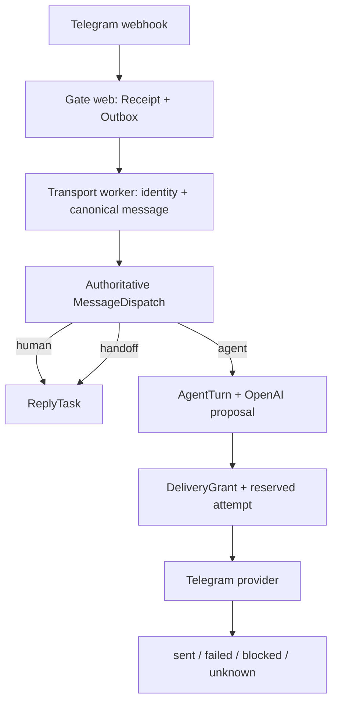

# Gate runtime recovery · техническое и продуктовое ТЗ

Статус документа: **implementation-ready specification; код не реализован**  
Дата аудита: **2026-07-24**  
Gate baseline: `main@8bab86581abe458407225e2733d1c35dd2945424`  
Production observation: `2026-07-24T05:40Z`  
Канонический master pointer: [Gate #277](https://github.com/markmalina/gate/issues/277)  
Продуктовый pointer Center: [Center #21](https://github.com/markmalina/center/issues/21)  
Текущие implementation pointers: [Gate #261](https://github.com/markmalina/gate/issues/261), [Gate #300](https://github.com/markmalina/gate/issues/300), [PR #301](https://github.com/markmalina/gate/pull/301), [MAYAKI #95](https://github.com/markmalina/mayaki/issues/95), [Oko #25](https://github.com/markmalina/oko/issues/25)

> Знаю правила: **1. Двигаюсь без подтверждения Марка · 2. Экономлю GitHub Actions · 3. Максимально работаю автономно. Продолжаю работу.**

## 1. Резюме решения

Gate не требуется переписывать с нуля. В репозитории уже есть хорошие заготовки: durable Telegram ingress, receiving-account-relative Business identity, canonical messages, agent deployments/sessions/turns, OpenAI Responses adapter, delivery grants и безопасная схема `reserve → provider → terminal receipt`.

Но два нужных продукта сейчас **не работают**:

1. **Личный Telegram Business → первая маска/Маяк → обучение.** В `main` присутствует только чистый application-контур универсального Маяка и один `system.md`. Нет production bundle, SQL adapter, Business binding, авторитетной маршрутизации, OpenAI composition, Business-agent delivery и activation. Открытый PR #301 разбирает обычный `message`, а фактический канал приходит как `business_message`.
2. **AlphaViaBot в группе.** Ingress, модельный shadow и безопасная доставка существуют, но установка `Alpha Group` сейчас `paused`, а код намеренно назначает любому OpenAI deployment режим `SHADOW_ONLY`. Автоматически доставлять разрешено только fixture/no-network runtime. Обычный `resume` не создаст постоянно отвечающего модельного бота.

Одновременно production нельзя считать здоровым:

- `reply-sequence` worker после каждого poll падает с `DetachedInstanceError` и повторяет ошибку примерно каждые 5 секунд;
- `/ready` при этом возвращает `200`, потому что проверяет только БД и Alembic;
- Telegram worker на каждой итерации создаёт и уничтожает новый engine/pool и HTTP composition;
- worker запущен как несупервизируемая background task внутри web-процесса;
- захваченный ingress item после process crash может навсегда остаться в `processing`;
- в production остаётся временный endpoint транскрипции личного звонка с committed bearer-equivalent token и фиксированной ссылкой на персональное аудио.

Правильная стратегия — **не big-bang**, а четыре быстрых вертикальных результата:

1. P0 containment и честная runtime readiness;
2. один OpenAI-ответ AlphaViaBot в группе, затем установка остаётся active;
3. один полноценный Telegram Business vertical для универсального Маяка;
4. подключение существующего MAYAKI learning loop без переноса LMS-логики в Gate.

После запуска — постепенное удаление 12-слойной webhook-цепочки и legacy transaction/provider coupling.

## 2. Что доказано, а что нет

| Контур | Спецификация | Код | CI | Deployed | Runtime | Пользовательский результат |
|---|---|---|---|---|---|---|
| Telegram Business durable ingress | да | да | да | да | принимает события | да, для текущего human inbox |
| Business identity/parity | да | да | да | да | `528 matched`, `0 mismatch` на момент наблюдения | да, но только как transport fact |
| Universal Mayak pure application contour | да | да | PR #296 green | да | **не скомпонован** | **нет** |
| Universal Mayak production bundle | частично (`system.md`) | **нет manifest/policy/evals** | нет | только неполный файл | loader не загрузит | нет |
| Universal Mayak Business ingress | ошибочная ветка в PR #301 | только `message`, не `business_message` | run #1042 упал до всех steps; это infra failure | нет | нет | нет |
| Universal Mayak SQL/model/delivery adapters | контракты портов | **нет** | нет | нет | нет | нет |
| Alpha group durable ingress | да | да | да | да | включён | принимает explicit invocation |
| Alpha OpenAI model shadow | да | да | да | да | 13 model turns, 0 failed | только proposal |
| Alpha automatic OpenAI delivery | правило явно запрещает | **нет** | нет | нет | `SHADOW_ONLY` | **нет** |
| Alpha fixture/manual canary delivery | да | да | да | да | два старых инцидентных ответа; более поздний тест — один ответ | bounded evidence, не постоянный продукт |
| Alpha installation | да | да | да | да | `paused`, `one_active_exact_revision=false` | не отвечает постоянно |
| Railway GitHub autodeploy | да | настроен | применимо | latest exact main deployed SUCCESS | работает без ChatGPT Railway connector | deploy ≠ product readiness |
| Web readiness | DB + migrations | да | да | да | `200` даже при падающем worker | ложноположительная |
| Worker readiness/heartbeat/queue lag | нет | нет | нет | нет | нет | нет |
| MAYAKI one-learning-loop | [MAYAKI #95](https://github.com/markmalina/mayaki/issues/95) | repository contour существует | отдельное evidence MAYAKI | default-off | не соединён с Gate | нет live E2E |
| Oko five-exercise program | [Oko #25](https://github.com/markmalina/oko/issues/25) | content registry/plan | материалы ожидаются | нет | нет | полное обучение не готово |

Вывод: зелёный merge, CI или Railway deployment нельзя использовать как доказательство product outcome. Center должен хранить отдельно: `specification`, `implementation`, `verification`, `deployment`, `runtime`, `product_evidence`, `freshness`.

## 3. Продуктовый outcome

### 3.1. Release A — AlphaViaBot в одной группе

Для exact approved группы:

- бот видим как `AlphaViaBot`;
- Privacy Mode подтверждён;
- отвечает только на `/alpha`, `/alpha@AlphaViaBot`, точное `@mention` или reply боту;
- обычный групповой текст не вызывает модель и не попадает в контекст;
- используется reviewed OpenAI deployment и immutable instruction revision;
- на один canonical trigger создаются максимум один model turn, один grant и один Telegram provider call;
- ответ содержит disclosure и отправляется одним plain-text сообщением;
- duplicate/replay возвращает terminal receipt без второго model/provider call;
- после успешного canary установка остаётся `active`, а не автоматически возвращается в `paused`;
- pause/revoke/leave/kick немедленно блокируют новые turns и delivery;
- timeout, cancellation, Telegram 5xx или неясный provider result дают terminal `unknown` без автоматического resend.

### 3.2. Release B — универсальная первая маска в личном Telegram

Для одной exact owner-selected Telegram Business installation:

- поддерживается реальный top-level `business_message`;
- identity определяется относительно receiving account и текущей Business connection, только из БД;
- первый `/start` или согласованный opt-in trigger активирует видимого помощника;
- каждый ответ маркируется, например: `Маяк · Око Возрождения — цифровой помощник`;
- модель получает только bounded context этой installation и этого private dialog;
- provider/account/dialog не попадают в prompt и не выбираются моделью;
- route назначается до human inbox projection;
- один trigger создаёт **либо** `AgentTurn`, **либо** `ReplyTask`, никогда оба;
- `/pause` останавливает агентный контур;
- `/human` создаёт ровно один handoff/ReplyTask;
- наблюдаемый исходящий человеческий ответ владельца переводит installation в handoff/paused, чтобы человек и агент не говорили одновременно;
- duplicate webhook и process restart не создают вторую генерацию/доставку;
- установка остаётся active после успешного canary.

### 3.3. Release C — один полный learning loop

Gate не является LMS. Полный минимальный loop:

```text
Gate canonical trigger
→ opaque MAYAKI intake
→ ProgramEnrollment
→ lesson/practice
→ result
→ durable progress
→ next-step proposal
→ Gate exact delivery
```

Gate хранит transport facts, dispatch, installation, turn/grant/attempt и terminal receipt. MAYAKI хранит enrollment, lesson, practice, result, progress и next-step semantics. Center хранит только pointers, execution/lease и redacted receipts.

Минимальная product acceptance:

- один пользователь;
- один enrollment;
- один урок;
- одна практика;
- один результат;
- один durable progress transition;
- один следующий шаг;
- restart/replay не повторяет result и Telegram message;
- `/human` останавливает обучение и создаёт один handoff.

### 3.4. Что нельзя называть «полным обучением»

Текущий `universal_mayak_v1/system.md` — общий помощник, а не курс. Он не содержит program state, уроков, практик, прогресса или completion.

Лестница честной готовности:

1. `transport_demo`: два связанных ответа в одном DM;
2. `learning_vertical`: один enrollment/lesson/practice/result/progress;
3. `oko_program_v0`: пять принятых упражнений и safety copy;
4. `external_pilot`: один invited user с purpose/consent/delete/handoff.

Пока материалы из Oko #25 не приняты, нельзя заявлять пользователю прохождение полной пятиупражненческой программы. Это content/safety dependency, а не причина откладывать transport и one-learning-loop.

## 4. Границы владения

| Система | Владеет | Не владеет |
|---|---|---|
| Gate | connector/account/dialog identity, webhook, durable ingress, dispatch, installation, capability grant, model boundary, exact delivery, terminal receipt, transport audit | программа обучения, CRM truth, личная память, контент-редактор |
| MAYAKI/LMS | program, enrollment, lesson, practice, result, progress, next-step semantics | Telegram credential, webhook, provider recipient, send attempt |
| Oko | упражнения, assets, safety/product copy, program revision | Telegram runtime |
| Relations | Person/identity/consent/relationship truth после отдельного cutover | Telegram raw payload, delivery |
| Center | Work, execution, lease, acceptance, portfolio/readiness metadata | raw messages, provider IDs, credentials, learning payload |
| OpenAI runtime | один schema-validated proposal | выбор account/recipient, отправка, DB mutation, tools |

## 5. Критические дефекты и обязательные решения

### P0-SEC-01 · Удалить временный personal-call endpoint

Источник: `app/api/health_routes.py`.

Проблемы:

- committed bearer-equivalent token;
- фиксированная ссылка на личное аудио;
- персональный prompt;
- query token попадает в access logs/history;
- до 180 секунд provider I/O внутри web request;
- весь аудиофайл загружается в память;
- наружу возвращаются части provider error/response.

Требуемое изменение:

1. Полностью удалить route, token, URL и personal prompt из текущего кода.
2. Считать token скомпрометированным; прекратить его использование.
3. Проверить доступ к исходному media URL и отозвать/заменить link, если он ещё действителен.
4. Проверить Git history, Railway access logs и secret-scanner evidence. Историю не переписывать без отдельного destructive owner gate.
5. Если транскрипция ещё нужна, реализовать её отдельной durable job за нормальной auth/data policy, streaming/size limit, retention и redacted errors.
6. Добавить secret/personal-data scan в required CI.

Acceptance:

- route отсутствует в OpenAPI;
- старый token не даёт доступ;
- production config/route test не содержит фиксированного private media;
- scanner ловит синтетический аналог утечки.

### P0-OPS-01 · Исправить непрерывный `DetachedInstanceError`

Источник: `app/worker/reply_sequences.py`.

Точная причина:

1. `run_reply_sequence_once()` загружает ORM `ReplyDraft`/`SendAttempt`;
2. вызывает `rollback()`;
3. закрывает session;
4. `_due_items()` читает `draft.prompt_context`;
5. rollback экспайрит ORM attributes, объект уже detached.

Немедленное исправление:

- select только необходимых scalar columns;
- внутри открытой session построить immutable `_SequenceRow`;
- за session boundary передавать только dataclass/IDs;
- не использовать `SimpleNamespace` как единственную проверку;
- добавить real PostgreSQL regression.

Целевой refactor:

- вынести расписания из JSONB `ReplyDraft.prompt_context` в `reply_sequences` и `reply_sequence_items`;
- поля item: `sequence_id`, `draft_id`, `position`, `state`, `due_at`, `attempt_id`, `terminal_code`;
- unique `(sequence_id, position)` и `(draft_id)`;
- index `(state, due_at)`;
- claim через `FOR UPDATE SKIP LOCKED`;
- provider call вне transaction;
- terminal `unknown` без слепого resend.

До code fix допустимая containment-мера — exact production-gated выключение `GATE_REPLY_SEQUENCE_WORKER_ENABLED`; это отдельная runtime mutation и не выполняется этим документом.

### P0-OPS-02 · Разделить web и workers

Текущее состояние:

- `app.main:lifespan()` запускает Telegram и reply-sequence loops внутри Uvicorn;
- каждый web replica поднимет собственные loops и webhook reconciliation;
- `run_telegram_worker_loop()` по умолчанию вызывает `_run_from_settings()`;
- каждая итерация создаёт новый engine/pool, session factory и при Alpha/voice новый HTTP composition;
- обрабатывается максимум один item, затем всё уничтожается;
- пойманная ошибка не завершает process, Railway restart policy не срабатывает.

Целевая Railway topology:

| Service | Команда | Ответственность | Реплики |
|---|---|---|---|
| `gate-web` | Uvicorn `app.main:app` | webhook durable accept, MCP/admin read, `/live`, `/ready`, `/meta/release` | 1+ |
| `gate-telegram-worker` | dedicated worker entrypoint | Telegram outbox, canonicalize, dispatch, agent turns/delivery, webhook desired-state controller | 1 до доказанного multi-worker режима |
| `gate-reply-worker` | dedicated worker entrypoint | reply sequence queue и human-send recovery | 1 |
| Postgres | managed | durable state | managed |

Все services используют один image и один exact full SHA. Каждая worker service создаёт один engine/pool и общие HTTP clients на process lifetime. Один loop не должен уничтожать другой; каждый имеет supervisor state и heartbeat.

Минимальный `RuntimeContainer`:

```python
class RuntimeContainer:
    session_factory: async_sessionmaker[AsyncSession]
    telegram_business: TelegramClient
    telegram_alpha: TelegramClient
    openai_http: httpx.AsyncClient
    bundle_loader: DeployedInstructionBundleLoader
    release_identity: ReleaseIdentity
```

Никаких `create_async_engine()` и `AsyncClient()` внутри poll iteration.

### P0-OPS-03 · Добавить lease recovery для ingress outbox

Сейчас `claim_due()` переводит receipt/outbox в `PROCESSING`, но выбирает только `PENDING`/`RETRY_SCHEDULED`. Process crash после commit claim оставляет событие навсегда.

Изменение:

- добавить `lock_owner`, `lease_expires_at`, `heartbeat_at`;
- `claim_due()` может reclaim `PROCESSING` только после истёкшего lease;
- попытка увеличивается один раз на новый claim;
- downstream `MessageDispatch`, `AgentTurn`, `DeliveryGrant` и `AgentSendAttempt` обеспечивают replay fences;
- reclaim ingress допустим, provider delivery — нет;
- stuck-running model/send terminalize как `unknown`, а не вызываются снова.

### P0-OPS-04 · Сделать readiness честной

Публичные endpoints:

- `/live`: только процесс отвечает;
- `/ready`: DB доступна, schema compatible, required production config валиден, webhook можно durably enqueue;
- `/meta/release`: full Git SHA, service, environment, start time, schema heads, bundle hashes, non-secret config fingerprint;
- `/ops/health`: auth-protected redacted aggregate.

`/ops/health` должен возвращать:

- exact full SHA каждого service;
- migration heads;
- worker heartbeat age/status/last success/last error code;
- queue pending/processing/retry/DLQ counts и oldest age;
- desired/observed webhook digest и age последней reconciliation;
- installation/deployment release states;
- last provider error category;
- `unknown` delivery count;
- никаких provider IDs, message text, secrets или identities.

Railway `/ready` web service не должен требовать текущей доступности Telegram/OpenAI: это вызовет unnecessary outage webhook ingress. Но aggregate product readiness обязана считать worker/provider degradation.

### P0-PROD-01 · Разрешить reviewed OpenAI delivery для Alpha

Текущий hardcoded rule:

```text
fixture/no-network → CANARY
любая OpenAI model → SHADOW_ONLY
```

Заменить runtime-profile heuristic на явную release policy:

- `shadow_only`;
- `bounded_live`.

Effective delivery authority:

```text
global worker enabled
AND connector active
AND connector supports agent_delivery
AND model/data gate approved
AND deployment active + validated + bounded_live
AND installation active
AND installation auto_reply enabled
AND explicit invocation
AND budget available
AND one dispatch/turn/grant fence
```

Ни runtime profile, ни один env flag не дают authority самостоятельно.

Для #261:

1. Не создавать новый parallel issue/PR.
2. Добавить release policy и privacy-safe context в существующий Work.
3. Rebind exact installation к reviewed OpenAI deployment/revision.
4. Fresh owner-only canary.
5. Read-only replay proof.
6. Второй fresh invocation.
7. При полном успехе оставить installation active.

### P0-PROD-02 · Построить реальный Business Mayak vertical

Нельзя просто повесить Mayak после текущего inbox projector. Сейчас ownership shadow остаётся non-authoritative и вся inbound Business text проецируется в `HUMAN_REPLY_TASK`.

На каждый canonical message необходима одна immutable authoritative dispatch-запись.

## 6. Целевая архитектура



### 6.1. Transaction boundaries

1. **T1 ingress:** verify secret → validate envelope → insert receipt + outbox → commit → return `200`.
2. **T2 transport:** claim lease → resolve identity → canonical message → authoritative dispatch → create exactly one downstream work item → commit.
3. **T3 model:** reserve/claim turn → commit → OpenAI outside transaction → persist proposal/usage or terminal failure/unknown.
4. **T4 delivery reserve:** validate immutable target/candidate → insert grant/attempt=`sending` → commit.
5. **Provider:** one external Telegram call, no DB transaction.
6. **T5 terminal:** persist `sent|failed|blocked|unknown`.

Application services не импортируют SQLAlchemy/FastAPI. Repository/UoW владеет короткой transaction. Через boundaries передаются immutable snapshots и opaque IDs.

### 6.2. Authoritative dispatch

Новая сущность `message_dispatches`:

| Поле | Требование |
|---|---|
| `id`, `workspace_id` | tenant scoped |
| `canonical_message_id` | unique, FK |
| `ownership_version` | версия dialog policy |
| `route` | `human_reply_task`, `agent_turn`, `agent_handoff`, `ignored`, `quarantined` |
| `installation_id` | nullable; required для agent routes |
| `policy_version` | immutable |
| `input_sha256` | canonical decision input digest |
| `state` | `reserved`, `processing`, `terminal` |
| `terminal_code` | safe code |
| timestamps | UTC |

`WorkOwnership` остаётся текущим dialog-level state. `MessageDispatch` — immutable message-level decision. Inbox projector и agent orchestration принимают `dispatch_id` и не решают route повторно.

DB constraints:

- unique `canonical_message_id`;
- agent route требует installation;
- human/ignored/quarantined запрещают installation;
- один downstream artifact связан с dispatch;
- altered replay digest → conflict.

### 6.3. Receiving-account-relative dialog identity

Текущий unique `(workspace, connector, provider_dialog_id)` недостаточен для Telegram Business: одинаковый provider dialog может существовать относительно разных receiving accounts/connections.

Целевой generic aggregate:

`connector_accounts`

- `workspace_id`;
- `connector_id`;
- `account_id`;
- `provider_account_binding`/Business connection reference;
- `state`;
- `valid_from`, `valid_to`;
- unique exact active provider binding.

`dialogs`:

- добавить `connector_account_id`;
- для `telegram_business` сделать обязательным;
- identity: `(workspace_id, connector_account_id, provider_dialog_id)`;
- для bot connector оставить совместимую identity.

Migration выполняется expand/backfill/validate/contract:

1. nullable columns/table;
2. backfill из `TelegramBusinessConnection`, receipt и identity evidence;
3. остановка migration при неоднозначном RU/BY mapping;
4. новые writes dual-safe;
5. unique partial indexes;
6. после доказанного cutover — NOT NULL/удаление старого unique.

Нельзя молча выбрать account при ambiguity.

### 6.4. Reuse existing agent kernel

Не создавать параллельные demo-таблицы. Использовать:

- `AgentDefinitionModel`;
- `InstructionRevisionModel`;
- `AgentDeploymentModel`;
- `AgentInstallationModel`;
- `AgentSessionModel`;
- `AgentTurnModel`;
- `DeliveryGrantModel`;
- `AgentSendAttemptModel`.

Изменения:

- переименования Python-классов можно отложить; физические table names не менять в быстром релизе;
- deployment получает explicit `delivery_release`;
- installation получает `purpose_ref`, `consent_ref`, `auto_reply_enabled`, public label/disclosure и context policy;
- turn получает `input_sha256`, `unknown`/terminal semantics;
- send attempt получает immutable transport target snapshot/hash, `started_at`, `finished_at`, `provider_started_at`;
- Business attempt snapshot включает exact connector account/dialog/Business connection, выбранные из DB до provider call.

### 6.5. Instruction bundles

`agent_bundles/universal_mayak_v1/` должен содержать:

- `manifest.json`;
- `system.md`;
- `policy.json`;
- `evaluations.json`.

Manifest:

- schema version;
- agent key;
- revision key;
- source repository/path/full commit;
- content SHA-256.

Policy:

- `reply`, `handoff`, `no_reply`;
- no tools;
- max output;
- allowed language/identity disclosure;
- data/context policy.

Evaluations:

- `/start`;
- обычный вопрос;
- prompt injection;
- просьба раскрыть system prompt;
- medical/legal/financial handoff;
- `/pause` и `/human` обрабатываются до модели;
- no cross-dialog facts.

`OpenAIResponsesAgentRuntime` сделать channel-neutral:

- общий invariant text;
- отдельный `ChannelSafetyContext` для `private_dialog` и `group_thread`;
- убрать hardcoded “untrusted group content” из общего adapter;
- `store=false`, `tools=[]`, strict JSON Schema сохранить.

### 6.6. Application methods

Рекомендуемые порты/use cases:

```python
class ResolveAuthoritativeDispatchService:
    async def execute(
        self, command: ResolveDispatchCommand
    ) -> DispatchSnapshot: ...

class BusinessAgentBindingReader:
    async def resolve(
        self,
        workspace_id: str,
        connector_account_id: str,
        dialog_id: str,
    ) -> AgentInstallationSnapshot | None: ...

class MessageDispatchStore:
    async def reserve(
        self,
        canonical_message_id: str,
        route: DispatchRoute,
        installation_id: str | None,
        policy_version: str,
        input_sha256: str,
    ) -> DispatchSnapshot: ...

class ProcessAgentMessageService:
    async def execute(self, dispatch_id: str) -> AgentTurnSnapshot: ...

class AgentTurnStore:
    async def reserve_turn(self, dispatch_id: str) -> AgentTurnSnapshot: ...
    async def load_context(self, turn_id: str) -> tuple[ContextMessage, ...]: ...
    async def complete_proposal(self, proposal: ProposalSnapshot) -> AgentTurnSnapshot: ...
    async def finish_unknown(self, turn_id: str, code: str) -> AgentTurnSnapshot: ...

class AgentDeliveryStore:
    async def issue_grant(self, turn_id: str, candidate_sha256: str) -> GrantSnapshot: ...
    async def reserve_attempt(self, grant_id: str) -> AttemptSnapshot: ...
    async def finalize(self, outcome: DeliveryOutcome) -> AttemptSnapshot: ...

class TelegramBusinessAgentAdapter:
    async def send_exact(self, attempt: AttemptSnapshot) -> ProviderOutcome: ...

class TelegramGroupAgentAdapter:
    async def send_exact(self, attempt: AttemptSnapshot) -> ProviderOutcome: ...

class UnknownDeliveryReconciler:
    async def inspect(self, attempt_id: str) -> ReconciliationSnapshot: ...
```

Model adapter получает `AgentTurnCommand`, но не target/account/provider credential. Delivery adapter получает только уже зарезервированный immutable attempt.

### 6.7. Dispatch rules для Business DM

| Событие | Route | Side effect |
|---|---|---|
| inbound human text, нет active binding | `human_reply_task` | один ReplyTask |
| inbound human text, exact active binding | `agent_turn` | один AgentTurn, ноль ReplyTask |
| `/start` в pending approved binding | `agent_turn` | activate/enroll по policy |
| `/pause` | `agent_turn` control | installation paused, без ReplyTask |
| `/human` | `agent_handoff` | handoff state + один ReplyTask |
| outbound human message владельца | `agent_handoff`/control | pause pending agent work |
| bot/service/outbound/unknown direction | `ignored` или `quarantined` | model/send запрещены |
| unresolved account/connection | `quarantined` | alert, никакой fallback send |
| model failure/unknown | terminal agent dispatch | не создавать скрытый human route; handoff только explicit policy |

### 6.8. Context policy

Private:

- только messages с dispatch этой installation/dialog;
- максимум 12 сообщений;
- максимум 6000 символов;
- максимум 24 часа для быстрого пилота;
- только user + confirmed sent assistant outputs;
- никакой старой переписки до opt-in;
- raw provider IDs отсутствуют.

Group:

- только явно адресованные боту triggers;
- reply chain/thread, а не весь групповой чат;
- только ранее доставленные ответы этой installation;
- обычные сообщения группы не входят в model context;
- no cross-group context.

## 7. At-most-once, replay и `unknown`

Exactly-once между PostgreSQL и Telegram API физически недостижим без provider idempotency contract. Gate обещает at-most-once provider attempt:

1. Grant и attempt=`sending` commit до Telegram.
2. Provider вызывается максимум один раз.
3. `sent`, `failed`, `blocked`, `unknown` terminal.
4. Timeout, cancellation, network reset, Telegram 5xx, invalid/missing result, crash после request start → `unknown`.
5. Replay `sending` не вызывает provider, а возвращает/terminalizes `unknown`.
6. Одинаковый trigger/digest возвращает сохранённый terminal receipt.
7. Тот же key с другим digest → `replay_conflict`.
8. `unknown` разрешается read-only reconciliation либо новым явно санкционированным сообщением; старый attempt не resend.

Общую Telegram outcome classifier вынести из human sender и использовать в human/Alpha/Mayak:

| Provider result | Gate outcome |
|---|---|
| confirmed `ok` + message id | `sent` |
| validation/permission definite 4xx | `failed` или `blocked` |
| rate limit до доказанного send | terminal safe code; automatic resend запрещён в pilot |
| 5xx | `unknown` |
| timeout/network/cancellation | `unknown` |
| malformed success | `unknown` |

## 8. Конфигурация и activation

### 8.1. Настройки

Разделить `Settings`:

- `DatabaseSettings`;
- `BusinessTelegramSettings`;
- `AlphaTelegramSettings`;
- `AgentRuntimeSettings`;
- `WorkerSettings`;
- `OpenAISettings`;
- `McpAuthSettings`;
- `ReleaseSettings`.

Требования:

- все secrets — `SecretStr`/secret references;
- enum вместо произвольных environment/mode/auth strings;
- никаких прямых `os.getenv` вне composition root;
- production не читает `.env`;
- send/agent capability defaults = `false`;
- production запрещает `temporary_bearer`;
- cross-field validator fail-fast.

### 8.2. Feature gates

Минимум:

- `GATE_TELEGRAM_WORKER_ENABLED`;
- `GATE_ALPHA_CONNECTOR_ENABLED`;
- `GATE_ALPHA_MODEL_RUNTIME_ENABLED`;
- `GATE_ALPHA_MODEL_DATA_GATE_APPROVED`;
- `GATE_ALPHA_AUTOREPLY_ENABLED`;
- `GATE_MAYAK_BUSINESS_RUNTIME_ENABLED`;
- `GATE_MAYAK_MODEL_DATA_GATE_APPROVED`;
- `GATE_AGENT_DELIVERY_ENABLED`.

Startup truth-table:

- connector enabled без worker → boot fails;
- autoreply enabled без model/data/delivery → boot fails;
- Mayak runtime enabled без complete bundle → boot fails;
- Business agent delivery без Business capability → boot fails;
- production send default-on/temporary auth/missing secrets → boot fails;
- config readiness содержит safe reason codes.

Env gates разрешают code path, но installation/deployment/grant дают точную authority.

## 9. Railway без ручного reconnect

### 9.1. Диагноз

Latest production deployment — exact `main@8bab86581abe...`, Railway state `SUCCESS`. История deployments показывает, что GitHub → Railway autodeploy уже работает. ChatGPT Railway connector нужен только для интерактивного management-plane просмотра и не участвует в webhook, worker, OpenAI или Telegram send.

Нельзя и не нужно «автоматически переподключать» чужой ChatGPT OAuth из Gate. Правильное решение — убрать connector из release, health, rollback и acceptance critical path.

### 9.2. Plugin-independent release

1. Required GitHub checks и stable `ci-required`.
2. Merge в `main`.
3. Railway native GitHub integration с `Wait for CI`.
4. Watch paths: docs/reports/tests-only не деплоятся.
5. Railway healthcheck.
6. External `release-verify` job ждёт:
   - `/meta/release.git_sha == GITHUB_SHA` (full SHA);
   - compatible schema heads;
   - все required worker service SHA совпадают;
   - heartbeat свежий;
   - webhook desired/observed совпадают;
   - no critical DLQ/unknown/cross-scope alert.
7. Project deployment webhook отправляет status во внешний monitor, не внутри того же упавшего проекта.
8. Optional Railway API использует только project/environment-scoped machine token в GitHub Environment secret, не personal/workspace token.

Официальные возможности Railway:

- [GitHub autodeploy, Wait for CI и watch paths](https://docs.railway.com/deployments/github-autodeploys);
- [healthchecks](https://docs.railway.com/deployments/healthchecks);
- [deployment actions/rollback](https://docs.railway.com/deployments/deployment-actions);
- [project webhooks](https://docs.railway.com/observability/webhooks);
- [`RAILWAY_GIT_COMMIT_SHA`](https://docs.railway.com/variables/reference).

Acceptance: в staging отключить ChatGPT Railway connector, выполнить bounded merge и доказать полный CI → deploy → exact-SHA → worker-health → alert flow.

### 9.3. Webhook reconciliation

Startup-only 0/3/10-second retries заменить desired-state controller:

- `getWebhookInfo` каждые 60 секунд + jitter;
- exact expected URL/secret-safe digest/allowed updates;
- безопасный repair mismatch;
- last success/error/counters в DB;
- failure влияет на aggregate ops readiness;
- alert по last error/pending update count;
- credential/secret никогда не логируется.

### 9.4. Rollback

- failed new healthcheck не получает traffic;
- post-release incident сначала freeze affected installation/delivery, а не весь ingress;
- записать exact SHA/schema/queue/unknown attempts;
- rollback image допустим только при N-1 schema compatibility;
- Railway rollback не отменяет DB/external effects;
- production `alembic downgrade` вслепую запрещён;
- при incompatible schema — roll forward;
- после rollback проверить exact SHA, workers, webhook, queue drain и отсутствие повторов ambiguous sends.

## 10. Observability и SLO

Рекомендуемые launch thresholds:

| Метрика | Target/alert |
|---|---|
| Authenticated webhook durable commit | p95 ≤ 500 ms, p99 ≤ 2 s |
| Worker heartbeat | каждые 10 s; warn > 30 s, critical > 60 s |
| Queue oldest age | warn > 30 s; critical > 120 s |
| DLQ | любое `> 0` — critical для pilot |
| Delivery `unknown` | каждое событие — immediate critical |
| Same exception | `>= 5` за 5 min — critical |
| Loop consecutive failures | `>= 3` — critical |
| DNS/connect errors | classify `db_dns`, `telegram_dns`, `openai_dns`; exponential backoff+jitter ≤ 60 s |
| Due reply → attempt | p95 ≤ 10 s, p99 ≤ 30 s |
| Accepted Alpha/Mayak → terminal | p95 ≤ 15 s, p99 ≤ 45 s |
| Merge → exact production SHA | p95 ≤ 10 min; mismatch at 10 min — critical |
| Webhook pending updates | `> 10` for 5 min — critical |

Alerts содержат release SHA, component, safe error code и runbook link. Payloads/identities/text редактируются.

## 11. Автоматическое тестирование

### 11.1. Unit

- real `business_message`, а не обычный `message`;
- Business inbound/outbound/bot/unknown direction;
- RU/BY receiving-account resolution;
- exact binding и activation truth-table;
- `/start`, normal text, `/pause`, `/human`;
- dispatch route/digest/replay conflict;
- Alpha command, addressed command, mention, reply;
- group non-invoked text → zero model;
- complete bundle manifest/digest/capabilities;
- private/group context filters;
- provider outcome truth-table;
- cancellation → `unknown`;
- public disclosure formatting/length.

### 11.2. PostgreSQL integration

- одинаковый provider dialog ID для RU и BY → разные dialogs/contexts;
- один canonical trigger → один dispatch;
- agent route → ноль ReplyTask;
- human route → один ReplyTask;
- `/human` → один ReplyTask;
- 100 concurrent duplicates → один canonical message, один dispatch, максимум один model call и provider call;
- multi-worker `SKIP LOCKED`;
- stale ingress processing reclaim;
- crash после delivery reservation → replay `unknown`, send count остаётся 1;
- exact Business connection из DB;
- cross-workspace/account/installation lookup blocked;
- real ORM regression для reply sequence после закрытия discovery session;
- migration expand/backfill ambiguity refusal/validate/contract;
- upgrade + schema drift; downgrade только disposable DB.

### 11.3. Contract

- Telegram webhook secret/allowed updates;
- Business `sendMessage` всегда содержит exact `business_connection_id`;
- Alpha send никогда не содержит Business connection;
- OpenAI Responses strict schema, `store=false`, no tools;
- provider IDs отсутствуют в model request/log;
- health/release/ops schemas;
- bundle content digest;
- MAYAKI envelope version/idempotency/failure semantics.

### 11.4. Synthetic E2E

Harness: real PostgreSQL + ASGI app + process-scoped worker container + fake OpenAI/Telegram HTTP transports.

Scenarios:

1. duplicate webhook дважды → one model + one send;
2. restart до model, во время model, после proposal, до send, после send;
3. OpenAI timeout/429/5xx/malformed JSON;
4. Telegram 4xx/429/5xx/timeout/invalid result;
5. pause/handoff across restart;
6. Business и group events одновременно без scope mixing;
7. worker task death делает `/ops/health` degraded;
8. webhook reconciliation восстанавливается после synthetic DNS failures;
9. one engine/client per process lifetime;
10. exact release SHA mismatch блокирует release verification.

### 11.5. Live canary — Alpha Group

Preconditions:

- exact production SHA;
- worker/webhook healthy;
- exact installation initially paused;
- reviewed OpenAI deployment `bounded_live`;
- owner-only aggregate presence = 2 для первого canary;
- старые incident turn/digest запрещены.

Steps:

1. Resume exact installation.
2. Fresh `/alpha <unique nonce>`.
3. Один model turn, grant, attempt и видимый ответ.
4. Read-only replay proof возвращает тот же terminal receipt; counters не меняются.
5. Non-invoked text → silence.
6. Второй fresh invocation → один новый ответ.
7. Installation остаётся active.
8. На любое mismatch/unknown — pause.

### 11.6. Live canary — Business Mayak

Preconditions:

- одна owner-selected installation;
- exact receiving account/connection/dialog;
- explicit opt-in;
- no historical conversation context;
- visible disclosure.

Steps:

1. `/start`/trigger → один маркированный ответ.
2. Второе сообщение → связанный ответ с same-dialog context.
3. Replay первого webhook → counters/model/send не меняются.
4. Human inbox → ноль parallel ReplyTask.
5. `/pause` → следующий text не вызывает модель.
6. Resume отдельным confirmed control.
7. `/human` → один ReplyTask и zero next model/send.
8. Restart сохраняет state/context/receipts.

### 11.7. Live learning-loop

1. Gate создаёт opaque MAYAKI intake.
2. MAYAKI создаёт один enrollment/session/practice.
3. Один result меняет progress ровно один раз.
4. Next-step proposal возвращается в Gate.
5. Gate доставляет один ответ.
6. Replay mutated payload отвергается.
7. Restart не повторяет result/delivery.

## 12. CI redesign

Текущий backend job запускает полный pytest, затем повторяет значительную часть Alpha suite; Windows job и два Docker build идут почти всегда. PR #296 получил два полных успешных CI run. Это медленно и не добавляет доказательств.

Целевой DAG:

1. `quality`: Ruff, strict mypy, unit/contract без DB.
2. `postgres-integration`: migrations + concurrency/idempotency/worker tests.
3. `release-evals`: marked security/product evals один раз; evidence строится из того же run, не повторным pytest.
4. `container`: build once с cache; Railway start command + `$PORT`; curl `/live`/`ready`; non-root; SBOM/vulnerability scan.
5. `ci-required`: стабильный aggregator required check.

Path gates:

- docs-only: Markdown/link/schema lint, no Windows/Docker/Railway deploy;
- Windows DPAPI: только personal Telegram/crypto/dependency/workflow paths;
- migration change: full migration/restore suite;
- worker/agent/delivery: critical PostgreSQL + container;
- nightly: restore drill, extended adversarial evals, dependency audit.

Дополнительно:

- lock transitive dependencies с hashes;
- pin pip/build tooling;
- secret scan;
- import-boundary test;
- unique FastAPI `(method, path)` test;
- production config fail-closed test;
- не вводить arbitrary global coverage floor до baseline; critical state machines и изменённый код должны иметь branch coverage.

## 13. Strangler-refactor legacy webhook

Сейчас public path зависит от registration order:

`durable ingress → sprint18b → sprint17 → sprint16d → sprint16 → sprint15b → sprint14b → sprint14 → sprint11b → sprint10 → sprint9 → base`.

Это 12 handlers одного method/path. В legacy есть direct sends и provider I/O внутри request-scoped transactions/locks.

План:

1. Добавить CI test, запрещающий новые duplicate `(method, path)`.
2. Один public route на Business connector и один на Alpha connector.
3. Typed `TelegramUpdateClassifier`.
4. Typed handlers по update class.
5. Characterization fixtures для каждого legacy class.
6. Переводить один class за PR:
   - parity shadow;
   - canonical handler;
   - production evidence;
   - удалить соответствующий sprint layer.
7. Последними удалить direct provider calls из base/legacy routes.
8. Снять mypy/Ruff file-wide ignores.

Нельзя объединять этот долг с быстрым Mayak/Alpha release в один PR.

## 14. Этапы реализации и bounded Work

### Wave 0 · Containment (0.5–1 engineering day)

Outcome: production перестаёт быть ложно зелёным и шумным.

- удалить personal-call endpoint;
- revoke/scan;
- исправить reply sequence immutable projection + real PG test;
- exact-gated disable worker до fix при необходимости;
- добавить minimal worker heartbeat/ops degradation;
- классифицировать errors без raw payload.

DoD: нет повторяющегося DetachedInstanceError, due sequence проходит один раз, old endpoint недоступен, alert видит worker failure.

### Wave 1A · Alpha bounded-live (1–2 engineering days)

Outcome: Alpha Group постоянно отвечает через OpenAI на explicit invocation.

- update existing #261, не создавать дубль;
- explicit deployment release policy;
- privacy-safe addressed context;
- generic Telegram outcome classifier;
- config truth-table;
- two fresh live invocations + replay proof;
- leave active.

DoD: критерии 11.5.

### Wave 1B · Stable worker runtime (1–2 engineering days, параллельно после P0)

Outcome: web и workers разделены, resources process-scoped.

- worker entrypoints/container;
- Telegram/reply services;
- leases/reclaim;
- periodic webhook controller;
- `/meta/release`, `/ops/health`;
- Railway service commands/healthchecks/watch paths.

DoD: connector-free staging release, task-death alert, resource reuse test.

### Wave 2 · Business universal Mayak (3–5 engineering days)

Outcome: два связанных личных сообщения получают два ответа.

- rework existing #300/#301; не создавать второй runtime PR;
- real `business_message`;
- connector-account dialog migration;
- `MessageDispatch`;
- reuse agent kernel;
- complete bundle;
- channel-neutral OpenAI adapter;
- Business delivery attempt;
- worker composition/flags;
- owner-only canary.

DoD: критерии 11.6.

### Wave 3 · MAYAKI learning loop (2–4 engineering days после stable envelope)

Outcome: один полный enrollment → practice → result → progress → next step.

- reuse MAYAKI #95;
- versioned opaque envelope;
- no Telegram code in MAYAKI;
- Gate adapter/outbox;
- synthetic E2E;
- owner-only live learning canary.

DoD: критерии 11.7.

### Wave 4 · Oko program and invited user

Outcome: approved program content и один external pilot.

- owner accepts exact five Oko asset revisions/checksums;
- safety copy reviewed;
- program revision immutable;
- purpose/consent/delete/correct/handoff;
- one invited-user installation;
- product evidence and retention review.

Calendar promise невозможен до Oko #25 assets. Engineering transport не должен ждать assets.

### Wave 5 · Legacy strangler (инкрементально 1–3 недели)

Outcome: один ingress router/dispatcher, strict typing, no transaction/provider coupling.

## 15. File-level implementation map

| Path | Изменение |
|---|---|
| `app/api/health_routes.py` | удалить temporary personal route; оставить health only |
| `app/main.py` | web-only composition; убрать worker loops |
| `app/runtime/container.py` | новый process-owned runtime container |
| `app/worker/telegram_runtime.py` | dedicated supervised Telegram worker |
| `app/worker/reply_runtime.py` | dedicated reply worker |
| `app/application/message_dispatch.py` | route contracts/service |
| `app/infrastructure/message_dispatch.py` | atomic PostgreSQL dispatch |
| `app/models/canonical.py` | connector-account-relative dialogs + dispatch |
| `app/models/agent.py` | delivery release/input terminal fields |
| `app/models/alpha.py` | generic installation/attempt extensions, без table rename |
| `app/worker/telegram_processing.py` | dispatch до inbox; enqueue one downstream route |
| `app/application/telegram_business_text_inbox.py` | принимать human dispatch, не решать route |
| `app/application/alpha_shadow_worker.py` | explicit release policy вместо runtime heuristic |
| `app/infrastructure/alpha_shadow_worker.py` | addressed context only |
| `app/infrastructure/openai_agent_runtime.py` | channel-neutral safety context/factory |
| `app/application/agent_delivery.py` | общий outcome/state contract |
| `app/infrastructure/telegram_agent_delivery.py` | Business + Bot exact adapters |
| `app/core/config.py` | nested typed fail-fast settings |
| `app/core/telegram_connectors.py` | explicit agent delivery capability по connector |
| `agent_bundles/universal_mayak_v1/*` | complete immutable bundle |
| `alembic/versions/*` | expand/backfill/validate migrations |
| `.github/workflows/ci.yml` | DAG/path gates/no duplicate suites |
| `railway.toml`/service settings | web/worker commands, health, watch paths |

Это карта, а не требование сделать один огромный diff. Каждый bounded outcome получает один существующий pointer/branch/PR.

## 16. Center handoff

Center не должен создавать новые дубли. Использовать:

- Center outcome: #21;
- Gate master: #277;
- group implementation: #261;
- DM runtime: #300 и текущий #301 после исправления направления;
- MAYAKI learning loop: #95;
- Oko assets: #25.

Текущее состояние, которое Center должен отражать:

```yaml
gate_main: 8bab86581abe458407225e2733d1c35dd2945424
gate_deployment: success
gate_runtime: degraded
degradation:
  - reply_sequence_worker_detached_instance_loop
  - worker_readiness_not_observed
universal_mayak:
  specification: partial
  application_contract: merged
  production_bundle: incomplete
  business_runtime: absent
  product_evidence: absent
alpha_group:
  ingress: running
  model_shadow: running
  openai_auto_delivery: blocked_by_code
  installation: paused
  product_evidence: one bounded prior reply, not current active product
railway_connector:
  critical_path: false
  role: optional_interactive_inspection
```

После каждой Wave project receipt обязан содержать:

- issue/execution/lease;
- base/head/full SHA;
- changed paths;
- exact tests и один final CI;
- deployment full SHA;
- worker/release health;
- live product evidence;
- non-claims;
- rollback target;
- next pointer.

Generated Center report нельзя править вручную; обновляется canonical registry/receipt, затем renderer.

## 17. Owner/external gates

Не блокируют repository implementation:

- выбор exact owner test group уже существует;
- Business transport/connection уже существует;
- OpenAI credentials/model runtime уже используются в shadow.

Требуют exact gate перед внешним эффектом:

1. production config change/worker disable/enable;
2. exact group canary command;
3. exact Business installation/account/dialog activation;
4. invited-user identity + opt-in/purpose;
5. Oko asset upload/acceptance;
6. live messages/provider calls;
7. history rewrite/destructive credential cleanup, если будет признано необходимым.

## 18. Definition of Done всей программы

Программа считается завершённой только если одновременно:

- personal temporary endpoint удалён и credential/media exposure закрыта;
- web/worker readiness отражает реальное состояние;
- deployment проверяется без ChatGPT Railway connector;
- Alpha Group active и даёт два последовательных fresh OpenAI answers без duplicate;
- Business installation даёт два последовательных same-dialog answers;
- replay обоих каналов provider-free;
- ни одного agent trigger с parallel ReplyTask;
- timeout/5xx/cancel → `unknown`, no resend;
- один MAYAKI learning loop завершён и переживает restart;
- Center содержит exact fresh evidence, а не выводы из merge/deploy;
- rollback/pause/handoff rehearsed;
- no secrets/provider IDs/private payload в Git/Center/logs.

## 19. Non-goals

- не строить второй LMS/CRM/intelligence в Gate;
- не запускать массовые группы/DM;
- не отвечать автоматически всем контактам владельца;
- не переносить raw messages в Center;
- не использовать Railway/ChatGPT connector как production dependency;
- не делать blind resend/retry ambiguous delivery;
- не объединять быстрый product vertical и полный legacy rewrite;
- не считать fixture response доказательством работающего OpenAI product;
- не считать `SUCCESS` Railway доказательством живого worker’а.

## 20. Финальная рекомендация

Порядок, который быстрее всего даёт реальный продукт без повторения недельной задержки:

1. Закрыть P0 containment.
2. Параллельно сделать Alpha `bounded_live` и dedicated worker foundation.
3. Исправить #301 в существующем Work, начиная от реального `business_message` и authoritative dispatch, а не от нового demo mapper.
4. Запустить owner-only universal DM.
5. Подключить MAYAKI #95 через opaque envelope.
6. После one-learning-loop и Oko assets — один invited user.
7. Только затем последовательно удалять sprint webhook layers.

Главный управленческий инвариант: каждая следующая работа должна завершаться не «кодом и зелёным deploy», а одним измеримым пользовательским outcome и terminal runtime receipt.
