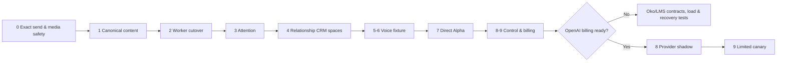

# Integrated delivery roadmap

Relationship CRM is the standalone owner of personal, commercial and program relationship data. See [its architecture](RELATIONSHIP_CRM_ARCHITECTURE.md).

## Sequencing rule

Every sprint must leave a product increment, an operational proof and a reversible cut. The first two sprints reduce the architectural risk that would otherwise multiply across voice, direct Alpha and Mayaki. From the third sprint onward, technical and product work are deliberately interleaved.

## Sprint map

| Sprint | Product outcome | Technical work | Release gate |
|---|---|---|---|
| 0. Exact and non-poisoning | Confirmed text stays literal; media cannot poison Alpha | Literal send adapter, terminal media classification, tests | CI green; no provider call/send |
| 1. Truthful canonical core | Retention no longer erases usable content | Normalized content/media, ownership registry, legacy/canonical map | Additive migration; retention/replay proof |
| 2. Authoritative worker | Business webhook has one processing authority | Process-scoped runtime, cutover slices, stale recovery, alerts | Parity fixtures; rollback flag; no Oko activation |
| 3. Real attention | Conversations no longer auto-become “answered” | Relationship CRM space boundary, explicit attention, compatibility projection | Backfill = `untriaged`; rollback/read compatibility |
| 4. Relationships MVP | Personal person card, note/thought and follow-up; commercial pipeline fixtures | Space-scoped identity/relationship repositories, deal contracts, export/import v1 | Workspace isolation + round-trip export |
| 5. Voice foundation | Voice is safely accepted and visible as processing/unsupported | Attachment metadata, worker, limits, fixture transcription | No provider call; duplicate/retry/media security tests |
| 6. Voice Alpha fixture | “Я понял так” + structured fixture answer | Transcription port, response contract, eval bundle, cost reservation interface | Synthetic end-to-end; Telegram sends blocked |
| 7. Alpha direct control | Private user appears pending and can be approved/paused | Separate public Alpha profile, private binding/consent/read projections | Default deny; private context isolated from Mark |
| 8. Product control surface | Owner sees people/attention/Alpha usage separately from ops | New read-only MCP tools and permission split; deprecate binary wording | Schema publication + OAuth scope tests |
| 9. Billing foundation | Costs/limits/entitlements visible per product | Immutable ledger, outbox, concurrent cap tests | $50 cap remains hard; synthetic reconciliation |
| 10. Provider shadow | Real text/voice proposals visible but never sent | Billing preflight, OpenAI adapters, shadow worker, privacy/quality evals | Billing confirmed; preflight green; delivery blocked |
| 11. Alpha limited canary | Approved installs receive controlled answers | Admission thresholds, auto-pause, grant reconciliation | Reviewed sample, zero isolation/critical defects |
| 12. Relationship CRM assist | Suggested summaries/status/follow-ups/deal stages | Provenance/confidence and owner confirmation workflow | No silent state mutation, no auto-send |
| 13. Oko dry runtime | One scripted route works on fixtures | Mayaki LMS skeleton, Relationship CRM program-space contracts, versioned program state machine | Fake data/evals only; no Oko Telegram activation |
| 14. Oko controlled pilot | One expert/person/practice reaches a result | Consent, handoff, notifications boundary, progress projection | Separate Oko authorization + canary gates |
| 15. Mayaki reuse | Proven Oko mechanics become reusable | Stable LMS/CRM events, template/migration contracts | Import/replay and isolation tests |
| 16. Commercial readiness | Alpha/CRM/Mayaki plans and margin view | Entitlements, revenue ledger, usage reconciliation | Hard caps + billing incident drills |

## First execution train

## Release policy

Each sprint is split into small deployable PRs when it includes a migration or an external-effect cutover:

1. schema/contracts/additive writes;
2. backfill and dual-read/compatibility;
3. product read path;
4. external behavior behind a default-off flag;
5. evidence, admission and cleanup in a later release.

Normal green PRs may auto-merge and Railway may auto-deploy under the standing Gate authorization. The following still stop the train:

- OpenAI provider use before billing confirmation;
- any Telegram delivery from tests/smoke;
- Oko or personal Telegram Business activation;
- spend above the $50 monthly cap;
- cross-group/private context or proactive messaging;
- manual production rollback/redeploy or destructive data operation;
- new external AI provider.

## Definition of done for every sprint

- Human product behavior and non-goals documented.
- Architecture owner and retention class assigned to every new datum.
- Workspace/identity isolation and idempotency tests.
- Metrics and privacy-safe operator visibility.
- Additive migration and rollback/compatibility evidence.
- No network call inside a database lock.
- CI, release evidence and deployed commit agree.
- Next sprint can start without a manual mini-test unless a previously declared critical gate is reached.
