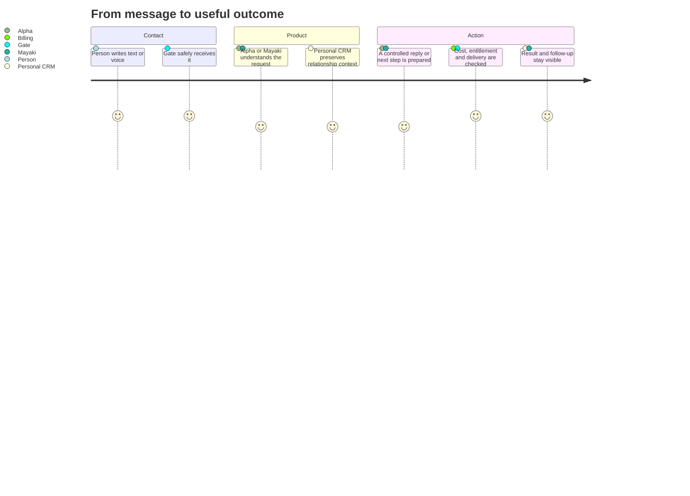

# Product roadmap: Gate, Alpha, Personal CRM and Mayaki

## Product thesis

Gate is the trusted passage for conversations. It should make delivery safe and observable, but it should not decide the meaning of a relationship, learning program or customer stage.

Four products build on it:

1. **Alpha access** — people can work with Alpha in an approved group or approved private chat.
2. **Personal CRM** — Mark sees people, interaction history, his own notes, real attention state and follow-ups.
3. **Mayaki application** — Oko and later other practices guide a person through a versioned program and record progress.
4. **Billing and entitlements** — usage, costs, limits, tariffs, revenue and access rights for each product.

## Human product map

## Product principles

- No proactive Alpha messages until a separately approved product feature defines purpose, audience and limits.
- A group/private dialog must be owner-approved before Alpha can use a model or deliver.
- Direction is not status. The owner controls who is waiting for whom.
- AI classifications are proposals with provenance, not silent truth.
- Every program/script is versioned and evaluated like software.
- Gate never becomes the customer database, LMS or personal memory.
- Every product can export its data in a documented, stable format.

## Product releases

### P0 — Foundation visible to the owner

**Outcome:** the system speaks one product language and no longer calls a conversation complete merely because Mark sent the latest message.

- Explicit attention states: untriaged, action on me, waiting on them, scheduled, no action, archived.
- Backward-compatible read model for existing drafts/reply tasks.
- Product dashboard separates operational health from people/work.
- Audit and current release map are visible in the repository.

### P1 — Personal CRM minimum useful product

**Outcome:** Mark can open a person and record what matters even when no reply is being written.

- Person card with linked Telegram identities.
- Chronological interaction timeline.
- Free-form private note/thought.
- Follow-up with state and optional due time.
- Explicit conversation attention state.
- Search/filter by person, state and recent activity.
- JSON/CSV export and idempotent import contract.

### P2 — Voice Alpha

**Outcome:** an approved user can address Alpha by Telegram voice message and receive a transparent response.

Standard response contract:

1. speech is transcribed;
2. Alpha starts with a concise “Я понял так: …” summary;
3. Alpha separates uncertainties or missing facts;
4. Alpha answers the understood request;
5. transcript/source metadata stays scoped to the same approved dialog and retention policy.

For the first release, a group voice message is eligible only when it is a verified reply to Alpha’s message; this prevents downloading and transcribing unrelated group speech. In an approved private Alpha dialog, any human voice message is an explicit invocation. Before the first provider upload, the user sees a versioned privacy notice and records consent.

Before billing this release operates on fixtures and synthetic audio only. Live transcription requires provider preflight and budget admission.

### P3 — Alpha direct access

**Outcome:** another person can write to Alpha privately, while Mark sees and controls access.

- Private dialog discovered as `pending_approval`.
- Owner sees a safe label and opaque installation reference.
- Approve/pause/resume lifecycle.
- User accepts a versioned privacy/data-use notice before any provider-backed text or voice turn.
- Per-install rate/token/cost limits.
- Owner panel shows user label, access state, recent usage, failures and spend; content visibility follows declared privacy policy.
- No response before approval; no proactive messages.

### P4 — Provider-backed Alpha launch

**Outcome:** Alpha produces useful real answers without opening uncontrolled delivery.

- Billing enabled and synthetic provider preflight green.
- Delivery-disabled shadow on approved dialogs.
- Human review of at least ten representative proposals, including voice and private fixtures.
- Isolation, prompt-injection, cost, retry and one-send-attempt evals green.
- Limited canary with immediate automatic pause conditions.
- Gradual installation-by-installation live admission.

### P5 — Personal CRM assisted workflow

**Outcome:** intelligence reduces work without rewriting Mark’s decisions.

- Suggested person matching; owner confirms ambiguous links.
- Suggested attention/follow-up with explanation and confidence.
- Draft notes and relationship summaries.
- Daily/weekly review projection.
- Never auto-send and never auto-close attention.

### P6 — Oko MVP on Gate

**Outcome:** one expert can guide one person through one practice from intake to result.

- Consent and intake.
- One versioned route/state machine.
- Scripted prompts and response evaluation.
- Minimal customer card and program enrollment.
- Progress/evidence timeline.
- Human handoff and pause.
- One notification purpose with explicit consent and limits.
- Billing boundary; payment provider can remain manual initially.

Oko activation requires separate authorization because the standing Gate Alpha permission excludes autonomous Oko and personal Telegram Business behavior.

### P7 — Mayaki reusable LMS and customer CRM

**Outcome:** Oko’s proven mechanics become reusable modules rather than copied product code.

- Program/version, competency, activity, evidence and progress read models.
- Lead/contact/member, enrollment, route, cohort and lifecycle read models.
- Versioned communication purposes and notification consent.
- Practice templates and migration tooling.
- Import Oko data without changing Gate transport identifiers.

### P8 — Commercial access and portfolio billing

**Outcome:** each product can be offered sustainably.

- Plans/entitlements for Alpha direct, Personal CRM and Mayaki.
- Immutable cost and revenue ledgers.
- Workspace/product/install usage attribution.
- Hard caps, soft alerts, grace behavior and owner overrides.
- Margin and unit-economics dashboard.

## What ships before OpenAI payment

- Architecture and data ownership cleanup.
- Explicit attention and Personal CRM primitives.
- Fixture-based voice extraction/transcript pipeline and policy/evals.
- Direct Alpha installation lifecycle, owner controls and fixture responses, default-disabled for live use.
- Attachment limits, retention, security and retry tests.
- Billing/entitlement schema and synthetic usage ledger.
- Load, isolation, migration, export/import and incident tests.
- Oko/Mayaki contracts, fake-data validation and scripted evals, without production activation.

## Success measures

| Product | Primary success measure | Safety counter-metric |
|---|---|---|
| Gate | accepted-to-ready latency and delivery success | duplicate/wrong-target sends |
| Alpha | useful resolved turns per approved install | unapproved turns, cost overruns, unsafe sends |
| Personal CRM | follow-ups and notes reviewed/acted on | auto-closed or mislinked relationships |
| Mayaki | program completion and evidence quality | unsolicited contact, stuck routes, forced automation |
| Billing | attributed usage and sustainable margin | spend beyond hard cap or access without entitlement |
