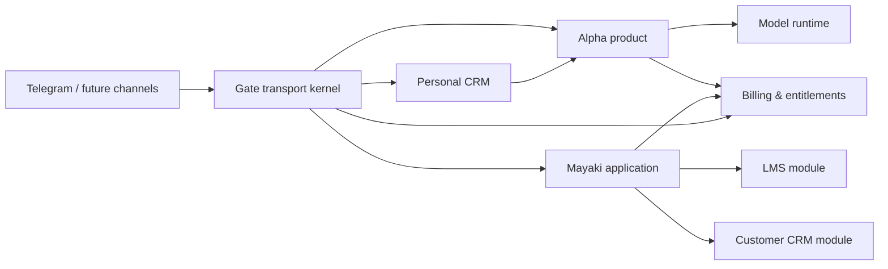

# Gate ecosystem audit — 2026-07-16

## Executive conclusion

Gate is no longer a webhook prototype. It already has the beginnings of a safe messaging platform: dedicated Telegram connectors, canonical messages, durable installation state, explicit delivery grants, idempotency, owner-visible opaque references, a model budget guard, shadow/canary admission, release evidence, rollback drills and a delivery-disabled model path.

The main risk is now architectural, not immediate operational fragility: transport, personal correspondence workflow, Alpha product behavior and future Mayaki learning/customer semantics are starting to converge inside one application vocabulary. If that continues, every new feature will make Gate harder to reason about and harder to extract. The correction is not microservices. The correction is a modular monolith with explicit owners for data and behavior.

No production model call, Telegram send, installation mutation or provider preflight was performed for this audit. This is a static architecture/code/documentation audit plus the existing read-only production evidence. It is not a penetration test or a load test.

## Evidence reviewed

- `README.md`, `docs/PROJECT_HANDOFF.md`, current architecture and operator documents.
- Telegram ingress, canonical projection, worker, delivery, Alpha installation/lifecycle, shadow worker, MCP and model-runtime code.
- Database models and migrations for canonical messaging, Alpha lifecycle, delivery grants, usage and release admission.
- Test and CI/release tooling added through the latest production releases.
- Product source documents in `markmalina/alfa`, `markmalina/mayaki`, `markmalina/oko`, `markmalina/mcore` and `markmalina/systemm`.
- Read-only production snapshot: RU/BY connectors ready; Alpha Group active on fixture; provider preflight not verified; model Telegram delivery blocked; no model turns, failures, stuck grants or model sends.

Architecture amendment: the earlier Personal CRM boundary is generalized by [Relationship CRM architecture](RELATIONSHIP_CRM_ARCHITECTURE.md) into one standalone product with isolated personal, commercial and program spaces.

## Target responsibility map

Gate owns receipt, connector identity, routing, idempotency, delivery attempts and transport audit. Relationship CRM owns people, space-scoped relationships, semantic interaction history, notes, follow-ups, pipelines, deals and attention state. Alpha owns installation/access policy, invocation, instruction bundles, scoped context, proposals and controlled replies. Mayaki owns practices, programs, enrollments, routes, competencies and customer lifecycle. Billing owns usage, cost, entitlement, plan and revenue ledgers.

They should initially run in one process and one PostgreSQL cluster, with separate Python packages and table namespaces. They communicate through typed in-process ports and durable domain events. A network API between them is deliberately postponed.

## What is already strong

1. **Safe delivery authority.** The model does not choose a Telegram destination. A prepared result must pass a durable grant and delivery contract. One inbound turn is bounded to one send attempt. The literal-payload defect below must be corrected before calling human delivery “exact text.”
2. **Fixture → shadow → canary path.** Provider readiness, delivery blocking and release admission are represented explicitly rather than by an informal operator convention.
3. **Durability and idempotency.** Telegram acceptance, work ownership, model turn reservations and delivery records are database-backed and tested for retries.
4. **Connector isolation.** Alpha credentials are separated from Telegram Business connectors; RU/BY and Alpha do not share an implicit send path.
5. **Privacy-aware control surface.** Group identifiers are not exposed through the owner MCP; installations use labels and opaque references.
6. **Operational discipline.** CI, supply-chain checks, non-root container work, retention dry-runs, restore rehearsal, incident drills and fail-closed admission are unusually mature for this product stage.
7. **Instruction versioning.** Alpha behavior is packaged and revisioned, which is the right base for both Alpha and future scripted Mayaki/Oko programs.

## Findings and priorities

### P0 — immediate reliability correction

#### 0. Human-confirmed Telegram text is not always transported literally

The human reply path delegates to a generic Telegram method that may infer HTML parse mode from `<code>/<pre>` and may attach an internal keyboard for text resembling `Draft created:` or `Edit draft:`. The target and stored draft remain protected, but the actual Telegram presentation can differ from the exact text the owner confirmed.

**Action:** human-approved delivery must use an explicitly literal adapter: only the intended account/recipient/text fields, no parse mode and no reply markup. Internal service cards use a separate named method and separate tests.

#### 1. Unsupported Alpha media can poison the worker queue

The webhook correctly accepts Telegram `message` updates, including media. Canonical projection can represent a non-text message, but the active Alpha canary currently forwards every active-group message to shadow preparation. Shadow preparation requires non-empty `message.text`. A voice/photo/sticker can therefore become `alpha_trigger_text_invalid`, be wrapped as a processing failure and consume the generic five-attempt retry/dead-letter path. This is especially important now because voice is the next product feature.

**Action:** before any usage/model reservation, classify Alpha content into supported text, supported voice pipeline, or terminal ignored media. Unsupported/unaddressed media is a successful terminal processing outcome, not a retryable failure. Add explicit retryability to worker errors so invalid product input never shares the infrastructure retry policy.

Provider-backed delivery must still remain blocked until billing, synthetic preflight, shadow evaluation, isolation checks and limited canary admission are all green.

### P1 — correct before broad product expansion

#### 2. Domain boundaries are implicit

Gate currently contains transport facts, reply workflow, Alpha product lifecycle and product-oriented status projections in one application structure. This makes the database and service vocabulary the de facto coupling mechanism.

**Action:** establish module ownership now. Gate transport keeps only the minimum durable payload needed for safe acceptance/retry/audit; long-lived semantic interaction history belongs to Personal CRM or the consuming product. Add architecture dependency tests so product modules may depend on transport contracts, while transport cannot import product behavior.

#### 3. “Answered/unanswered” is not a valid product state

Direction is a fact; attention is a decision. An outbound “Хорошо, жду” does not mean the conversation is complete. A binary projection silently loses the real next action.

**Action:** introduce explicit, user-controlled attention states: `untriaged`, `action_on_me`, `waiting_on_them`, `scheduled`, `no_action`, `archived`. Never derive them from the latest message. Preserve the existing MCP method temporarily as a compatibility projection and mark it deprecated.

#### 4. Alpha is hard-coded as a group agent

The canonical dialog model already supports private chats, but Alpha policy and ingress reject them and installation validation requires group/supergroup. Extending that code ad hoc would create two policy paths.

**Action:** generalize to an Alpha installation on a dialog with an explicit access mode. Group policy remains command/mention/reply only. Private policy accepts a human message only after owner approval of that private installation. Both use the same budgets, revision, isolation and delivery grant.

#### 5. Canonical messages are text-only and depend on raw receipts

Telegram voice arrives as a normal `message`, but the canonical model has no first-class media/attachment lifecycle. `CanonicalMessage.text_content` exists but current persistence leaves it empty; Alpha reconstructs text from raw Telegram receipts. Deleting raw receipts under the declared retention policy would therefore remove usable context while leaving an incomplete canonical fact. Downloading and transcribing directly inside ingress would also add network work to the webhook transaction and make retries expensive or unsafe.

**Action:** store immutable attachment metadata, acknowledge quickly, then download and transcribe in an idempotent worker outside database locks. Never persist the token-bearing Telegram download URL. Enforce size/type/duration limits before provider use.

#### 6. Delivered Alpha replies are not a complete context source

Inbound context is reconstructed from canonical messages joined to Telegram receipts. Alpha sends are recorded as proposals, grants and send attempts rather than inbound webhook receipts. A later turn can therefore omit a prior assistant reply that was actually delivered, while a raw proposal must not be treated as delivered.

**Action:** project only `sent` attempts into an immutable outbound conversation fact, or load them through a dedicated delivered-turn projection. Shadow-only proposals, failed and unknown attempts must never appear as assistant history.

#### 7. Telegram Business has not completed the durable-ingress cutover

The Business webhook can record the durable shadow receipt and still proceed through the legacy chain of sprint handlers. A disabled durable-acceptance mode and a global “ignored” response path leave two processing authorities.

**Action:** migrate update classes with parity fixtures until the webhook has one job—authenticate, durably accept, acknowledge—and all processing is worker-owned. Do not activate Oko autonomous behavior on the legacy chain.

#### 8. External-owner tenancy is not ready

New canonical/agent tables use strong workspace-scoped composite keys, while legacy `Account`, `Person`, project relationships and several OAuth claims retain single-owner/global assumptions. This is acceptable for Mark’s present workspace and approved Alpha participants; it is not a safe SaaS ownership model.

**Action:** distinguish “participant using Mark’s approved Alpha installation” from “external workspace owner.” Before selling independent workspaces, make identities, people, accounts, grants, projects and OAuth resource claims workspace-authoritative in the database.

#### 9. Documentation does not describe the latest production releases

The README/handoff evidence lags the incident, retention, restore, supply-chain and release-admission releases. This weakens incident response and makes a new developer reconstruct the real state from PR history.

**Action:** make release evidence generated or checked by CI and update the handoff in every production release.

#### 10. Cost control is model-specific, not a complete business ledger

The current $50 OpenAI guard is valuable, but future product decisions require costs per workspace/product/install, entitlements, tariff periods, revenue and margin. Telegram/infrastructure and future provider costs also need representation.

**Action:** create a separate billing/entitlements bounded context. Keep hard provider guards in the execution path, and asynchronously project immutable usage events into the business ledger.

### P2 — address during the next product increments

#### 11. Retention must follow data ownership

“Messages should not live in Gate” cannot mean zero durable acceptance: Gate needs enough data for deduplication, retry and audit. It should mean that Gate is not the source of truth for long-lived semantic history.

**Action:** define two retention classes: short-lived encrypted transport payload and long-lived product interaction projection. Record deletion tombstones and projection checkpoints so cleanup cannot create replays or orphaned CRM history.

#### 12. Identity needs a channel-neutral model

Direct Alpha and Personal CRM require distinguishing a Telegram account, a human person and a product customer. They are not the same entity and must not be merged solely by username/display name.

**Action:** use `ChannelIdentity` → explicitly linked `Person` → optional `Customer/Member`. Links are workspace-scoped, auditable and reversible.

#### 13. Event handoff needs a durable contract

In-process calls are enough for MVP, but future extraction requires stable event semantics. No complete, documented transactional-outbox boundary was found in the reviewed product flow.

**Action:** use an outbox written in the same transaction as the owner aggregate. Consumers keep idempotent checkpoints. Do not deploy a broker yet.

#### 14. Control-panel projections need product vocabulary

The current operational MCP is excellent for readiness, but Personal CRM needs people, attention, notes and follow-up projections; Alpha access needs installs/users/usage; Mayaki needs route/progress/cohort projections.

**Action:** keep operator status separate from product read models and permissions. Read-only list actions should reveal labels and scoped product facts, never raw cross-workspace transport identifiers.

### P3 — deliberate later investments

- Extract modules into independent services only after ownership, event contracts, scaling or team boundaries make the split useful.
- Add a provider abstraction only when a second provider is actually approved; do not build a speculative universal AI layer.
- Add automated semantic classification as a suggestion with provenance/confidence, never as a hidden overwrite of user-controlled attention.
- Add multichannel support only through the canonical envelope and connector adapter contract.

## Additional engineering debt observed

- Legacy and canonical stacks currently duplicate receipt, message, conversation/ownership and connector concepts. New product work must target the canonical stack; migration adapters must be explicit.
- The worker creates/disposes its database engine and HTTP client per processed item and claims one item per iteration. Compose a process-scoped runtime, bounded batch/parallelism and provider semaphores before meaningful volume.
- Queue recovery, incident and notifier components exist but are not all composed into the main loop. Crash-stuck `processing` work needs automatic bounded reclaim and observable alerts.
- Connector metadata says Alpha has no send authorization while the grant path can send. Either enforce an `AGENT_DELIVERY_GRANT` capability in the adapter or remove the misleading declaration.
- Legacy draft edit links use long-lived deterministic query tokens and a shared-purpose secret. Replace with a purpose-bound secret, TTL and one-time nonce, or retire that UI during cutover.
- Agent keys are constrained to `alpha_group` and `oko`; adding every future program through enums/check migrations will not scale. Keep stable agent profiles/data scopes in tables and reserve code enums for capabilities.
- Several operational “drills” are valuable policy/unit evidence, but they are not a production observation. Status and handoff must label synthetic, disposable-restore and live evidence separately.

## Consistency assessment

| Area | Current assessment | Required direction |
|---|---|---|
| Transport safety | Strong | Preserve exact connector/target/grant invariants |
| Human literal send | Defect found | Dedicated no-markup/no-parse adapter |
| Alpha release safety | Strong, provider not verified | Complete preflight/shadow/canary only after billing |
| Product semantics | Inconsistent around reply state | Explicit attention + Personal CRM ownership |
| Module ownership | Emerging, not enforced | Modular monolith + dependency tests |
| Voice/media | Missing first-class contract | Attachment lifecycle + async transcription |
| Private Alpha | Canonical support exists; policy rejects | One channel-neutral installation lifecycle |
| Identity/privacy | Good opaque group controls | Add channel identity/person linking model |
| Billing | Strong hard OpenAI cap; incomplete ledger | Separate cost/revenue/entitlement module |
| Documentation | Good depth, stale release snapshot | CI-checked current handoff |
| Business ingress | Dual legacy/canonical authority | Authoritative durable worker cutover |
| External tenancy | Mixed new workspace scope + legacy single owner | DB-authoritative resource grants before SaaS |
| Extraction readiness | Conceptual | Outbox, module-owned tables, import/export contracts |

## Scale model

The next scale target is not “millions of messages.” It is predictable isolation across several products and workspaces. Before adding infrastructure, measure:

- ingress acceptance latency and duplicate rate;
- worker queue age by connector and product;
- transcription size/duration, latency, failure and cost;
- model turn reservation/failure/cost by installation;
- delivery grant age and one-attempt invariant;
- product projection lag;
- per-workspace rate-limit and budget denials;
- deletion/retention backlog.

PostgreSQL plus bounded workers is sufficient for the near-term MVP. Scale with indexed claim queues, `SKIP LOCKED`, short transactions, per-workspace fairness and horizontal workers before introducing a message broker.

## Architecture decisions

1. Relationship CRM is a separate product and bounded context, not part of Gate transport, Alpha memory or Mayaki learning logic. Personal, commercial and program use are isolated spaces of that product.
2. For MVP it lives in the same repository/deployment as a module, with module-owned tables and public contracts. A separate repository now would slow coordinated schema/product work without creating real isolation.
3. Alpha for groups and Alpha direct are one product with two invocation policies.
4. LMS and customer CRM are Mayaki modules; Gate only transports their messages/events.
5. Billing/entitlements is independent of all four product modules.
6. `alfa` remains Mark’s personal human-readable system/interface; it may consume/export Relationship CRM personal-space data, but it is not the runtime transport or CRM database.
7. “Mark-private Alpha Intelligence” and “Alpha offered to other people” are separate agent profiles and data scopes. External installations must never inherit Mark’s private Alfa repository, Personal CRM or another installation’s context.

## Exit criteria for the cleanup phase

- Dependency tests enforce module direction.
- Attention state is explicit and no longer derived from message direction.
- Personal CRM owns its tables and has portable export/import contracts.
- Attachments and transcripts have an idempotent, retention-aware lifecycle.
- Alpha installation policy is channel-neutral and private access is owner-approved/default-deny.
- Billing emits a unified usage ledger while retaining the hard $50 OpenAI blocker.
- Runbooks and current release evidence match production.
