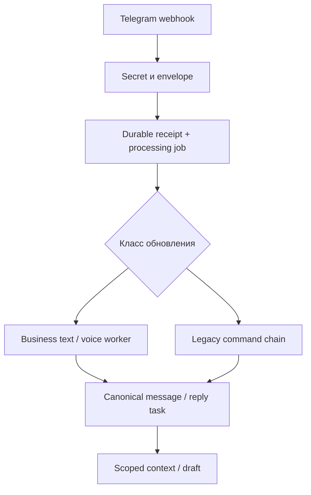
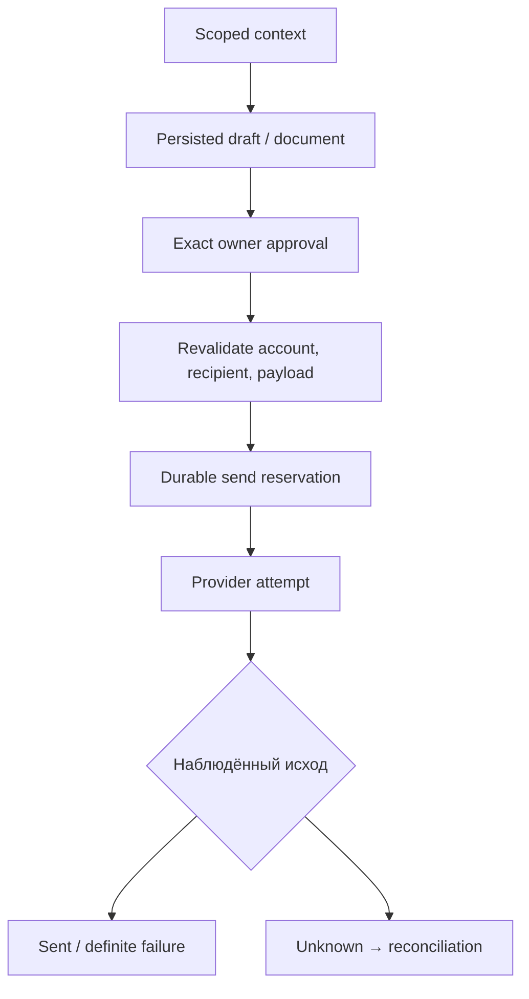

# Назначение и фактическая архитектура Gate

Основа: `86dbc0f429dce089bf733fc422f20f556535895b`. [Ограничения аудита](EVIDENCE-AND-COVERAGE.md).

## 1. Задача системы

Gate связывает внешний канал с внутренним приложением и управляющим Work. Он должен ответить на пять отдельных вопросов:

1. Что было получено и сохранено?
2. Какому аккаунту, workspace, проекту и установке принадлежит событие?
3. Кто имеет право его читать или выполнить действие?
4. Какой точный текст/файл/адресат разрешён?
5. Каков подтверждённый или неизвестный результат внешней попытки?

Gate не должен выводить разрешение из текста модели, менять адресата по её усмотрению или повторять неизвестный внешний исход как новую отправку. Доставка, интерпретация сообщения и принятие результата — разные события.

## 2. Границы владения

| Область | Назначенный владелец смысла | Что реально есть в Gate |
| --- | --- | --- |
| Webhook, connector identity, ingress, delivery ledger | Gate | Основной backend, SQL stores, transport clients и workers |
| Workspace/account/project/installation scope | Gate для transport grants | Canonical models, OAuth claims, DB scope resolution |
| Частная память и интерпретация жизни | Alfa / владелец | Транспорт к приватным артефактам; также исторические Alpha runtime modules |
| Person, consent, отношения | Relations после принятого cutover | 12 CRM tables и compatibility/application logic остались внутри Gate |
| Программы, задания, прогресс | MAYAKI / Oko / BECOME | В Gate остались program/quest/invitation/review/pilot реализации |
| Media editing/render/approval | TAKE | Synthetic contracts/shadow intake; не полноценный live TAKE connector |
| Портфель, Work, execution, приёмка | Center / проектный Work | Local bootstrap/receipts/pointers; Gate не второй Center |
| Модельный расход | Конкретный принятый product policy | Общий billing domain и несколько различающихся provider paths |
| AQUB | Frozen historical source | Код/контракты/миграции сохранены; main не монтирует AQUB ingress и не запускает его worker |
| Meta/Instagram и другие будущие каналы | Их принятые продуктовые контуры | Rehearsal/contract/plans; live connector этим аудитом не установлен |

Это карта ответственности. Она не является поручением переносить или удалять модули.

## 3. Стек и процессы

- Python >=3.12, FastAPI, Pydantic Settings.
- SQLAlchemy async + asyncpg, PostgreSQL, Alembic.
- HTTPX для внешних API, PyJWT/JWKS для OAuth/OIDC.
- FFmpeg/ffprobe для декодирования и частей аудио.
- Telethon 1.44.0 в optional personal/contact CLI и offline/default-off границах.
- Pytest, Ruff, mypy; CI использует PostgreSQL 17.
- Основной ASGI entrypoint: `app.main:app`.
- Отдельный provider-disabled I4 service: `app.become_i4_service`, отдельные Dockerfile.i4 и railway.i4.toml.
- UI-приложения в этом репозитории нет; основные пользовательские поверхности — Telegram и MCP/Gate M.

Основной web lifespan владеет engine/session factory и shared HTTP client. Он также запускает включённые фоновые задачи. Это не означает, что все фоновые задачи имеют единый supervisor или leader election.

## 4. Карта каталогов

| Путь | Что искать | Риск при изменении |
| --- | --- | --- |
| app/api | HTTP, MCP dispatch, schemas, webhook seams | Порядок include_router, auth, serialization и external effect boundaries |
| app/application | Commands, services, protocols, pure validation | Не терять invariants, scopes и exact approval |
| app/infrastructure | SQL repositories, provider clients, retention/diagnostics | Транзакции, locks, replay, секреты, uncertain outcome |
| app/models | ORM и DB constraints | Согласованность с Alembic и существующими данными |
| app/worker | Durable polling/dispatch/recovery | Claims, leases, cancellation, запуск нескольких процессов |
| app/services | Telegram HTTP boundary и webhook reconciliation | Последняя проверка credentials/target/send grant |
| app/personal_telegram | Enrollment/session, local/cloud foundation, durable sends | RU-only scope для #696, encrypted custody, один session owner |
| app/contact_sync | Отдельный bounded contact snapshot CLI | Это чтение персональных данных, а не свободный smoke |
| src/become_w1…w9 | Изолированные proof-loop adapters | Docker добавляет /app/src в PYTHONPATH; wheel сам включает app*, не src |
| alembic | 119 revisions и schema evolution | Не менять применённую history; проверять объединённые heads |
| contracts | 45 schemas/fixtures/provenance files | Neutral contracts, closed shape, byte/value parity |
| registry | Capability/installation metadata | Датированные registry claims не равны runtime |
| agent_bundles | Исторические model instruction bundles | Продуктовые инструкции, не право на активацию |
| scripts | Evidence, security guard, restore/resume helpers | Некоторые CLI делают effects и не подходят для аудита |
| tests | 325 файлов | Pure, HTTP, PostgreSQL, media, concurrency и policy tests |
| .github/workflows | CI, exact-head, Atlas, Ops requester | Изменение workflow может менять authority и расходы |

Полный список файлов с Git SHA, imports и exported symbols: [source-inventory.json](source-inventory.json).

## 5. Приём Telegram

Публичный Business ingress — `app/api/telegram_ingress.py`. Receipt сохраняется раньше legacy processing. Ошибка durable acceptance превращается в HTTP503; webhook secret проверяется до сохранения. Voice и canonical Business text направляются в durable worker.

Для остальных классов сохраняется цепочка 11 legacy handlers от sprint18b до базового routes.py. Повторные route declarations здесь намеренные: первый durable route вызывает legacy chain явно. Не следует удалять их как «просто дубли» без characterization.

У Alpha, Beta и BECOME отдельные webhook paths и connector boundaries. AQUB webhook module существует как source, но не входит в текущий include_telegram_ingress.

## 6. Подготовка и отправка ответа

Важнейшие модули: application/reply_sends.py, infrastructure/reply_sends.py и services/telegram.py. Проверки включают scope, task/draft state, account/recipient, Business connection rights, payload digest, idempotent attempt. Отправка отделена от транзакционной reservation и terminal recording.

Серия — 2–50 сохранённых drafts, тот же task/recipient/account, интервал 60 секунд. В main metadata серии лежит в ReplyDraft.prompt_context.reply_sequence; due items разных серий обрабатываются последовательным await. Полный parallel dispatch и атомарный inbound stop — ещё PR720.

Snapshot guard любого изменения диалога — PR747, не текущий main. Предварительная проверка newer task не эквивалентна snapshot CAS.

## 7. MCP: фактическая сборка

main сначала включает mcp_metadata_router. Этот router включает communication_feed_mcp с POST /mcp. Его non-feed delegate вызывает основной mcp_routes.mcp_endpoint. Позже main включает mcp_transcription_routes с тем же POST /mcp.

Поэтому публичная цепочка исходной ревизии: **feed wrapper → core19**, а не предполагаемая feed → transcription5 → core19. Пять transcription actions определены, но не достижимы через первый route. Это [GATE-A01](04-FINDINGS.md#gate-a01), а не ещё один режим продукта.

Discovery разрешён без token только в предусмотренном OAuth discovery flow; tools/call требует нужный scope и explicit workspace/account/project containment. Прямое обращение к helper-функции не проверяет настоящую HTTP композицию.

## 8. Голос: три разных пути

| Контур | Вход / хранение / выход | Admission и состояние |
| --- | --- | --- |
| Telegram Business / Dropbox Calls | Durable voice/call source → normalized parts → transcript/archive | Современный bounded STT service и общий budget reservation; свои flags/data scopes |
| Watch → private Mark | /Alpha/Voice → Watch note/cursor/journals → transcript → verified private Mark issue/comments | Persistent-token worker либо pinned private Actions OIDC; в main persistent driver принудительно off; #736 не завершён |
| Alfa transcription jobs | Upload/Dropbox source → jobs/parts → private Dropbox verbatim/clean/analysis/manifest | Отдельный worker с credential-presence startup; budget/policy/lifecycle gaps A02–A04; пять MCP tools перекрыты |

Не переносить успешность одного пути на другой. В частности, единичная ранее доставленная запись не доказывает постоянную автономную очередь.

## 9. Данные и безопасность

Есть несколько одновременно существующих моделей идентичности:

- legacy Bot/Account/Project/Conversation/Message/ReplyTask;
- canonical Workspace/Connector/ChannelAccount/Dialog/CanonicalMessage;
- installation/agent identity и grants;
- CRM и продуктовые projections;
- opaque downstream refs.

Они связаны адаптерами. Нельзя предполагать, что workspace key, UUID, raw Telegram chat ID и opaque installation ref взаимозаменяемы. Перед новым route нужен явный resolver и негативные cross-scope тесты.

Raw payload/аудио/текст могут существовать в разрешённых private data stores, но не в shared documentation, logs или CI evidence. Private Mark — отдельное явно описанное исключение для текстового destination, не разрешение копировать оригиналы в GitHub.

## 10. Направление развития

Сначала устранить assembly/admission/lifecycle разрывы, затем выпустить существующие bounded outcomes. Лишь после этого упрощать legacy и добавлять каналы. Из аудита не следует необходимость нового broker, LLM framework, базы, frontend или переписывания Gate целиком.
