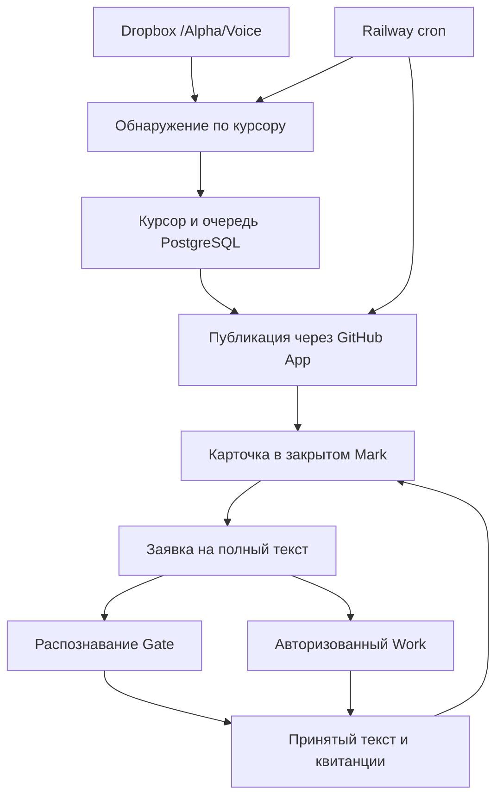

# Galaxy Watch → Gate → закрытый Mark

Техническое задание к [Gate #770](https://github.com/markmalina/gate/issues/770). Координация в [#787](https://github.com/markmalina/gate/issues/787). Версия 1 от 20 ноября 2026. Владелец результата — Марк Малиновский. Статус — проектирование завершено. Параметры с пометкой «предлагается» фиксируются при приёмке первого спринта. Реализация и включение по этому ТЗ ещё впереди.

## 1. Результат для Марка

1. Марк записывает голосовую заметку на Galaxy Watch. Samsung Recorder и Dropsync доставляют завершённый аудиофайл в `/Alpha/Voice`.
2. После загрузки Gate автоматически создаёт одну карточку в закрытом `markmalina/mark`. По карточке сразу понятно, что запись получена и текст ожидается. Цель — 15–30 минут от появления файла в Dropbox, включая пачку записей.
3. Оригинал доступен Марку и авторизованному Work по защищённому маршруту. Gate или Work добавляет **полный текст в ту же карточку**. В карточке видны источник результата, время, полнота и состояние обработки.
4. Одна версия записи имеет один принятый текст. Результат Work, принятый Gate до первого запроса на распознавание, предотвращает запуск платной обработки этой версии. Уже начатая обработка учитывается по факту.
5. При сбое Марк видит, на каком этапе находится запись, а сохранённый оригинал остаётся доступен. Повторное событие, рестарт и потерянная квитанция сохраняют связь с исходной карточкой. Исполнение поручений из текста остаётся отдельным действием Марка или Work.

Границы первой поставки — один владелец, один связанный Dropbox-аккаунт, одна заданная папка, один закрытый репозиторий Mark. Продуктовый маршрут работает независимо от Telegram-ответов, Calls и AQUB.

## 2. Фактическое состояние на 20 ноября

| Участок | Проверенный факт | Значение для проекта |
| --- | --- | --- |
| Gate и PostgreSQL | Gate в Railway онлайн. Production и `main` совпадают на [26264474018b](https://github.com/markmalina/gate/commit/26264474018b1f0bd3351efc3696649bccbe8bf8). Последний выпуск — пул PostgreSQL для Telegram worker. Telegram text parity — 7 379 совпадений, 0 расхождений, 2/2 аккаунта. [Квитанция #847](https://github.com/markmalina/gate/issues/847#issuecomment-6976187699) | Новый Watch-контур должен сохранить работоспособность существующего Gate и использовать отдельную роль и ограниченный пул. |
| Завершённые загрузки | В выборке `/Alpha/Voice` за 20.11 по МСК — 10 M4A. С пятью карточками Gate сопоставлены Dropbox file ID и время изменения. У пяти карточек на момент сверки статус ожидания текста, комментариев 0. Для пяти более поздних аудио карточек в доступном срезе Mark не обнаружено. У 10/10 аудио есть одноимённый TXT в Dropbox. [Предыдущий срез #787](https://github.com/markmalina/gate/issues/787) | Одноимённый TXT — кандидат на импорт после проверки исходника и происхождения текста. |
| Задержка входа | Для пяти сопоставленных карточек — 20 981–26 356 секунд от Dropbox server_modified до GitHub created_at. Все пять появились в 16:25 МСК, примерно в пределах двух секунд после обнаружения Gate с учётом точности часов источников. В 36-часовом срезе Railway пять HTTP 200 для `/internal/watch-voice/drain`, интервалы между запросами **4 ч 42 мин — 9 ч 19 мин**. В Mark настроен GitHub cron примерно каждые пять минут. [Автоматическая доставка 15.11](https://github.com/markmalina/gate/issues/770#issuecomment-6899584606) | В этой выборке время ушло на ожидание вызова обработчика. Параметр cron сам по себе не задаёт фактический интервал. |
| Текущий Watch-код | В production работает ранняя карточка из #845 поверх OFF-first #846. Обычный STT-воркер Watch выключен. Gate M показывает исторический журнал Actions: 67 доставленных, 3 pending, 67 транскрибированных, 1 unknown и 2 rejected в состоянии STT. Статус Actions строится по `WatchVoiceNote` и `WatchVoiceDrainRun`. [Установка #845](https://github.com/markmalina/gate/issues/770#issuecomment-6882221578) · [Код статуса](https://github.com/markmalina/gate/blob/26264474018b1f0bd3351efc3696649bccbe8bf8/app/infrastructure/watch_voice_actions.py) | Нужны отдельные агрегаты ранних карточек и фактической задержки. Исторические 67 не описывают сегодняшние карточки. |
| Подготовленный Railway cron | Пачка из 22 изменений остаётся STAGED. Scheduler и bootstrap для роли БД находятся в staged-create. Запланированы `*/15` и commit [b1db11f](https://github.com/markmalina/gate/commit/b1db11f5340b086f830e371faa6d9cbc56ce9674). Head ветки уже [12e761b](https://github.com/markmalina/gate/commit/12e761b96e421bb40db112482ae3c28193ffe27a). Между этим head и текущим main расхождение 10 коммитов вперёд и 8 назад. Живой scheduler, эффективная роль БД и доступ ключа App не подтверждены. [Подготовка](https://github.com/markmalina/gate/issues/770#issuecomment-6899402110) · [Результат согласования](https://github.com/markmalina/gate/issues/770#issuecomment-6899709526) | Сначала собрать и проверить актуальный исходник и точный состав установки. Предыдущая попытка применения вернула Cancelled/INVALID_ARGUMENT после сообщения Марка об одобрении. Состояние этого запуска требует сверки с обращением #19384733 и штатным маршрутом согласования. |
| Распознавание и соседние задачи | 21 голосовое Telegram в dead letter с `openai_transcription_quota_unavailable`. У последних 20 Calls в срезе #787 отсутствовали транскрипты. Последний read-only probe Calls также вернул ошибку квоты. PR #747 для актуальности ответа открыт, проверяется отдельно. [#787](https://github.com/markmalina/gate/issues/787) · [#788](https://github.com/markmalina/gate/issues/788) · [PR #747](https://github.com/markmalina/gate/pull/747) | Сначала обеспечить карточки независимо от STT. Затем закрыть получение полного текста. Проверить совместимость миграций при подготовке каждого выпуска. |

Время выборки по карточкам основано на метаданных Dropbox и чтении закрытых issues. Источник HTTP-интервалов — журнал Railway по фиксированному маршруту Gate. HTTP 200 означает успешный ответ endpoint. Для доказательства доставки используются номер и состояние карточки. Для будущего среза точное совпадение ревизии следует проверять по API Dropbox и сохранённому конверту записи.

### Что исправлять в исходниках

| Найденное в текущем коде | Проектное решение |
| --- | --- |
| `run_early_cards` сначала публикует сохранённую очередь и выходит из прохода после любой публикации или сверки. При большой сохранённой очереди может потребоваться несколько таких проходов, прежде чем будут найдены новые файлы. | На каждом тике отдельно выделить время на intake и на публикацию. Успех или отказ одной стадии не отменяет вторую. |
| Строка курсора запирается на время OAuth, проверки аккаунта и чтения до 100 страниц Dropbox. Ошибка в конце откатывает прогресс целой пачки. | Короткое владение потоком с версией курсора. Сеть вне транзакции. Атомарно сохранять каждую страницу и соответствующий курсор. |
| Текущий `publish_saved` переводит `sending` в `unknown` и может начать сверку, пока прежний HTTP ещё в процессе. В записи ранней карточки нет срока владения и признака поколения писателя. | Общий fence для старого и нового писателя, срок claim и номер попытки. Свежий `sending` ожидает. Просроченный переходит в сверку чтением. |
| Сопоставление получения учитывает полное тело и автора, а кандидат с App отдельно читает списки для App и GitHub Actions. Просмотр может занимать до 100 страниц на каждый тип автора. | Сохранить проверку тела и автора. Один ограниченный проход REST по обоим допустимым авторам, а при сохранённом номере карточки читать её напрямую. |
| Существующий App-раннер выдаёт обобщённый результат. Состояние ранней очереди и возраст записи в Dropbox не проходят в Gate M. | Ввести безопасные коды причин и метрики задержки до подтверждённой карточки. Отдельно фиксировать успешный tick без новых данных и отказ. |
| В кандидате scheduler корневой `railway.toml` заменён настройкой cron-сервиса. | Использовать отдельную явную конфигурацию только для выбранного Watch-сервиса. Держать характеристики Gate web и Watch scheduler проверяемыми в diff выпуска. |

Исходники для сверки — [ранние карточки](https://github.com/markmalina/gate/blob/26264474018b1f0bd3351efc3696649bccbe8bf8/app/infrastructure/watch_voice_early_cards.py), [клиент GitHub](https://github.com/markmalina/gate/blob/26264474018b1f0bd3351efc3696649bccbe8bf8/app/infrastructure/watch_voice_github.py), [модели Watch](https://github.com/markmalina/gate/blob/26264474018b1f0bd3351efc3696649bccbe8bf8/app/models/watch_voice.py), [миграция 0117](https://github.com/markmalina/gate/blob/26264474018b1f0bd3351efc3696649bccbe8bf8/alembic/versions/0117_watch_early_cards.py), [кандидат App-раннера](https://github.com/markmalina/gate/blob/12e761b96e421bb40db112482ae3c28193ffe27a/app/worker/watch_app_runner.py) и [предыдущая схема выпуска](WATCH-EARLY-CARDS-RELEASE.md).

## 3. Архитектура

**Первый выпуск.** Один короткоживущий Railway cron каждые 15 минут. Читает метаданные из Dropbox, сохраняет их и курсор в PostgreSQL, публикует карточки прямо в Mark через GitHub App. Запуск GitHub Actions исключается из критического пути. Существующий клиент и схему ранних карточек использовать как основу. Runner выполняет две ограниченные стадии и завершает процесс, закрывая HTTP-сессии и соединения. Первое включение — metadata-only.

**Учётные данные.** Предлагается отдельная GitHub App с установкой только на private Mark, `Issues: write` и обязательным `Metadata: read`. Перед публикацией проверять неизменяемые ID владельца, установки, приватного репозитория и автора, видимость, доступность issues и разрешения выпущенного токена. Отзывать доступ через штатные настройки App. Годность installation token — до часа. Закрытый ключ остаётся в защищённой среде выбранного сервиса. Существующая широкая n8n App — допустимый вариант только после решения владельца об изоляции выдачи узкого токена. Укороченный token scope ограничивает конкретный токен, а закрытый ключ широкой установки по-прежнему имеет более широкие возможности. [GitHub App token](https://docs.github.com/en/apps/creating-github-apps/authenticating-with-a-github-app/generating-an-installation-access-token-for-a-github-app) · [Права Issues API](https://docs.github.com/en/rest/issues/issues#create-an-issue) · [История существующей App](https://github.com/markmalina/gate/issues/770#issuecomment-6899004231)

**Dropbox.** Фиксировать разрешённый аккаунт, namespace и папку. Для metadata runner нужны чтение метаданных и проверка identity через минимальные scopes `files.metadata.read` и `account_info.read` там, где используется проверка текущего аккаунта. Проверить эффективные scopes и производственный путь доступа в S0. Если имеющийся refresh token даёт доступ к аудио Calls, выбрать узкую metadata-only авторизацию или оставить широкий credential за существующей защищённой границей Gate и предоставить узкое чтение метаданных. При выборе второго варианта интерфейс принимает только внутренний запрос, ограниченный фиксированным каталогом и выборкой, без произвольных путей. Роль STT или получения оригинала отделена по полномочиям. [Dropbox scopes](https://docs.dropboxapi.com/dropbox-api/docs/get-started/quick-start)

### Варианты и выбор последовательности

| Вариант | Когда применяется | Что нужно доказать |
| --- | --- | --- |
| Railway cron → API Issues через GitHub App | Основной маршрут первого выпуска. Есть исходный кандидат. Две отдельные стадии одного тика. | Фактическая периодичность, узкие права, совместимость source/DB, закрытие пропущенного тика следующим проходом. Railway пропускает следующий запуск, если предыдущий ещё активен. [Railway Cron](https://docs.railway.com/cron-jobs) |
| Существующий Mark workflow и OIDC | Текущая доставка до переключения. Возможный режим возврата после остановки App и сверки исходов. | Четыре триггера и отсутствие параллельных писателей. GitHub допускает задержки и пропуск scheduled jobs при нагрузке. [GitHub schedule](https://docs.github.com/en/actions/reference/workflows-and-actions/events-that-trigger-workflows#schedule) |
| Railway → workflow_dispatch в Mark | Сохранённый исторический вариант. Действующий Workflow и Gate OIDC требуют actor владельца на ручном запуске. | Замена PAT на App меняет actor и требует отдельного изменения защищённого контракта. В выбранном варианте используется прямое создание issues. [Исходный план](WATCH-EARLY-CARDS-RELEASE.md) |
| Webhook Dropbox + тот же курсор и очередь | Ускорение после первого выпуска, если нужен меньший лаг или наблюдение подтвердит пропуски тиков. | Webhook приносит сигнал на уровне аккаунта. Проверить HMAC по исходному телу, разрешённый аккаунт и применимый OAuth scope. Успешный HTTP после фиксации сигнала. За деталями обращаться к delta API. Poll остаётся способом сверки при потере сигнала. [Dropbox webhooks](https://docs.dropboxapi.com/dropbox-api/docs/webhooks) |
| n8n или запуски из Work | Ручная диагностика либо отдельное решение после доказательства доступности. | Подтверждённых действующих credentials и требуемого фактического интервала для этого маршрута сейчас нет. [#770](https://github.com/markmalina/gate/issues/770#issuecomment-6899748737) |

## 4. Контракт метаданных, курсора и публикации

### 4.1. Идентичность и исходник

- Ключ версии — `(workspace, Dropbox account, file_id, rev)`. Перед первой отправкой и целевым backfill сверить и `WatchEarlyCard`, и прежний `WatchVoiceNote`. Они вычисляют один и тот же event ID для ключа, но прежний `part=0` мог содержать первую часть транскрипта. Найденная прежняя issue становится существующей привязкой после подтверждения источника и автора, даже если её тело отличается от шаблона ранней карточки. Конфликт либо неизвестный исход старой отправки переводит только затронутую версию в сверку. Путь и имя служат отображению. Сохранить действующие идентификаторы `gate-inbox:v1` и привязки уже созданных карточек. Один ключ версии даёт одну первичную карточку. Поздний дублирующий webhook, повтор страницы Dropbox, rename с тем же ключом или повторный tick возвращают прежнюю привязку.
- Новая ревизия того же file ID сохраняется как отдельный факт. Если доступный Dropbox content_hash доказывает равенство байтов, сопоставить её со старой карточкой и зафиксировать alias. Если байты изменились или эквивалентность неизвестна, показать `revision_changed` в защищённом статусе и сохранить обе версии. Обработку новой ревизии разрешает явное правило владельца в S0. До этого уже принятый текст связан со старой ревизией. Новый file ID с повторным именем обрабатывается как новая запись. [Хеш Dropbox](https://docs.dropboxapi.com/dropbox-api/docs/technical-reference/content-hash)
- Вход — завершённый файл из Dropbox допустимого аудиоформата с валидными ID/rev, размером >0, временем Dropbox и разрешённым корнем. Расширение и метаданные достаточны для ранней карточки. Декодирование, лимиты и длительность проверяются на этапе текста. Чужой namespace, вложенный каталог, служебный элемент, TXT, tombstone и ошибка метаданных получают определённую классификацию. Удаление или перемещение исходника меняет доступность оригинала, сохранённая карточка и квитанции остаются.
- Для исходника хранить дату Dropbox, первую durable фиксацию, размер, формат, provider content_hash при наличии, статус доступа и точную версию. Серверный upload timestamp используется для задержки. client_modified пригоден для отображения и сравнения, если указан его источник. Аудиобайты нужны лишь заявке текста. В защищённом контуре скачивания сверяются file ID, rev, размер и хеш. Обычный SHA-256 байтов и Dropbox content_hash хранятся как разные поля.

### 4.2. Обнаружение и возобновление

1. Сохранить существующий Watch cursor и cutover границу через выпуск. Курсор Calls остаётся отдельным. Начальный read-only снимок S0 сравнивает метаданные с ранними и историческими карточками. Для отставших записей формируется ограниченный список с датой, точными версиями и состоянием, включая найденные TXT. Сначала сверка доставленных и UNKNOWN, затем целевой backfill. Сбрасывать cutoff на дату релиза опасно, поскольку часть исходников выпадет из обработки.
2. Новый poller короткой транзакцией получает право на обработку потока и читает cursor с поколением. OAuth и чтение страницы Dropbox выполняются вне транзакции. При сохранении CAS проверяет то же поколение и тот же предыдущий cursor. Каждая страница, найденные версии и безошибочная классификация её элементов фиксируются атомарно. Cursor продвигается только вместе с ними. Смена режима, сбой до commit или проигранный CAS оставляют страницу пригодной для безопасного повторного чтения.
3. Валидные записи и отклонения одной страницы классифицируются независимо и фиксируются в той же транзакции страницы. Дедупликация по уникальным ключам. `has_more=true` после исчерпания бюджета переносит обработку на следующий tick. Для `429` использовать Retry-After и сохранять `next_attempt_at`. При истёкшем cursor перейти в `cursor_reset_required`. Повторное получение списка от согласованной нижней даты и сравнение по известным версиям сохраняют полноту и исключают повторную публикацию. Новый cursor становится рабочим после readback сверки. [Dropbox Detecting Changes](https://docs.dropboxapi.com/dropbox-api/docs/detecting-changes) · [Ошибки Dropbox](https://developers.dropbox.com/en-us/error-handling-guide)
4. Каждый tick даёт ограниченное время и discovery, и публикации. Публикация сохранённых pending продолжается, если Dropbox недоступен. Intake продолжается, если GitHub недоступен. Старая очередь и точечная сверка UNKNOWN получают отдельную квоту работы. Новые записи обрабатываются в порядке даты источника и стабильного ID при равной дате.

### 4.3. Один владелец записи в Mark

| Состояние | Переход и подтверждение |
| --- | --- |
| `pending` | Карточка ожидает публикации. Одна короткая транзакция проверяет активный fence, состояние, backoff и лимит. Пишет ID попытки, поколение, срок claim и SHA-256 точного payload. |
| `sending` | Сначала commit попытки, затем один разрешённый POST вне транзакции. Перед отправкой проверить режим/поколение и срок. Пока claim действителен, другие обработчики оставляют его текущему писателю. HTTP, уже принятый GitHub, может завершиться после смены режима. |
| `saved` | Получен корректный результат или найден ровно один точный receipt. Сохранить repo ID, issue ID/number, writer ID, GitHub created_at, readback time и hash. Корректность включает точный закрытый repo, разрешённого автора, отсутствие признака pull request и соответствие сохранённому тексту/маркеру. Продвинуть состояние может попытка с совпадающим долговечным ID. |
| `unknown` | Таймаут, потеря ответа, обрыв после commit sending, 5xx, неожиданный ответ 201 или просроченный claim переводят попытку в чтение и сверку. Повтор GET ограничен и применяется только в авторизованном Mark. Для доказанного точного receipt — `saved`, для пустого/частичного поиска — ожидание сверки. |
| `blocked` | Отдельные причины для подтверждённого отказа доступа, rate limit, неверной цели, конфликта получателей, дубликата или дрейфа. Только доказанный отказ до внешнего эффекта допускает новую попытку после устранения причины. Identity mismatch и нарушение fence останавливают весь writer. Ошибка конкретной записи оставляет доступной обработку других записей. |

Применить общий долговечный режим `legacy_actions`, `off` или `app` и монотонное поколение writer для обоих путей. Для рабочего окна режим задаёт единственный допустимый issuer. При переходе `off` отсечь новые admission, дочитать живые claims и reconcile отправленное. Таблицы ранних карточек, курсоров и отклонений остаются источником журналов. Переиспользовать поля, которых достаточно для инварианта. Добавить только требуемые поля владения, попытки, квитанции и короткий контроль режима. Поздний ответ от старой версии учитывается как доказательство результата той же попытки и не разрешает следующий POST.

При известном issue number сверка адресная. Для потерянного ответа без номера использовать ограниченную пагинацию Issues API в фиксированном приватном repo, сверять сохранённый digest, маркер, ожидаемую identity, время попытки и полное машинное тело. Одним проходом учитывать прежнего и текущего автора. Исходы «карточка перемещена/удалена/отредактирована», «два точных совпадения» и «прошли не все страницы» имеют отдельное состояние. Для привязки изменённой человеком карточки требуется адресный readback и явное решение по конфликту. GitHub search индекс удобен для диагностики, отрицательный поиск не доказывает отсутствие POST. Для UNKNOWN автоматическое повторное создание карточки запрещено. [GitHub Issues API](https://docs.github.com/en/rest/issues/issues) · [Подход к лимитам GitHub](https://docs.github.com/en/rest/using-the-rest-api/troubleshooting-the-rest-api#rate-limit-errors)

### 4.4. Полномочия и изоляция

Роль scheduler читает и изменяет только утверждённые операции с `watch_early_cursors`, `watch_early_cards`, `watch_early_rejections` и записью контроля очереди/писателя. Сверка исторических исходников — через projection с безопасными полями, позволяющими получить привязку версии и исход операции без аудио и текста. Роли миграции, служебного чтения и загрузки оригинала отдельны. Проверить grants на уровне схемы, таблиц и колонок, наследуемые права, PUBLIC, negative-доступ к приватному payload и соседним таблицам на изолированном тесте. Bootstrap выполняется как одна утверждённая операция с readback фактических прав. Повторный доступ к администрированию базы закрывается после установки роли. Рабочий runner использует role-scoped URL и ограниченный пул.

Запросы к Dropbox и GitHub отправляются только по заданным методам, хостам и областям, с верхней границей таймаута и ответа. Перед первым private write в рабочем окне проверять видимость и identity цели заново. Таблица источников и журнал содержат приватные ID только в защищённой БД. Снаружи — enum причины, числа, тайминги и версия сервиса.

### 4.5. Пользовательская карточка

- Начальная карточка содержит краткий заголовок, состояние «Запись получена, текст ожидается», дату Dropbox и Gate, безопасную привязку оригинала и указание на защищённый способ чтения. Существующие V1 карточки остаются используемыми. Маркер версии, полный ожидаемый payload и receipt сохраняются для сверки.
- При подтверждённом тексте публикация идёт в ту же карточку упорядоченными комментариями. Использовать отдельный машинный маркер результата, связанный с хешем принятого manifest и номером части. Он не занимает исторический слот `gate-inbox:v1 part=0`. Финальный комментарий сообщает состояние, метод, время, полноту и количество частей. Переотправка остановленной части использует квитанцию этой части. Сохранённый пользователем текст и его сообщения в карточке остаются доступны.
- Машинная разметка показывает текст буквально. Упоминания, команды, ссылки из диктовки и строки с Markdown не становятся действиями автоматизации. Критичные проверки — полный UTF-8 round-trip, кириллица, emoji, переносы строк, управляющие символы, длинная заметка и разделители Markdown. В логи и общий Gate попадают только безопасные агрегаты. Оригинал, текст, issue/Dropbox identifiers и временные download URL остаются в разрешённом приватном контуре.

## 5. Полный текст и резервный путь Work

### 5.1. Получение оригинала и уже существующего текста

- По номеру закрытой карточки Gate разрешает доступ только авторизованному владельцу/Work, проверяет связывание issue с точными file ID и rev и возвращает ограниченную возможность прочитать оригинал. Публикуемая карточка не содержит bearer URL. Для пользовательского пути сначала проверить реальную выдачу байтов через авторизованный Dropbox-клиент или фиксированный Gate-адаптер. Если доступ выдаётся ссылкой на текущую версию, перед обработкой подтвердить ревизию, размер и хеш. При расхождении запросить точную версию через пригодный интерфейс Dropbox. Отсутствие байтов, неподдерживаемый формат или недоступное в Work распознавание — отдельный проверяемый статус.
- Когда рядом лежит TXT, искать происхождение из разрешённой обработки и подтверждение, к какому хешу исходника относится текст. Имя, дата и непустой текст позволяют предложить проверку. Для принятия нужны manifest или явно проверенная Марком связка исходник → TXT с подтверждёнными размерами, целостностью и полнотой. После верификации импорт TXT может закрыть выбранную запись с нулём новых STT-вызовов.
- В S4 проверяется один реальный оригинал из закрытой карточки и один повторный доступ после перезапуска. Read-only наличие метаданных, возможность получить временную ссылку и успешное чтение исходного байтового потока — отдельные состояния. Поддерживаемый путь распознавания Work сначала доказать на синтетической или специально записанной короткой заметке.

### 5.2. Один журнал принятия текста

| Состояние | Требование |
| --- | --- |
| `awaiting_transcript` | Карточка существует, принятый текст отсутствует. Work может запросить явный claim через авторизованный путь. Предлагаемый порог обычного запроса Work — 15 минут после создания карточки. Владелец может инициировать обработку раньше, если Gate свободен или показана блокировка STT. |
| `claimed` | Один worker/Work владеет точной версией. Claim включает owner, generation, purpose, короткий срок и абсолютный deadline. Получение claim проверяет принятую версию и активную попытку другого обработчика. При истечении до любого внешнего вызова запись можно снова взять после проверки состояния. |
| `provider_started` | Gate резервирует бюджет и долговечно фиксирует попытку перед отправкой каждой разрешённой части. Перед первым запросом повторно читает claim и принятый результат. Прерванная или неполная операция получает статус неопределённости, с отдельным учётом попыток и расходов. |
| `accepted` | Одна транзакция принимает одну полную версию результата по исходнику и хешу. Сохраняет в защищённом месте текст, происхождение, метод, размеры, порядок частей, время и факт принятия. Принятый Work результат до provider admission исключает новый Gate STT. Сбой после принятия восстанавливается публикацией уже сохранённого результата. |
| `publishing` / `published` | Публикация отправляет только недоставленные части принятого текста по тому же issue ID. У каждой части есть digest и квитанция. После readback GitHub части собираются в порядке и проверяются по полному digest и размеру. Только тогда показывать «Полный текст добавлен». |

Минимальный manifest результата содержит версию формата, opaque record ref, file revision и hash исходника, метод `verified_txt`, `work` или `gate_stt`, версию исполнителя или модели применительно к методу, время завершения, число и порядковые номера частей, UTF-8 bytes, число символов и SHA-256 полного канонического текста. Канонический текст включает согласованную нормализацию переносов строк и сохраняет порядок, слова и содержимое. Фрагменты в Mark ограничены существующим безопасным лимитом размера с учётом служебной разметки. Нужен отдельный финальный receipt полноты.

Work передаёт результат через защищённый Gate submit с claim/manifest и стабильным ключом операции. Повтор одного payload возвращает прежний receipt. Другой payload того же ключа, потерянный lease или устаревшая ревизия возвращают конфликт. Если Gate временно недоступен, Work сохраняет подготовленный результат в разрешённом приватном месте и продолжает submit после восстановления. Принятая публикация в Mark подтверждается чтением. Если допустим отдельный операторский импорт уже опубликованного текста, он начинается со сверки существующих частей и их привязки к версии.

При живой Gate-попытке обычный Work получает её состояние и срок сверки. Для явно разрешённого импорта уже проверенного TXT после UNKNOWN допустимо принять этот текст с сохранением открытой провайдерской квитанции. Если Work и Gate встретились **после** провайдерского вызова, фиксируются реальная попытка и её известный либо неизвестный расход. Принятая версия текста защищена от позднего результата. Для позднего альтернативного результата возможна ручная сверка в приватном контуре. Неизвестная попытка ведёт к чтению и разбору, автоматических новых provider requests по этому исходу нет. Очередь остальных файлов продолжает идти при учтённых ограничениях.

### 5.3. Политика STT

- Этап ранних карточек выполняет 0 загрузок аудио и 0 модельных вызовов. У Gate STT отдельное разрешение, feature flag и квитанция точного извлечённого payload. Перед включением проверить текущий model lock, policy, авторизованный endpoint, фактическую квоту и штатное отключение. Текущий лимит Gate — общий **$3/месяц** для связанного entitlement. Оплата и состояние API проекта проверяются отдельно.
- В действующем контракте Watch предел исходника 25 MiB и 60 минут, до 20 нормализованных частей по три минуты, до 25 000 000 байт на provider upload, timeout 60 секунд на часть, максимум 100 000 символов, автоматические повторы 0. Точный scope $3, резервирование, settlement, отказ и UNKNOWN сверяются с принятой политикой. Неизвестный расход не освобождает бюджет автоматически.
- Provider quota unavailable открывает circuit для автоматического STT и показывает «Распознавание Gate приостановлено, оригинал доступен». Watch metadata и Work fallback продолжают работать. Временный rate limit, definite no speech, unreadable media, превышение размера, сбой хранения, частичный результат и ошибка доступа имеют отдельные коды.
- В [официальном календаре OpenAI](https://developers.openai.com/api/docs/deprecations) указан вывод действующих моделей семейства `gpt-4o[-mini]-transcribe` 26.02.2027. До production STT требуется сверить поддержку точного подтипа модели. Переход на рекомендованный в [документации](https://developers.openai.com/api/docs/guides/speech-to-text) `gpt-transcribe` — отдельное изменение при необходимости с обновлением model lock и политики, проверкой формата, качества, бюджета и retention. [Действующая политика Gate](../policies/GATE_TRANSCRIPTION_MODEL_ACCESS_POLICY.md) · [OpenAI data controls](https://developers.openai.com/api/docs/guides/your-data)

## 6. Время, мощность и видимость

### 6.1. Измеримые цели

| Показатель | Как измеряется | Порог для приёмки |
| --- | --- | --- |
| Доставка карточки | `GitHub issue created_at − Dropbox server_modified` для совпавшей версии, отдельно время readback | Цель владельца — карточка не позднее 30 мин. Предлагаемый рабочий ориентир — p95 ≤20 мин при нормальной доступности. Считать автоматически доставленные, ручные, просроченные и отсутствующие. |
| Лаг обнаружения | `detected_at − server_modified`, включая записи, найденные поздно после сбоя | При здоровом опросе должен укладываться в один обычный цикл плюс обработка. Просрочка материализуется в статусе старейшего файла. |
| Лаг публикации | `issue_created_at − detected_at`. Отдельно `readback_at − issue_created_at` | Предлагаемый ориентир p95 ≤2 мин для нормальной пачки. В initial canary у каждой записи подтверждать issue и отсутствие второй карточки. |
| Пропуск запланированного запуска | Сопоставить плановый slot, старт, полный итог и отметку успешного завершения | Последний успешный тик старше 30 мин — сигнал проверки. Два последовательных среза растущего backlog либо oldest eligible >30 мин — деградация. |
| Полнота карточек | Подтверждённые уникальные карточки / все подходящие версии в измеряемом окне. Отдельно неразобранные UNKNOWN | 100% учтённых исходов. Дублей 0. Каждая запись либо delivered, либо имеет конкретный код, время и дальнейший переход. Для продуктовой приёмки в здоровом окне все подходящие файлы доставлены в срок. |
| Полнота текста | Доля полных readback по manifest. Счётчики вызовов и UNKNOWN по каждой принятой версии | 1/1 точный полный TXT/Work кейс в S4, затем 1/1 точный Gate STT кейс в S5. Второй принятый результат и повторный биллинг по одной штатной версии — 0. |
| Время полного текста | `final_readback_at − claim_at` и `final_readback_at − issue_created_at` | Замерить по короткой и длинной в рамках политики. Предлагаемый ориентир для стандартной записи до 10 мин — p95 ≤20 мин после claim при исправном STT. Для Work отдельно измерить ожидание ручного запуска. |

Границы наблюдения для запуска — минимум семь календарных дней и 20 автоматических записей по мере обычного использования. Если записей меньше, продлить выборку или явно принять меньший объём после фиксации полного списка исходов. Показать n, min, p50, p95 и max, количество ненайденных, интервалы и признаки ручного запуска. Для p95 использовать nearest rank и отмечать малую выборку. В выгрузке с отсутствующими карточками показывать их возраст и незакрытое состояние рядом со статистикой состоявшихся доставок. Периоды сбоя внешних сервисов отмечать с началом и концом. Все исходы остаются в общем срезе.

### 6.2. Бюджет одного прохода

- Рабочие параметры для проверки S1/S2 — период 15 мин, deadline тика 180 с, ограниченный пул БД, всего один активный цикл на поток и один writer. Предлагаемое распределение бюджета — 55 с discovery, 95 с публикация с авторизацией, 20 с сверка, 10 с закрытие. Использовать монотонное время для дедлайнов и отдельные таймауты соединения, чтения и SQL. При исчерпании стадия сохраняет прогресс и освобождает ресурс. Следующий tick продолжает с durable cursor/queue.
- Кандидат сейчас обрабатывает до 5 карточек за проход. Две порции по 5 при периоде 15 мин могут вынести хвост из 30-минутного окна. Для нового writer доказать одну пачку из 10 синтетических записей за один нормальный проход. Рекомендуемая верхняя граница на старте — 10 POST карточек/тик при лимите выдачи и проверке GitHub rate limits. Фактический canary ограничить утверждённым объёмом. Старая OIDC-ветка сохраняет действующий контракт до 5. При пачке крупнее метрика backlog показывает прогноз остатка и задержку. Повышение допустимых лимитов требует новой измеренной пропускной способности.
- GitHub публикации идут последовательно, с интервалом для мутаций по рекомендациям API. `401` и ошибку scope обрабатывать как восстановление авторизации только при доказанном отсутствии эффекта. При `429` или вторичном rate limit использовать vendor backoff. `5xx`, обрыв и спорный receipt идут в UNKNOWN. Повтор таких POST отсутствует. [Правила GitHub REST](https://docs.github.com/en/rest/using-the-rest-api/best-practices-for-using-the-rest-api)
- Номинально 96 тиков в сутки. Экономику считать по фактическим CPU, памяти, длительности, egress, вызовам GitHub/Dropbox и завершённым тикам. В baseline записать текущие Actions, Railway usage и STT раздельно. Для STT по факту фиксировать reserve, settle, released и unknown. В спринте карточек STT cost = $0 по счётчику вызовов. Изменение стоимости инфраструктуры подтвердить замером. [Контракт метрик Gate](../GATE-METRICS.md)

### 6.3. Статусы и действия при сбоях

| Сигнал | Первое действие оператора |
| --- | --- |
| Тик пропущен или процесс остался Active | Сверить последние start/end, живой lease, общее состояние Gate и Railway. Остановить новые входы спорного writer штатно. Продолжать со свежего сохранённого cursor после подтверждения исхода старого тика. |
| Dropbox 429, cursor reset, аккаунт изменён | Публиковать сохранённые pending в прежний Mark. Сверить сроки backoff или выполнить scoped re-list для reset. При несовпадении identity удержать discovery до подтверждения scope. |
| GitHub отказ или private repo identity drift | Продолжать metadata intake. Остановить новые POST. Проверить ожидаемый ID, privacy, App permissions и rate limits. Вернуть writer после успешного preflight. |
| `sending` старше lease или `unknown` | Read-only сверка GitHub issue/comment и журнала попыток. Положительный receipt связывается с той же попыткой. Для неизвестного исхода сохраняется HOLD, независимые записи идут дальше. Два точных receipt требуют ручного решения по конкретной записи. |
| Источник удалён, версия поменялась или файл повреждён | Карточка сохраняется, состояние доступа обновляется, текст ждёт восстановления нужной версии. Обработка следующей записи продолжается. |
| Квота STT недоступна | Gate STT circuit open. Для выбранной записи предложить проверенный TXT или авторизованный Work. Измерение и доставка новых карточек продолжаются. |
| Scope/fence/схема нарушены либо затронуты соседние функции Gate | Пауза Watch writer, сверка принятого эффекта и совместимый OFF/rollback из S3. Проверка Gate/Postgres/Telegram parity и Calls intake после операции. |

В Gate status показать safe counters по фазам, время и результат последнего успешного discovery/publish, oldest pending/unknown, overdue, следующий разрешённый retry, время card latency, состояния writer и STT, количество живых claims, версию сервиса и схему. Состояние источника и точную issue показывать только авторизованному владельцу. Измеримый сбой должен быть виден в существующем статусе Gate. Решение о канале активного уведомления — отдельная настройка в рамках S6.

## 7. Спринты и проверяемые переходы

Спринты ниже относятся к Watch. Старый инфраструктурный S1 из [#781](https://github.com/markmalina/gate/issues/781) и пакет [#838](https://github.com/markmalina/gate/issues/838) остаются в истории программы. Они становятся зависимостями только при доказанной необходимости конкретной операции. Координация в #787, технические результаты по карточкам в #770, полный поток Watch в [#736](https://github.com/markmalina/gate/issues/736) и [#731](https://github.com/markmalina/gate/issues/731). Для существующего результата переиспользовать текущую задачу, ветку или PR. Ведущий Gate Work фиксирует целевой scope, исполнитель выполняет согласованный этап, проверяющий принимает исходник и доказательства. Для каждой операции вести фактические даты, время, baseline, caps, состояние и квитанцию.

| Спринт | Работы и результат | Условие перехода |
| --- | --- | --- |
| **0. Подтвердить вход и выпуск** | Дочитать точный runtime, active workflows и схему. Сверить все поздние записи с метаданными, `watch_early_cards`, старым архивом и Mark. Зафиксировать фактический oldest и UNKNOWN. Установить точный baseline cursor/cutoff, backlog и LKG. Дочитать текущий ответ по согласованию Railway. Зафиксировать выбранный вариант App, Dropbox scope, реальный способ установки и приёмку новой ревизии. | Готова карта конкретных файлов и стадий в закрытом контуре, перечень фактов и остатка, действительные полномочия на следующий этап. S0 evidence из этого ТЗ покрывает текущий source, HTTP-выборку и агрегат Dropbox/Mark. |
| **1. Надёжный metadata-only исходник** | Подготовить существующий runner на фактическом main. Разнести discovery/publish, проверить per-page commit и drain после Dropbox outage. Ввести общий writer fence, рабочие claims, safe GET reconciliation, readback и статусы. Выделить конфигурацию cron от Gate web. Протестировать совместимость действующего OIDC и additive schema с production базой и ожидаемым merge #747. | Тесты на синтетике по матрице, PostgreSQL concurrency и проверка миграции с существующими строками. Ноль audio/STT. Один пакет source с доказанной настройкой OFF и планом возврата. |
| **2. Проверить сборку и доступы** | Выполнить интеграционный прогон на изолированных данных: репозиторий/identity, ограниченные роли, API bounds, фактическая suite/CI на фиксированном head, неизменённый Gate web config. Подтвердить минимальные полномочия App и bootstrap lifecycle безопасным способом. Проверить цепочку deployment control для Gate и отдельно для Watch, совместимые прошлый и новый SHA. | План активации имеет точную цель, artifact/commit, диапазон данных, конечные caps, распознаваемый OFF, проверяемый rollback и независимую source приёмку. Если согласование Railway ещё блокирует действие, переход к установке ждёт разрешённого штатного маршрута. |
| **3. Переключить и принять карточки** | Установить совместимые source/schema с новым writer OFF. По процедуре ниже остановить старый вход, сверить claims, включить App с узкой датой или одной записью. Прочитать реальную карточку, затем испытать ограниченную пачку и повтор того же источника. Дать системе работать в измеряемом регулярном режиме после базового canary. | Доказаны точный deploy, реальный cadence, один writer, одна карточка, ноль STT, задержки по §6, восстановление после пропуска тика. Приёмку автоматических карточек записать отдельно от текста. |
| **4. Один полный текст через Work** | Сделать защищённый переход от карточки к оригиналу, claim и submit. Проверить скачивание байтов подтверждённой версии. Сначала использовать подходящий TXT с проверенным происхождением, если он есть. Параллельно доказать путь живого распознавания в разрешённом Work. В текущем окружении подтверждён ffmpeg, стандартные локальные Whisper executables и модули не обнаружены. Нужен доступный STT-исполнитель либо согласованный и проверенный текст. | Один полный текст в уже существующей карточке с подтверждённым readback и правильным привязыванием к версии. В синтетике доказано, что trigger Gate STT после принятого Work вызывает 0 provider requests. Подготовленный вне Gate текст, принятый текст и завершённая публикация имеют квитанции. |
| **5. Автоматический Gate STT** | Подтвердить действующую авторизацию и квоту по model lock. Проверить media bounds, источник и exact issue, резерв, ordered parts, опубликованные части и остановку при сбое. Одна короткая реальная заметка только Марка в утверждённом объёме после read-only readiness. Затем согласованное ограниченное включение с circuit breaker и повторной сверкой частей после рестарта. | Зафиксирован успешный полный автоматический текст в той же issue, реальный бюджет и результат теста двух обработчиков. В отчёте ясно, как продолжает работать путь Work при остановке Gate STT. |
| **6. Устойчивая эксплуатация** | Доработать операционные статусы по результатам наблюдения. Принять изоляцию невалидного медиа, очередь частичных публикаций, восстановление cursor и существующих historical gaps по назначенному списку. При подтверждённой необходимости добавить Dropbox webhook как wake-up в ту же очередь. Полностью раздельные курсоры Calls и Watch. | Закрыты доказанные отказы, сохранён понятный runbook, измерения повторяемы. Режим webhook принимается по реальным задержкам и повторной сверке после отключения уведомлений. |

Ориентир для планирования: S0 — 1–2 рабочих часа, S1 и S2 вместе — 2–4 рабочих дня, S3 — одно согласованное окно плюс наблюдение, S4 и S5 — по 1–2 рабочих дня инженерной работы при готовой среде и квоте. Ожидание credentials, согласования, полноты выборки и ответа провайдера учитывать отдельно. По окончании каждого спринта фиксировать source, результат проверок, факт установки и пользовательскую приёмку отдельными полями.

## 8. Порядок переключения и возврата

1. **Снять baseline.** Записать текущие `main`, деплой Gate, head/артефакт runner, schema head, pool, роль, private repo identity, версии старого и нового writer, объём очереди, ACTIVE и UNKNOWN, состояние Gate/DB. Зафиксировать обратимый OFF и точную рабочую версию с поддержкой текущей схемы.
2. **Подготовить OFF.** Совместимый Gate source применяет общий fence и поддерживает режим существующего writer. Новый scheduler доставляется с direct publish OFF и проверяет scope без создания issues и комментариев. Использовать релиз только на точной разрешённой цели. Состав staged patch, pending changes, migration и безопасное восстановление на фактическом source перечитать перед изменением. Старая попытка согласования зафиксирована в #770.
3. **Погасить входы и дождаться исходов.** Для смены writer режим OFF останавливает новые claims. Учитывать Mark schedule, dispatch, owner issue-comment и push. Доказать, что старые процессы, jobs и допущенные HTTP-операции завершены либо их конкретные записи изолированы в UNKNOWN. Таймаут job не является свидетельством остановки внешнего POST. Прочитать page cursor и историю очереди.
4. **Включить один writer.** Повысить поколение, разрешить App для утверждённого scope и короткого окна. Пройти от одной фактической записи к пачке. Перечитать Card ID, timestamps, counts и GitHub receipt. Отдельно доказать ноль STT и отсутствие повторной карточки после повторного входа. Постепенно расширить cadence только в согласованной границе.
5. **Условия STOP.** Чужая цель/credential, два писателя, неожиданный выпуск, несовместимая схема, дубли, неизвестный исход самой операции переключения либо регрессия Gate → режим OFF и сверка. При проблеме одной карточки изолировать её исход. Для ухудшения задержки или пропущенного тика оставить явный статус деградации и обследовать очередь.
6. **Возврат.** Сначала запретить новые App claims и дочитать уже допущенные попытки. Использовать совместимый режим OFF. После проверки исходов и схемы восстановить один legacy writer через то же поколение контроля. Для незавершённых операций — read reconciliation и защищённые квитанции. История, оригиналы, курсоры и журналы сохраняются. Forward recovery сохраняет additive schema, удаление исторических данных или downgrade базы не являются частью переключения. Подтвердить Gate/DB ready и отсутствие новых двойных эффектов. [Ранее проверенный порядок OFF-first](WATCH-EARLY-CARDS-RELEASE.md) · [Выпуск Gate #847](https://github.com/markmalina/gate/issues/847#issuecomment-6976187699)

## 9. Матрица приёмки

| ID | Вход или сбой | Ожидаемое доказательство |
| --- | --- | --- |
| A01 | Одна новая запись, STT OFF | Одна карточка в private Mark, точная привязка к версии, original доступен, 0 STT. |
| A02 | Пачки 1/5/10, уже заполненная очередь, повторы | В нормальном тике все 10 обнаружены и обработаны в пределах измеренного бюджета. Есть прогресс обеих стадий, дедупликация, реальные counts и readback. |
| A03 | Неисправный файл среди хороших, TXT, tombstone, rename или новая ревизия | Корректная классификация и очередь продолжается. Повтор старого ключа возвращает прежнюю issue. Изменение байтов и отсутствие оригинала имеют явный статус. |
| A04 | Дубли delta, рестарт до/после commit, reset Dropbox cursor | Курсор и строка страницы атомарны. Повтор чтения восстанавливает прогресс, пропущенных версий и дублей 0. |
| A05 | Dropbox недоступен, GitHub доступен, затем наоборот | При первом сбое pending доставляются. При втором фиксируются новые версии и сохраняются до восстановления GitHub. |
| A06 | Два процесса и старый OIDC writer одновременно | Один допуск на целевую операцию, поколение и claim проверены. Проигравший процесс не инициирует второй POST. |
| A07 | Crash после durable POST admission, timeout, GitHub 5xx, поздний 201 | UNKNOWN. Readback либо связывает точную карточку, либо оставляет открытый исход. Повтор POST 0. |
| A08 | Совпавший маркер с чужим автором, неверный target, публичный repo, неверная роль | Отказ до записи. Валидный exact readback GitHub подтверждает корректного автора и repo. Проверено отсутствие доступа роли scheduler к данным Calls, Telegram и аудио. |
| A09 | Rate limit, auth deny, stale tick, зависший cron | Сохранены коды и сроки retry. Tick ограничен по времени, следующий штатный проход восстанавливает работу по журналу. |
| A10 | Переключение и откат во время очереди | Один writer, legacy-приём работает после возврата, сохранены source rows, cursor, receipts и UNKNOWN. |
| A11 | Work импортирует подтверждённый TXT либо распознаёт точную версию | Существующая issue, полный текст, provenance, byte/hash match, один принятый результат, ноль новых Gate STT после принятия. |
| A12 | Gate и Work одновременно претендуют на запись | Одно выигравшее принятие. Начатая попытка отражена в бюджете. Поздний ответ не перезаписывает принятый результат. |
| A13 | UTF-8, Markdown, длинный текст, потеря части, перезапуск между частями | Полный readback, порядок и итоговый SHA-256, одно завершение. Посторонняя команда из диктовки остаётся текстом. |
| A14 | Provider quota, неподдерживаемое медиа, расход UNKNOWN | Card intake работает. Причины различимы. Capped attempts, бюджет сохранён, независимый файл проходит. |
| A15 | Реальные автоматические записи в рабочем окне | Точные n, p50/p95/max, просрочки и отсутствующие, плановые и фактические тики, пример успешного readback. |
| A16 | Соседние контуры при выпуске Watch | Gate и PostgreSQL healthy. Telegram text parity, RU/BY, Calls intake и их схемы проходят scoped регрессию без отправки сообщений. |

Матрица требует синтетические тесты на штатной точке входа, PostgreSQL с параллельными процессами, миграцию с существующими данными, HTTP timeout и crash injection, проверку доступов. Production canary ограничен утверждённым набором. Зелёный CI, schema migration, установка и реальный результат имеют собственные подтверждения.

## 10. Что записать в первую рабочую итерацию

**Цель S0/S1.** Поздние исходники сверены без дублей. На текущем main готов один проверяемый кандидат независимого опроса и публикации. Согласован точный private Mark App scope и способ штатной установки Railway. Текст, платные вызовы, большой backfill и изменение соседних маршрутов планируются отдельными этапами.

Рабочая квитанция в #770 содержит дату и базовый SHA, scope/ревизию, состояние source/CI/deploy/приёмки, старые и новые метрики с n, число незавершённых и UNKNOWN, фактический объём provider calls/cost, следующий переход, условия STOP и доказательство восстановления. Реальные примеры и manifests хранятся в закрытых Mark/Gate. В общий #787 передаётся обезличенный итог и ссылка на следующий этап.

Если на S0 остаются открытые вопросы, владелец решает их по одному пакету с последствиями. Это выбор отдельной App или изолированного применения существующей, правило содержательно новой ревизии, узкое окно ввода в production и отдельная активация платного Gate STT. Разработка metadata-only исходника и тесты на синтетических данных имеют самостоятельный результат.
