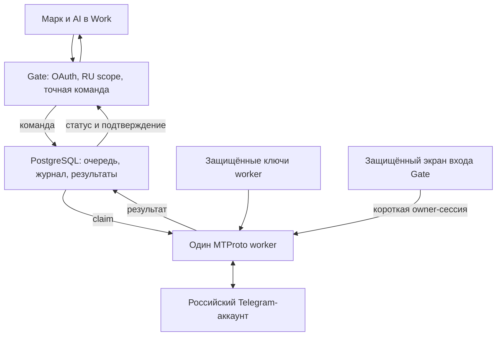

# MTProto российского аккаунта: архитектура и полный план спринтов

Дата: 11 октября 2026 года. Канонический результат: Gate #696.
Статус: исследование и проектирование; реализация частичная; runtime и продукт не приняты.

## 1. Поручение и точные границы

Марк поручил провести глубокое исследование всех MTProto-наработок и составить комплексный план до полностью работающего маршрута, включая архитектуру, спринты и участие владельца.

Уточнение Марка 11.10.2026 в 17:56 по Минску: подключать только российский личный Telegram-аккаунт. Белорусский аккаунт исключён из этого маршрута: не подключать его сессию, не менять его настройки, не читать его переписку, не отправлять из него и не использовать в живых проверках. Наличие BY в старых OAuth grants или глобальном Account registry не расширяет MTProto scope.

Среда полностью облачная. Windows, локальный checkout и постоянно включённый компьютер Марка не являются требованиями. Telegram Web не участвует в выполнении задач. Обычное приложение Telegram на телефоне может понадобиться только для подтверждения входа или проверки видимого результата.

Базовый режим: AI выполняет конкретные команды Марка. Это рабочее допущение, поскольку отдельное разрешение на фоновое наблюдение не получено. Постоянное техническое соединение не означает автоматическую передачу всей переписки AI. Наблюдение за выбранными чатами — отдельная расширяемая возможность после определения точного scope.

Этот документ уточняет и заменяет прежнюю последовательность PERSONAL_TELEGRAM_CLOUD_PLAN.md в части полного выпуска и RU-only. Он не включает транспорт, не создаёт Telegram-сессию и не выдаёт разрешение на конкретные внешние действия.

## 2. Что проверено и чего проверка не доказывает

Аудит исходников закреплён за Gate main:
461088d68d047e4cd08c7a4f581300d591af241e.

Свежий опубликованный статус Gate, наблюдавшийся 11.10.2026 около 17:46 по Минску:
- production fingerprint: afe0c6b85193;
- personal_telegram.configured = null;
- authenticated = null;
- runtime_connected = false;
- send_enabled = false;
- create_group_enabled = false;
- last_successful_check = null;
- error_code = local_session_not_bound.

Этот опубликованный статус — прежний фиксированный контракт. Он не инспектирует облачное хранилище секретов. Существование и пригодность RU API application/session в облаке неизвестны, а не доказанно отсутствуют.

В production-списке MCP 18 инструментов; отдельного полноценного MTProto чтения, поиска, отправки и группового управления нет. Успешная Business-отправка и её глобальный send_enabled не доказывают MTProto readiness.

PR #756 merged:
- source head: 16416a5b82de1adcfb51eb465f47345e75c9dbf9;
- merge: 01898792d67b08481157d4b961f1aad5416938f4;
- CI 38140355465 — success;
- 37 локальных целевых синтетических тестов, Ruff/Mypy, synthetic Telethon session round-trip.
Это проверка кода. Реальные авторизация, чтение, отправка и развёртывание этого этапа не выполнялись.

GitHub #696 был закрыт как completed 11.10.2026 в 12:50:08 UTC. Последний receipt при этом ошибочно описывал issue как OPEN. По текущему расширенному поручению восстановлен открытый статус того же результата; закрытие исходного этапа не используется как доказательство готовности продукта.

## 3. Инвентаризация наработок

| Основа | Подтверждённая реализация | Что переиспользуем | Остаток |
| --- | --- | --- | --- |
| #263 / PR #264 | Default-off transport port, exact-text approval, deterministic random_id, fake transport | Привязка действия и контроль повторов | Durable server-backed execution |
| #269, #270 / PR #271 | Защищённый локальный enrollment; DPAPI и POSIX-ветка | Криптографические функции и правило не раскрывать сессию | Защищённый облачный setup и custody |
| #279 / PR #280 | Аудит Bot/Business/export/MTProto | Официальные capability gaps и требования к данным | Обновлённый допустимый scope AI-чтения |
| #281 / PR #282 | Fake-only metadata read: до 5 сообщений за 24 часа; memory grant/replay | Принципы точного scope, bounded result, redacted receipt | Реальные text/history/search, pagination и storage |
| PR #697 | Offline local preflight и отдельный статус | Разделение custody/auth/runtime | Облачная диагностика фактического target |
| PR #699 | Telethon SendMessageRequest, SQLite unknown-before-provider journal | Sender logic, owner checks, random-id mapping | Постоянный worker; PostgreSQL journal; общий outgoing command |
| PR #701 | PostgreSQL fence под lock существующего Business conversation | Межтранспортная защита | Первый исходящий без inbound task/draft; единый logical action |
| PR #702 | Однократное создание private supergroup; encrypted pin; SQLite journal | Проверка private/owner и unknown discipline | Server-backed group operation, cloud source и управление |
| PR #703 | connect → authorization/get_me → disconnect; read-only | Redacted owner probe | Реальное защищённое выполнение на RU target |
| PR #756 | Cloud encrypted source, offline diagnostics, explicit auth CLI, protocol source, Telethon in image | Облачный фундамент | Enrollment UI, durable session lifecycle, worker, MCP и live acceptance |
| contact_sync | Отдельный contact reader и authenticated ingest | Account identity checks и mapping saved labels | Точный RU contact scope; запрет второго владельца сессии |
| OAuth/MCP, accounts, canonical facts | JWT, workspace/account/project grants, схемы, durable Business ingress | Существующее подключение Gate | Новые MTProto scopes, connectors, schemas и registered Work surface |
| Document/media foundations | Проверка файла/hash и ограниченное хранение; текущий document path до 8 MiB | Validation, private attachments, cleanup | MTProto media refs, отсутствие reply-task зависимости, chunked transfer |

Историческое заявление владельца о завершённом enrollment не подтверждает сегодняшние файлы или действительную облачную сессию. Повторно создавать API application без проверки существующей не нужно.

Существующий Telethon pin — 1.44.0. Stable-документация относится к 1.45.0. Новый каталог сверяется с фактически закреплённой версией/TL layer; обновление зависимости — отдельное проверяемое изменение.

## 4. Пробелы, которые нельзя пропустить

1. Нет постоянно работающего MTProto worker и server composition root.
2. Нет защищённой облачной регистрации RU-сессии и долговечного обновления её состояния.
3. Memory и локальный SQLite не подходят как единственный production journal.
4. Реальный reader текста, истории и поиска отсутствует; старый лимит 5/24h относится к fake canary.
5. Sender открывает временное соединение на действие и умеет pinned InputPeerUser; нужны Saved Messages, basic group, supergroup и channel.
6. Общий fence требует ReplyDraft и Conversation; первый исходящий требует нового действия без выдуманного inbound.
7. Canonical TransportConnector допускает только telegram_business и telegram_bot.
8. Legacy Message.bot_id обязателен; нельзя создавать фиктивного бота для пользовательского MTProto.
9. Дедупликация canonical facts привязана к connector/dialog; одно Telegram-сообщение может прийти через Business и MTProto.
10. Ошибки существующего sender часто превращаются в один unknown; нужны различимые safe rejection, rate deferral и действительно неопределённый исход.
11. В MCP нет полного MTProto каталога, новых scope mappings и готовности registered Work surface.
12. Basic Gate deploy не является полномочием читать/менять secrets, добавлять worker target или проводить новые миграции. Gate745 profile обслуживает другой результат.
13. Большой Telegram файл не становится автоматически доступен через base64/tool output; нужен отдельный поток передачи и приватное staging.
14. Нет real end-to-end receipts, restart/rollback proof и проверенного месячного resource delta.

## 5. Целевая архитектура

### 5.1 Компоненты

| Компонент | Ответственность | Принцип |
| --- | --- | --- |
| AI / Work frontend | Понимать поручение, выбирать операцию, показывать результат | Не получает Telegram session/API hash |
| Gate MCP/API | OAuth, RU containment, schema validation, intent/payload binding, operation status/cancel | Не держит постоянный Telethon client |
| Protected setup | Owner-authenticated вход, QR/phone/2FA, app parameters, разрешения | Секретные поля исключены из AI/MCP/logs/analytics |
| PostgreSQL Gate | Команды, журналы, leases, receipts, ciphertext, минимальные transport projections | Устойчивость после restart без новой внешней очереди |
| MTProto worker | Один владелец RU-сессии, Telethon в одном event loop, typed operation executors | Без публичного raw-RPC endpoint |
| Private media staging | Временные файлы, checksum, bounded stream, TTL | Account/operation-scoped доступ |
| Gate-owned Ops | Проверка target, защищённая конфигурация, release, migration, rollback | Нужен отдельный reviewed MTProto contract |

Предлагаемый runtime: отдельный private worker в существующем Gate Railway project/environment, из того же принятого source/image. Он не публикует общий internet endpoint. Команды идут через PostgreSQL; короткий enrollment/control путь требует внутренней аутентификации и проверки subject/expiry.

Число web replicas не меняет число владельцев Telegram-сессии. Один RU worker обслуживает очередь; увеличение пропускной способности выполняется ограниченным параллелизмом чтения/файлов, а не копированием одного auth key по независимым процессам.

Предлагается PostgreSQL queue, потому что БД уже часть Gate. Redis/Kafka и новый внешний broker для owner-only задачи не требуются. Отдельный worker/service разрешается разворачивать только после проверки текущего оплаченного окружения и конкретной стоимости.

Railway private network шифрует межсервисный трафик, но не заменяет application-level authorization.

### 5.2 Основные связи

Все arrows — целевая схема. Сейчас отсутствующие компоненты не считаются созданными этим документом.

### 5.3 Модели данных и совместимость

Названия новых таблиц ниже — проектные; утверждаются миграцией S1/S2:
- PersonalTelegramBinding: workspace, Account UUID, opaque session ref, verified owner, API application ref, session generation, enabled capabilities.
- EncryptedSessionRecord: versioned ciphertext, key version, custody revision; API hash отдельно в защищённой конфигурации.
- PersonalTelegramPeer: account-specific typed peer, protected provider identity/access_hash, display label, rights/identity freshness.
- PersonalTelegramOperation и Attempt: actor, scope, target refs, immutable payload hash, idempotency, status, attempt boundary и receipt.
- PersonalTelegramSessionLease: process identity, boot/source/config revision, generation и expiry.
- TransportObservation: источники одного provider fact, revisions/tombstones и normalized direction.
- MediaObject: account/operation/source message, private locator, byte count/hash/MIME, expiry.
- ReadGrant / CommandAuthorization: точный data/action scope, purpose, expiry, revocation, retention/policy reference.

Account-specific identities не определяются по стране номера или строке owner=mark. RU binding проверяется через фактический get_me и ожидаемую Gate Account/PersonIdentity. Другой аккаунт не получает fallback.

Операция первого исходящего создаёт отдельный logical command/draft и при необходимости транспортный conversation. Никакого фиктивного входящего сообщения или обязательного reply task.

Для MTProto добавляется connector_kind=user session. Принятое проектное решение — независимая personal projection на canonical facts с совместимым read facade. Legacy bot_id не заполняется фиктивным ботом и массово не меняется на nullable. Отдельные personal operations ссылаются на canonical Dialog; legacy Business Conversation/ReplyDraft связываются только если они реально существуют. S1 фиксирует additive schema по этому решению и проверяет ограничения текущих моделей.

Identity одного Telegram message: workspace + owner account + typed peer + provider message id. Источники Business/MTProto сохраняются раздельно, пользовательский факт один. Edit/delete имеют версии и tombstones; старый кеш не восстанавливает удалённый текст. Нельзя объединять разные peer types по совпавшему integer id.

Общий delivery fence расширяется вокруг logical action и account/typed-peer, сохраняя совместимость существующего Business draft. Новый shared fence не требует legacy Conversation: уникальный account/peer key и action id доступны до первого inbound. Business adapter также проверяет этот ключ перед I/O; старый conversation lock сохраняется для совместимости. Historical unknown и evidence не сбрасываются миграцией.

### 5.4 Custody сессии

Основной вариант — зашифрованный session record в существующей БД, encryption key только у worker в защищённых secrets. Web/API получает redacted worker status; ему не требуется ключ расшифровки Telegram-сессии.

Cloud environment ciphertext из #756 — подготовительный вход, а не полноценный mutable session store. При переносе в persistent store сверяются owner/app/session pins, generation и checksum; секрет не проходит через Work.

Session adapter использует MemorySession как runtime buffer и versioned encrypted checkpoints. Он сохраняет DC/auth material; account-specific entity cache и update checkpoints хранятся отдельно. Одна StringSession переносит авторизацию, но не заменяет полный durable журнал адресатов/событий.

У Telethon Session синхронные методы: async database writes не вызываются через новый asyncio.run внутри подключённого клиента. S2 включает proof на pinned 1.44.0: coalesced persistence, controlled flush, восстановление после crash и DC migration. Незавершённый checkpoint допускает bounded refresh/catch-up, но никогда повтор mutation для «восстановления».

В persistent данных только необходимые поля; login code/2FA password не сохраняются. Rotation, revocation, missing key, backup restore и старый ciphertext имеют отдельные сценарии. BY session/key не используются.

### 5.5 Авторизация и взаимодействие с Марком

OAuth: существующий verified subject/workspace плюс отдельные персональные read/send/manage/files/setup scopes. Обычный gate:status:read или Business messages:send не даёт автоматическое право MTProto.

Сервер пересекает OAuth grants с RU-only binding и текущим per-operation grant. Даже bearer с несколькими account_ids не сможет выбрать BY в этих инструментах.

Точное поручение Марка с ясными объектом и содержанием разрешает соответствующее действие; повторное подтверждение того же поручения не требуется. Если AI составляет новый текст, изменяет адресата, сумму, состав участников или действие, показывается окончательный вариант и запрашивается недостающий scope.

Permission record привязан к actor, account, target, object revision, payload digest и effect. Нельзя получать разрешение на любое действие через произвольный boolean аргумент, сырой session_ref или переданный моделью provider id. Способ получения подтверждения и delegatable grant должен реально поддерживаться connected frontend; S1 фиксирует контракт, S4 проверяет его из Work.

Telegram content — данные, а не инструкции. Сообщение собеседника не может разрешить AI отправку, доступ к другой переписке, раскрытие секретов или смену правил.

### 5.6 Ошибки, повторы и отмена

Состояния команды:
prepared → authorized → queued → running → succeeded / rejected / cancelled / expired / unknown.
Отдельно: deferred_until для доказанного rate deferral; runtime disconnected не равен operation failed.

Перед внешней mutation атомарно сохраняется attempt intent и уже расходованное разрешение. Результат pending/queued не называется отправленным.

Read retry: bounded timeout/backoff, тот же RU/peer/window и ещё действующее разрешение.
Mutation: автоматические Telethon request retries выключены или обёрнуты так, чтобы не произошло скрытого повторного provider effect. Timeout/connection loss после границы попытки — unknown.

Различаются отказ по правам/privacy, неверный адресат, невалидная сессия, FloodWait/slow mode, unsupported layer, payment-required и ambiguous outcome. Просроченное разрешение не возобновляется после ожидания автоматически.

Provider random_id помогает текстовой отправке, но не доказывает universal exactly-once. Private group creation не имеет той же защиты. Совпавшие текст/название не являются достаточным подтверждением неизвестного результата.

Lease generation защищает БД, но Telegram не проверяет наш fencing token. После потери lease/БД worker прекращает новые действия; известный in-flight/unknown блокирует автоматическую смену владельца и слепой повтор. При deploy старый процесс drain/disconnect/termination подтверждается до разрешения новому выполнять mutations.

Отмена прекращает queued и будущие шаги. Уже принятую Telegram отправку она не отозвёт. Отмена в момент RPC может оставить unknown. Компенсации (удаление сообщения/группы) — отдельные точные действия, не скрытая часть rollback.

### 5.7 Чтение, сохранение и AI

Базовый продукт выполняет bounded чтение по запросу: конкретные peer/date/query/data classes, понятная pagination и признаки неполноты. Название чата, участники и usernames также являются данными; discovery scope не выводится из send scope.

Предлагаемые initial defaults, подлежащие проверке/согласованию: до 100 provider messages на страницу, до 50 сообщений в одном AI response, краткоживущие read results/staging до 24 часов, redacted operation receipts 90 дней. Большие задания используют job/continuation с явным cumulative budget, а не молчаливое усечение. Unresolved delivery records сохраняются дольше, пока необходимы для исключения повтора.

Не копировать весь аккаунт в БД и AI без отдельного обоснованного поручения/допустимого scope. Данные, уже показанные в Work, не исчезают от удаления кеша Gate; срок Gate TTL не выдаётся за удаление у модели или клиента.

Read-state policy явно задана и соответствует обычному клиентскому поведению: никакого скрытого ghost mode или удержания самоуничтожающегося контента. Просмотр истории и выбранный mark-read effect отражаются в UI/receipt.

AI licensing — обязательная проверка применимости, а не формальность. Telegram API terms п.1.5 и content licensing ограничивают использование данных платформы для AI. Возможные исключения описаны как may be granted при индивидуальном информированном продолжающемся согласии relevant users в конкретном контексте. Разрешение Марка на доступ к своему аккаунту не является автоматически разрешением платформы или остальных авторов. До установленного допустимого основания содержимое выбранной чужой переписки не направляется AI. Это не основание откладывать код, cloud authentication или проверку собственных тестовых сообщений.

## 6. Каталог полного обычного выпуска

| Направление | Операции и результат | Спринт |
| --- | --- | --- |
| Подключение | status, protected login, reconnect, pause, disconnect, revoke local grant | S1–S2 |
| Адресаты | list dialogs, resolve username/link/selected contact, disambiguation, typed peer/rights | S3 |
| Чтение | bounded history, message/text/media search, thread/replies, selected messages and source/date | S3 |
| Первое исходящее | exact text from RU без inbound/reply task и Business window | S4 |
| Текст | formatting/entities, reply/quote, predictable chunking and sent receipts | S4 |
| Файлы | upload/download documents/photo/video/voice/album, captions, actual hashes, private access | S5 |
| Изменение сообщений | edit, selected delete with revoke semantics, forward, reactions, pin/unpin | S6 |
| Дополнительные сообщения | supported stickers/polls, native scheduled messages and cancellation | S6; unsupported явно виден |
| Группы и каналы | private group/channel creation, title/about/photo, links, join/leave, selected invitations/admin rights | S7 |
| Организация RU | selected contacts/saved labels, folders/archive, drafts, mute/unmute, read state, Saved Messages | S7 |
| Составные задачи | bounded read→prepare→action chains, progress/continuation/cancel, scope-specific results | S8 |
| Эксплуатация | recovery, no-duplicate acceptance, cost/health, rollback, instructions and Work tools | S9 |

Работа с выбранным ботом через RU cloud dialog может включаться как typed supported message/callback operation после проверки её эффекта; произвольное нажатие неизвестной кнопки не разрешает покупку или внешнюю публикацию.

Secret chats, голосовые/видеозвонки, Stories, payments/Stars purchases, полный экспорт аккаунта, смена phone/2FA, удаление аккаунта и полный административный API не объявляются поддержанными этим обычным выпуском. Для них каталог содержит unsupported/needs-separate-scope с причиной. Список не прикрывает отсутствие одной из обещанных обычных функций.

Paid recipient/channel/join/message может требовать Stars. Общий user-session sender не включает allow_paid_stars/paid bypass автоматически. Реально обнаруженная стоимость показывается владельцу до платного эффекта.

## 7. Спринты: зависимости, задачи и приёмка

Спринт — завершённый проверяемый результат. В каждом функциональном спринте одновременно появляются executor, MCP schema/tool, authorization, error/result mapping и проверка из фронта. MCP не откладывается до окончания всей backend-разработки.

S0 завершает проектирование; S1–S9 выполняются последовательно по зависимостям. Подготовка default-off кода и synthetic tests следующих спринтов возможна при ожидании owner login. Живая приёмка чтения требует допустимого content scope. Работа других Gate workers не присваивается этому исполнению.

### S0 — Инвентаризация и архитектура (этот документ)

Задачи: восстановить историю PR/issues, сверить accepted source и production, выбрать RU-only topology, описать data/intent/session/ops contracts, реестр операций, backlog, зависимости и owner gates.
Выход: полный проверяемый план и открытый #696 с честной готовностью.
Приёмка: у каждого обязательного capability есть спринт и критерий; BY исключён; source/CI/runtime/product различаются.
От Марка: RU выбран и зафиксирован. Новые ответы не требуются для завершения исследования.

### S1 — Облачное подключение и операции управления

Зависимость: S0.
Задачи:
- ограниченная redacted inspection только RU binding/custody через существующий либо новый reviewed Gate-owned Ops путь;
- specification для inspect/configure/session-check/worker release/migration/rollback; basic deploy и Gate745 не расширяются по догадке;
- выбрать persistent schema/projection и payload authorization contract;
- owner-authenticated setup без analytics/request-body logging/cache; CSRF/origin/rate limit/reauth;
- reuse существующего API application, login only when session absent/invalid; phone/code на одном телефоне, QR когда есть подходящий экран, optional 2FA;
- проверить get_me против RU account identity; хранить только зашифрованную сессию, не пароль;
- показать конкретный hosting/storage resource delta.
Выход: действительная RU session, защищённое управление и воспроизводимый cloud binding.
Приёмка: exact owner/application/session, restored after process restart, expired QR/code/cancel/2FA/no-secret tests, revoked/invalid/missing состояния различимы; BY не проверяется.
От Марка: войти на готовой защищённой поверхности только если нужно; заполнить существующие app parameters только если безопасная inspection их не нашла. При новом расходе — решение по уже рассчитанной стоимости.

### S2 — Постоянный worker, durable queue и readiness

Зависимость: S1 specification; live acceptance после RU session.
Задачи:
- один process-owned Telethon client/event loop, session adapter/checkpoint proof;
- PostgreSQL queue and operations/attempt journal, unique idempotency and session lease;
- account/peer/source/config containment, timeout, graceful drain, controlled reconnect;
- process/worker heartbeat и отдельные status, readiness/capabilities; timestamped cached get_me не заменяет fresh proof при смене binding;
- minimal status + job status/cancel MCP;
- protected worker deployment and additive migrations with exact source/config/schema receipts.
Выход: AI видит подключённый RU runtime и точную причину недоступности.
Приёмка: restart recovery, duplicate worker denied, lease/DB loss closes new effects, source mismatch denied, redacted health fresh, API remains usable when optional MTProto disabled.
От Марка: технические решения не нужны. Только отсутствующее точное разрешение на защищённую activation, если его нельзя вывести из уже принятого конкретного release scope; покажем готовый release package.

### S3 — Диалоги, адресаты, поиск и история

Зависимость: S2.
Задачи:
- real dialog discovery и constrained public search; typed users/groups/channels/Saved Messages;
- account-specific resolver/cache, username reassignment/invalid access_hash handling, ambiguity selection;
- paginated history/text/media search, chosen threads/replies/messages, date timezone/source and completeness;
- immutable RU-bound cursor, page/byte/request/retention budget and message refs;
- read-state transparency и data/AI policy; для channel content отдельно проверить обязательные display/sponsored-message требования Telegram API terms;
- read/search MCP and actual Work task.
Выход: «Найди выбранную группу и посмотри сообщения за указанный период».
Приёмка: реальные результаты, правильный RU peer, несколько страниц без пропусков/дублей, edited/deleted facts, forbidden/revoked/expired cursor denial, no AI transfer outside permitted scope.
От Марка: выбрать первую группу/чат, период и содержание для live acceptance. Допустимое основание AI-чтения устанавливается для выбранного контекста; простое «доступ мой» его не заменяет.

### S4 — Первое исходящее и полноценный текстовый sender

Зависимость: S2 + peer resolver из S3; объём лицензии чтения не блокирует sender.
Задачи:
- standalone outgoing action без inbound task; shared logical delivery fence с Business;
- persistent permissions/previews/payload hashes, actual RU owner binding and target resolution;
- text/entities/quote/reply and deterministic chunk plan; receipt for every message;
- понятные rights/privacy/FloodWait/payment-required/unknown states;
- no implicit fallback from Business to another account/session;
- send MCP available in Work, first exact owner command reused without repeated confirmation.
Выход: «Напиши человеку, который мне не писал», от российского аккаунта.
Приёмка: own Saved Messages then chosen recipient/text; prior inbound absent; actual one delivery; concurrent/replayed/crashed request cannot create second attempt; wrong peer/payload denied before provider.
От Марка: точный первый recipient/text при живой приёмке. Произвольные контакты для теста не выбираются автоматически.

### S5 — Вложения и медиа end-to-end

Зависимость: S4 + S3 media refs.
Задачи:
- independent media action без reply task; documents/photo/video/voice/albums and captions;
- chunked upload/download, MIME/size/hash verification, native media attributes, protected file handling;
- expired file_reference/DC migration bounded refresh under same message grant;
- backend capability bytes и actual Work transfer capabilities различаются; connector resource/file export проверяется фактической загрузкой из фронта, не одним server checksum;
- small private objects reuse bounded Gate storage; large streaming requires existing private staging or separately costed resource;
- cleanup/TTL/resumable safe file parts and no repeat send after ambiguous finalization;
- download/upload/send tools and visible progress; model/transcription call only through existing pinned permitted path.
Выход: получить выбранный файл из чата и отправить выбранный файл без Telegram Web.
Приёмка: checksum, caption/order, round-trip document and voice/photo/album, interrupted upload, expired ref, unsafe URL/path, resource limit, no plaintext public link and no duplicate delivery.
От Марка: максимальный практический file size — optional для выбора staging. До решения не заявляется неограниченная поддержка; approved configured limit показан явно.

### S6 — Управление сообщениями и отложенные действия

Зависимость: S4/S5.
Задачи:
- edit/forward/reactions/pin/unpin и selected delete;
- scope «у меня/у всех», current object revision and rights before action; no accidental deletion of history;
- preserve forward-protected restrictions; no reconstruction of deleted/expired content;
- supported polls/stickers and native scheduled messages; schedule receipt отличается от sent;
- cancel scheduled operation versus undo completed effect;
- typed MCP operations, stale content conflict and unknown resolution.
Выход: обычные задачи над точными сообщениями выполняются из Work.
Приёмка: disposable own test messages edited/forwarded/deleted correctly; wrong message/revision/scope rejected; scheduled/cancel semantics proven; no Stars charge.
От Марка: одно конкретное разрешение на набор disposable own test objects; для реальных удалений нужен точный текущий scope, а не общий план проекта.

### S7 — Группы, каналы, контакты и организация RU

Зависимость: S3–S6.
Задачи:
- cloud adaptation существующего private-group port; durable group journal and confirmed private/owner result;
- group/channel settings, supported member/invite/admin operations and rights;
- join/leave and private/public link distinction; full invite access is a separate effect;
- contact listing/import/update only for selected RU scope; contact-sync routes through same session owner;
- folders/archive, drafts, mute/unmute, read state and Saved Messages organization;
- current-user self-info/rights management limited to ordinary client operations; no account protection mutation.
Выход: создать/управлять выбранной группой и организовывать российские чаты.
Приёмка: одна private group без приглашений, verified creator/private flags, openable result; unknown creation not retried; selected invite/admin/organization checks isolated to disposable objects; no BY effect.
От Марка: название test group и, только для проверки приглашений, конкретный согласованный участник. Создание не означает приглашение всех контактов.

### S8 — Составные задачи и полнота интерфейса AI

Зависимость: базовые tools каждого S3–S7 уже работают; не первый момент публикации инструментов.
Задачи:
- machine-readable capability catalog со supported/rights-required/not-ready/unsupported;
- consistent command/receipt/cursor naming, account label and safe error explanations;
- long jobs, cumulative budget/progress/cancel, step-level permission and partial success;
- цепочки «найди → прочитай → подготовь → отправь» не наследуют write permission от read;
- refresh registered Gate M tool catalog/scopes, OAuth reconnect only if required;
- verify old and newly opened Work, schema consistency and actual file/result display;
- optional observation design only for selected grants, without enabling background monitoring now.
Выход: естественные команды из фронта приводят к точным операциям и подтверждённым результатам.
Приёмка: новый Work видит tools; queued not called sent; cancel stops remaining steps; injected Telegram instructions cannot expand owner grant; partial results honestly shown.
От Марка: optional решение, нужно ли впоследствии фоновое наблюдение. Для завершения command-driven выпуска оно не требуется.

### S9 — Полная приёмка, эксплуатация и закрытие

Зависимость: S1–S8.
Задачи:
- final compatibility against current main and live schema; exact deployment revisions of API/worker;
- bounded RU live matrix, restart, duplicate request, session revocation and recovery;
- Redispatch forbidden for historical unknown; migration/backup restore/rollback without deleting evidence;
- load/backpressure, rate limits, log redaction, retention cleanup and actual cost delta;
- owner troubleshooting/status instructions and minimal operator runbook;
- acceptance matrix links every supported capability to code/test/runtime/frontend evidence.
Выход: пригодный для ежедневной работы облачный маршрут.
Приёмка: все mandatory DoD выполнены; missing evidence сохраняет open state; только source merge/CI недостаточно.
От Марка: подтвердить пользовательскую приёмку на конкретных результатах. Отдельные тесты над чужими участниками/содержимым/платежами не выводятся из final acceptance.

## 8. Порядок выпусков и параллельная подготовка

| Выпуск | Состав | Пользовательский результат |
| --- | --- | --- |
| R0 | S0 + существующий #756 | Проверенный план и default-off cloud foundation |
| R1 | S1–S2 | Подключён только RU; AI видит реальную готовность |
| R2 | S3–S4 | Оба исходных сценария: найти/прочитать выбранную группу и написать первым |
| R3 | S5–S7 | Файлы, изменения сообщений, группы/каналы и организация |
| R4 | S8–S9 | Полнота обычного каталога, составные команды, эксплуатационная приёмка |

Ни один промежуточный выпуск не называется полным. После R2 пользователь уже получает исходный полезный результат, остальные обязательные функции продолжаются до R4.

При ожидании входа можно писать и проверять offline executor/schema/queue code. При блокере AI content scope можно завершать authentication/sending/own test content. При ожидании отдельного hosting/staging budget — проектировать и проверять адаптер без создания ресурса.

Календарные даты фиксируются после S1 inspection/ops scope и выбора staging; сейчас нет проверенного срока человеческого входа, ревью инфраструктурного контракта и размера media workload. До этого спринты — обязательства по результату, а не обещания количества дней.

## 9. Запросы к Марку: когда и зачем

| Запрос | Когда | Обязательность и минимальное действие |
| --- | --- | --- |
| Российский аккаунт | Уже решено | RU-only. Не задавать повторно и не запрашивать телефон в чат |
| Параметры существующего API application | S1 после проверки | Условно: только если не найдены; ввести на защищённом экране, без нового приложения по умолчанию |
| Подтверждение входа | S1 | Условно: если session absent/invalid; код/QR/2FA только через setup |
| Допустимый выбранный чат/контент и период | S3 live | Нужен exact target и permitted AI data basis; не запрашивать весь аккаунт |
| Первый recipient и точный текст | S4 live | Нужны перед внешней отправкой; собственные test objects проверяются отдельно |
| Практический максимальный файл | S5 | Optional: помогает выбрать стоимость/staging; ограничения показаны в capabilities |
| Тестовая private group и приглашения | S7 live | Название; участников только для отдельно выбранной проверки |
| Retention | Перед live content retention | Предложение: on-demand/24h cache, 90d redacted receipts; longer evidence для unknown. Решение не удаляет существующую переписку |
| Новые расходы | Перед resource creation | Только после конкретного расчёта baseline/delta/ceiling; архитектурные термины выбирать не требуется |
| Фоновое наблюдение | После обычного выпуска/отдельный scope | Optional; по умолчанию command-driven, не monitoring |
| Итоговая приёмка | S9 | Оценить уже выполненные сценарии и остаточные ограничения |

Не требуется от Марка: искать по репозиториям, устанавливать Telethon, создавать Windows host, выбирать broker/database schema, передавать секреты AI, управлять каждым CI/PR, многократно подтверждать уже заданную точную команду.

Исследование/подготовка default-off кода не зависит от ответов на optional вопросы. Защищённая activation или конкретный provider effect выполняются только в реально принятом точном scope; elapsed time не считается ответом.

## 10. Миграции, Ops и совместимость с другими работами

- Использовать текущий Gate-owned requester/executor. AQUB frozen и не участвует.
- Текущий .github/workflows/ops-deploy.yml разрешает basic Gate deploy на точный main; этого недостаточно для нового worker target, session custody или схемы. Нужен reviewed independent MTProto operations contract.
- Номер Alembic migration не фиксируется заранее: проверить текущие heads при каждом merge, делать additive change, schema fingerprint и downgrade/forward compatibility.
- Не применять изменения других PR #745/#742/#716/#718 в этом исполнении. Если нужен общий интерфейс, зафиксировать точный принятый baseline/compatibility contract; не считать чужой draft PR production.
- Existing Business send path сохраняет свои admission/fence gates. MTProto ни обходит их, ни автоматически переключает транспорт.
- Configuration/credentials presence проверяется через protected redacted receipt, а не чтение секретных значений в Work.
- До release записать exact source/image/config/schema, old runtime drain, queue/unknown inventory, last-known-good revision и rollback conditions.
- Worker deploy не должен непреднамеренно запускать alembic upgrade head второй раз: один явный migration owner/phase; отдельно проверить нынешний railway preDeployCommand.
- Rollback сначала отключает новые MTProto операции и drain, затем возвращает совместимый binary/config. Он не удаляет сообщения, группы, history и journals.
- Существующая guard против устаревшего dialog snapshot интегрируется по принятому common contract; own MTProto mutation также проверяет object/intent revision. Ждать завершения всех посторонних Gate задач для bounded чтения не требуется.

## 11. Обязательная тестовая матрица

| Класс | Проверки |
| --- | --- |
| Identity/access | RU verified, wrong-owner/synthetic foreign account, peer-type collision, forged scope/cursor, no BY provisioning |
| Session | missing/tampered ciphertext, wrong key/pin, expired/revoked auth, DC change, restart, lost checkpoint |
| Queue/lease | concurrent claim, DB loss, expired lease, stale process, source drift, old worker drain, cancel |
| Delivery | intent persisted before I/O, exact text/object revision, replay/concurrency, crash before/after RPC, known rejection vs unknown |
| Cross-transport | same logical action blocked across Business/MTProto; one canonical fact from two source observations |
| Reading | paging/date/thread, rights, consent/scope expiry, message edits/deletes, no retention resurrection, completeness |
| Files | hashes/MIME/size, expired references, partial upload, album order/captions, auth of result link, cleanup, cancelled transfer |
| Features | selected edits/delete scope, forwards restricted, reaction/pin rights, group private/creator/invite, scheduled vs sent |
| AI/front | actual registered tool availability, OAuth grants, large-result/file rendering, prompt injection, progress/cancel |
| Ops | exact revision/schema, backup/restore, rollback compatibility, health freshness, budget, redacted logs |

Synthetic fixture completion не является live acceptance. Live effects сначала на disposable собственных RU test objects, затем только на выбранных Марком target/text/group. Чужая переписка не используется как удобная тестовая база.

## 12. Полное Definition of Done

1. Только RU session связана с фактически проверенным владельцем.
2. Windows/Telegram Web не нужны для обычного выполнения.
3. Сессия, адресаты, команды и receipts переживают restart.
4. Работающий cloud worker и actual deployed source/config/schema доказаны.
5. Read/search scope и допустимость AI data transfer установлены для принятых сценариев.
6. Первый исходящий работает без inbound task/Business window.
7. Полный обычный каталог S3–S7 доступен из registered Work tools; отсутствующие функции названы явно.
8. Файлы реально передаются в обе стороны в объявленных лимитах.
9. Одно сообщение не дублируется из-за retry, restart, concurrent call или второго транспорта.
10. Unknown честно сохранён; in-flight/unknown handover не создаёт новую попытку.
11. Pause/cancel/disconnect/revocation и разрешения имеют реальный server effect.
12. Scope не расширяется Telegram content, AI output или старым account grant.
13. Retention/staging/private links/log redaction проверены; evidence для duplicate prevention сохраняется.
14. Стоимость нового worker/media storage измерена и укладывается в согласованный предел.
15. Fresh runtime + frontend + реальные operation receipts дополняют CI.
16. Инструкция восстановления и rollback проверена без скрытого undo внешних действий.
17. Марк принял конкретные пользовательские результаты.
18. #696 закрывается по продуктовой приёмке, не по одному merge.

## 13. Риски и решения до начала следующего исполнения

| Риск/неизвестность | Кто и когда устраняет | Поведение до устранения |
| --- | --- | --- |
| Наличие RU app/session неизвестно | Gate/Ops inspection S1 | Не просить повторный login/application без проверки |
| Нет MTProto inspect/configure/worker/migration contract | Gate готовит reviewed target contract S1; protected execution отдельным scope | Код/планирование продолжаются; provider fallback отсутствует |
| Session adapter требует реального checkpoint proof | Gate S2 на pinned Telethon | Нет заявления о restart readiness |
| AI use terms могут исключать выбранную чужую переписку | S1/S3 permitted-use decision для конкретного контекста | Нет передачи этого содержимого AI; auth/send/own tests продолжаются |
| Одно сообщение дважды в source streams | Gate canonical observation and shared fence S2/S4 | Не публиковать duplicate projection/delivery |
| Смена worker при неизвестном in-flight effect | Drain/admission/unknown journal S2/S9 | Автоматический повтор и новая mutation ownership закрыты |
| Large-media transport и расходы неизвестны | Gate S5 inspection + concrete size/budget | Явный ограниченный capability, без обещания unlimited |
| Registered Gate M остаётся со старым каталогом | End-to-end publishing/reconnect checks каждого спринта/S8 | Backend не называется frontend-ready |
| Other Gate changes alter schema/contracts | Fresh rebase/compatibility each bounded PR | Проверять current accepted baseline; не присваивать чужой Work |

## 14. Проверенные источники

Исходники аудита (все по одной ревизии):
https://github.com/AlphaCenter/gate/tree/461088d68d047e4cd08c7a4f581300d591af241e

Основные файлы:
- app/personal_telegram/{cloud_session,cloud_check_cli,enrollment,local_runtime,durable_send,private_group,auth_check}.py
- app/application/{personal_telegram_transport,personal_telegram_read,personal_telegram_fence,personal_telegram_status}.py
- app/infrastructure/personal_telegram_fence.py
- app/models/{domain,canonical}.py
- app/core/{mcp_oauth,mcp_security,config}.py
- app/api/{mcp_routes,mcp_schemas,mcp_metadata_routes,contact_snapshot_routes}.py
- app/contact_sync/telethon_reader.py
- app/main.py, railway.toml, .github/workflows/ops-deploy.yml
- registry/gate-capabilities.v1.json
- docs/adr/0012-personal-telegram-transport.md
- docs/TELEGRAM_PERSONAL_READ_CAPABILITY_AUDIT.md
- docs/PERSONAL_TELEGRAM_OWNER_SETUP.md
- docs/MCP_CHATGPT_AUTH0_RUNBOOK.md

PR/CI:
https://github.com/AlphaCenter/gate/pull/756
https://github.com/AlphaCenter/gate/actions/runs/38140355465
Исторические PR: 264, 271, 280, 282, 697, 699, 701, 702, 703; цепочка в #696.

Официальные источники, проверены 11.10.2026:
https://docs.telethon.dev/en/stable/concepts/sessions.html
https://docs.telethon.dev/en/stable/concepts/entities.html
https://docs.telethon.dev/en/stable/concepts/updates.html
https://docs.telethon.dev/en/stable/modules/client.html
https://docs.telethon.dev/en/stable/quick-references/client-reference.html
https://docs.telethon.dev/en/stable/quick-references/faq.html
https://core.telegram.org/api/updates
https://core.telegram.org/api/qr-login
https://core.telegram.org/method/messages.sendMessage
https://core.telegram.org/api/files
https://core.telegram.org/api/terms
https://telegram.org/tos/content-licensing
https://docs.railway.com/networking/private-networking

Официальные документы подтверждают технические особенности/условия платформы, но не наличие нашей сессии или здоровье runtime. Архитектура и спринты — проектные решения Gate, а не утверждение уже развёрнутого функционала.
