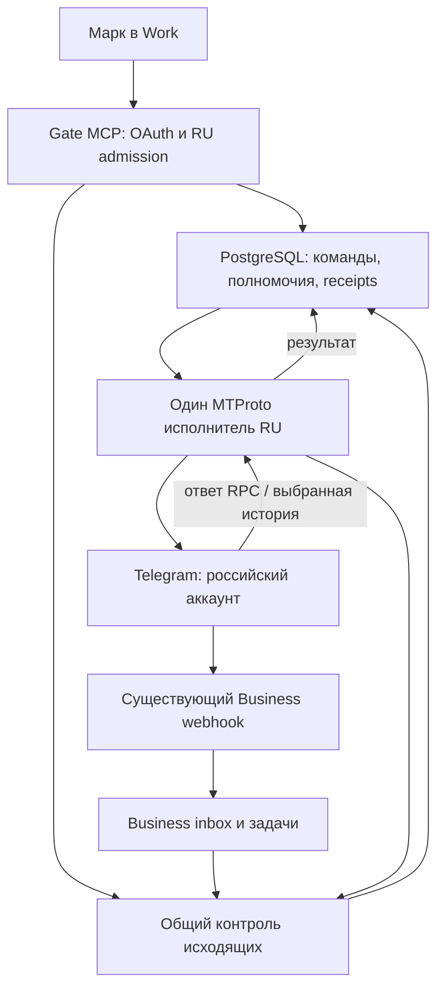

# MTProto RU: техническое задание и план выпуска v3

Актуализация: 12 октября 2026, Europe/Minsk. Каноническая задача: [Gate #696](https://github.com/AlphaCenter/gate/issues/696). Документационный [PR #759](https://github.com/AlphaCenter/gate/pull/759) переиспользуется.

Статус: **актуализированный план α; runtime и продукт не приняты**. Это поручение на ревизию ТЗ, а не запуск реализации или формальный независимый Delta ACCEPT. V3 уточняет v2 на основании текущего main, исходников и проверок PR #761, свежего scoped Gate status и смежных Gate/Ops-контрактов. История v2 сохраняется в commit `50792e3db48ee26084f6eeb839a5661b34ac16c4`; S0–S9 — в `d29e73d199ed3c680912b42fa707f06959888c0d`.

Начать чтение с [ревизии и реестра находок](MTPROTO_RU_REVIEW_2026-10-12.md), затем с §11 этого ТЗ. [OSS review](MTPROTO_RU_OSS_REVIEW.md) остаётся датированным исследованием 11.10, а не свежей проверкой каждой библиотеки.

Изменение v3: не повторять пройденные session/SQL proofs; разделить V0 на небольшие пакеты; обеспечить надёжность worker и сверку UNKNOWN; доказать привязку клиента/полномочий и реальную Work-поверхность; отдельно подключить runtime, первую отправку и выбранное чтение. Полный C01–C23 scope сохраняется. Файлы исследуются рано, но их отдельный frontend blocker не останавливает текстовый первый выпуск.

## 1. Решение

Расширить существующий Gate небольшим адаптером пользовательского MTProto на Telethon. Сохранить Business Bot API как существующий входящий маршрут и маршрут ответов. Добавить один облачный исполнитель команд российского аккаунта, устойчивый журнал операций и общую защиту исходящих действий.

Начать с двух законченных сценариев: написать первым по точному поручению; найти доступную группу и прочитать выбранный период. Оба работают из подключённого Gate в Work. Отправка не должна ждать реализации полной истории, медиа или администрирования.

Не строить до первого результата полный архив аккаунта, собственный движок Telegram updates, универсальную очередь задач, второй MCP gateway, новый OAuth-сервер или автоматический оркестратор AI. Переиспользовать Telethon, Gate PostgreSQL, существующие OAuth/MCP, форматирование, журналы и тестовые подходы. Нужная новая логика — правила Gate, которых нет в готовых Telegram-библиотеках.

Область: только российский аккаунт Марка. Белорусский аккаунт исключён из MTProto подключения, проверки сессий, чтения, отправки, настройки и live-приёмки. Общие изменения кода проверяются на синтетическом втором аккаунте; реальные BY данные и настройки не используются.

Базовый режим — команды владельца. Непрерывное наблюдение, полный индекс и автоматические ответы от нового MTProto маршрута не включаются. Windows и Telegram Web для ежедневной работы не нужны. Разовый вход делается на защищённой поверхности Gate с обычным приложением Telegram, только если действующая сессия не найдена.

## 2. Проверенная исходная точка на 12.10.2026

| Предмет | Прочитанный источник / факт | Практическая граница |
| --- | --- | --- |
| Gate main | `461088d68d047e4cd08c7a4f581300d591af241e` | Не равен развёрнутой ревизии |
| Scoped Gate status, 12.10 около 08:13 Минск | production `afe0c6b85193`; personal runtime_connected=false, send/create_group=false, configured/authenticated=null, local_session_not_bound | Это метаданные текущего API; не inspection защищённых RU credentials и не свежий Telegram probe |
| Каталог того же статуса | Existing Business/status tools; личного MTProto маршрута нет | OAuth существующих tools не доказывает новые scopes, discovery, jobs или файлы |
| PR #756 | Cloud source установлен в main | Source custody contract не означает найденную/валидную RU session |
| PR #759 | Draft/open; v2 head `50792e3db48ee26084f6eeb839a5661b34ac16c4` | Документация, не implementation |
| PR #761 | Open/unmerged; head `3955eb0539c1b30bd0816a958ffc7127f768fcb3`; 14 файлов | Staged source foundation; callable MCP, entrypoint, active migration, login и dispatcher отсутствуют |
| CI #761 | [run38175506026](https://github.com/AlphaCenter/gate/actions/runs/38175506026), exact-head SUCCESS; logs: 2943 passed, 1 skipped, 12 subtests; Ruff/Mypy314 PASS | 25 новых provider-free и 4 PostgreSQL contention cases не являются live/session/Business parity/Work acceptance |
| Telethon | 1.44.0 закреплён в обоих extras и constraints/runtime.txt | Stable docs1.45 — справка, не доказательство совместимости pin1.44 |
| Dockerfile main | Устанавливает `.[personal-telegram]` | Установка библиотеки больше не blocker; dedicated worker/run path ещё нет |
| PR #747 / #745 | Open; head `9723382ba37fd3b3d15430d7e1ba436217d0d72b`; snapshot source/CI подготовлены | Не установлен в main/runtime; ревизии Business connection/chat не готовы как универсальный typed-peer guard |
| PR #744 / #742 | Open; head `08c499b943b432ab1ceca78c2d6df6bba57174c1` | Stale base; media0115 и main watch0115 ветвятся от0114. Интеграция без согласования создаёт multi-head; не готовая зависимость V4 |
| Ops main | `b2ca3677ec5f664d9ac0eca2359b4cbcceed605e` | Есть Gate-only deploy и отдельный Gate745 cutover source; ни один не является MTProto authority |
| Последний execution #696 | [receipt6113926523](https://github.com/AlphaCenter/gate/issues/696#issuecomment-6113926523): bounded source package done, lease released | Непрерывный implementation worker не подтверждён; утренняя automation — report-only |

Наличие RU app/session остаётся неизвестным. `local_session_not_bound` при выключенном cloud flag задаётся статической веткой status: оно не доказывает отсутствия credentials. Scope результата — RU; общий status содержит соседние блоки, но их данные не используются и не копируются в доказательства MTProto.

Историческая цепочка: #263/264 intent/random_id; #269–271 enrollment/custody; #279–282 read contracts; #697 preflight; #699 text sender; #701 draft-bound fence; #702 private group; #703 auth probe; #756 cloud source. Переиспользовать исходники после compatibility checks, без повторной авторизации или копирования чужой session.

Параметры retry проверяются отдельно: старый sender request_retries=0, connection_retries=0, auto_reconnect=False, flood_sleep_threshold=0; новый worker connection_retries=1. Это явное отклонение, не доказанная duplicate send: перед выпуском закрепить ограниченный connect policy; mutation RPC retries остаются выключенными.

## 3. Ревизия прежнего плана

| Находка | Сохранённое решение v2/v3 |
| --- | --- |
| Верно выбраны RU-only, cloud, Telethon, один владелец сессии, standalone action, unknown | Сохраняются |
| Собственный полный Session backend и checkpoints до первой команды | Заменены built-in StringSession и тонким сохранением encrypted auth/DC в PostgreSQL |
| Приёмка restart в S1 зависела от реализации adapter в S2 | Persistence, login и single-owner acceptance сведены в один вертикальный этап V1 |
| First outbound ожидал полного S3 чтения | V2 требует только минимального resolver; V3 готовится параллельно после V1 |
| Shared fence рассматривался как уже общий для всех Business отправок | Требуется реестр всех RU writers и обязательный admission либо доказанный запрет непокрытого пути |
| Canonical Dialog/Message считались почти готовой общей идентичностью | Добавляется account + typed peer + message identity mapping; без массового переписывания canonical модели |
| Outgoing echo автоматически закрывает все задачи диалога | Вводится причинная связь ответа с покрываемыми task IDs; ad-hoc MTProto send сам по себе задачи не закрывает |
| confirmed=true и OAuth смешивались с доказательством user intent | Честное owner delegation + immutable operation; отдельное подтверждение вне делегирования |
| Файловый Work path проверялся поздно | Synthetic upload/download и discovery проверяются в V0 |
| Unknown мог навсегда остановить весь аккаунт | После доказанного завершения старого worker карантин ограничивается действием/затронутым peer |
| Полнота определялась словами «обычный Telegram» | Конечная матрица обязательных capabilities, со статусами и evidence |
| Финальная S9 выглядела первым этапом надёжности | Restart, redaction, rollback, replay и реальные Work checks входят в каждый живой выпуск |

## 4. Что брать готовым

Основной transport — Telethon 1.x. Для первого выпуска **сохранить доказанный pin1.44.0/layer227**: его Session hooks и основной method inventory уже проверены в #761. Кандидат1.45.0/layer229 из исследования не является обязательной предварительной миграцией. Обновление выполнять отдельным compatibility пакетом только при конкретной недостающей функции/исправлении, закрепляя оба extras, constraints, distribution evidence и source/runtime compatibility. Не использовать floating HEAD или v2 alpha.

TDLib — сильная резервная архитектура, если появится обоснованная необходимость полноценного offline client, непрерывной синхронизации или функций, которые Telethon не покрывает. Для текущего Python Gate переход добавляет native build, JSON bridge, отдельное управление БД/сессией и переписывание готового адаптера. Смена сейчас не обоснована.

Готовые telegram-mcp проекты использовать как каталог методов и примеры обработки peer/media. Их самостоятельный server не устанавливать рядом с Gate: это второй источник полномочий и отправок, который придётся заново соединять с RU grants, Business task semantics и общим журналом.

Очередь — состояние выполнения в собственной обязательной таблице операций, с уже используемым Gate SQLAlchemy/asyncpg и коротким FOR UPDATE SKIP LOCKED claim. Procrastinate — возможный будущий общий scheduler, но сейчас дублирует lifecycle и добавляет зависимости. Redis/Kafka/Taskiq не требуются.

Owner web setup использует существующий identity provider. Если готового browser OIDC клиента в принятом Gate коде нет, использовать проверенную интеграцию Authlib для Starlette/FastAPI; не писать OAuth протокол вручную. Gate PyJWT/JWKS validation остаётся на MCP API. Версия Authlib и зависимости фиксируются после совместимости с существующим httpx.

## 5. Целевая архитектура

Схема показывает ответственность, а не сетевой proxy: общий контроль исходящих исполняется до provider I/O, в Gate DB/admission, и используется обоими транспортами.

### 5.1 Runtime

Один долгоживущий Python process владеет одним TelegramClient и одним event loop. Логически это отдельный worker CLI из того же source/image, что Gate. Предпочтительное размещение — private worker service в существующем проекте/окружении. Возможность использовать уже оплаченный singleton process проверяется в V0; нельзя помещать независимый клиент в каждую ASGI replica.

Никакого публичного raw MTProto RPC. Команды читает worker из PostgreSQL. API получает redacted readiness/receipts без ключа сессии. Небольшой внутренний setup endpoint допускается только для owner login, с authentication, expiry и запретом журналирования тела.

Лимит один replica недостаточен: при развёртывании old/new процессы могут пересекаться. Lease не разрешает новый connect, пока старый владелец не завершён по принятому release/recovery протоколу. Второй процесс не «проверяет сессию» параллельным get_me.

### 5.2 Command-driven session

Использовать встроенный StringSession: он сохраняет авторизацию/DC, но не полный durable cache entities/updates. Обёртка сохраняет только encrypted versioned session bundle и гарантирует сохранение существенных изменений до готовности worker.

receive_updates=False и catch_up=False; выполнять прямые bounded методы для истории/поиска. Фоновая синхронизация PTS/seq/getDifference и общий message mirror не входят в этот продуктовый режим. Флаг не гарантирует, что Telegram вообще не пришлёт update; непрошенные сообщения не запускают AI, задачи, сохранение содержимого или расширение grants. Ошибки/служебные уведомления обрабатываются отдельно и безопасно.

QR login может временно требовать updateLoginToken/receive_updates=True в эксклюзивном enrollment lifecycle. После login клиент переходит в выбранный command-driven режим. Телефон/код — обязательный альтернативный сценарий для работы с одного телефона.

Тонкую обёртку проверить на реальной pinned версии: awaitable save/close/delete hooks; сериализация через StringSession.save(instance); изменения auth/DC; исключение временных media/DC clones из записи основной сессии; failure/cancel/crash. Нельзя вызывать asyncio.run внутри действующего loop или считать все Session методы строго синхронными: Telethon1.44 уже использует maybe_async в ряде hooks.

Async Session support upstream помечен experimental. Поэтому adapter изолируется и закрепляется версией; compatibility suite обязательна перед обновлением Telethon. Исторический provider-free эксперимент1.44 проверил callback/serialization/clone/failure. Теперь #761 содержит воспроизводимые tests actual Telethon hooks и отдельно четыре PostgreSQL contention checks. Их не повторять как несуществующие; объединённый Session→PG reload/new process, настоящий DC migration и production restart ещё требуют evidence.

Это не новая реализация криптографии, протокола или session cache. Если потребуется непрерывный ingest, добавить отдельное ADR: полноценный стандартный SQLiteSession на защищённом persistent volume либо доказанный совместимый adapter, вместе с update recovery. Не выдавать StringSession-only за такой режим.

### 5.3 Custody и вход

Сначала проверяется наличие существующей RU привязки и защищённых параметров, наружу — только present/absent/invalid/version/redacted identity. Затем, по точному scope, проверяются authorization и get_me. Старое local_session_not_bound этого не заменяет.

Основной durable объект: encrypted session bundle в Gate PostgreSQL; encryption key только в защищённой конфигурации worker. В bundle допустимы необходимые app credentials и auth/DC, если они не остаются в worker-only protected environment. Нельзя хранить encryption key рядом с ciphertext в БД.

Существующий cloud source #756 — источник импорта, а не второй активный session owner. Импорт атомарно связывает expected RU account, app, owner, session generation, key version и checksum. Старые CLIs/auth-check/contact-sync/enrollment не получают права открыть тот же primary auth key мимо ownership; до импорта доказать их остановку либо запрет соответствующего пути. Вход, временный probe и постоянный worker — один эксклюзивный lifecycle. Wrong owner не исправляется автоматической перепривязкой.

Web setup удостоверяет владельца через существующий IdP, использует short-lived server-side session, state/nonce/PKCE, CSRF/origin checks, fixed redirect allowlist, Secure/HttpOnly cookie. Общий admin bearer не попадает в страницу или URL. Login code/2FA password не сохраняются, не передаются AI и не попадают в analytics, traces или request logs. API hash не возвращается после ввода.

Отмена enrollment уничтожает временное состояние; auth_key revocation/logout не запускаются как побочный эффект обычного disconnect. Backup сессии проверяется offline; для live restore сначала подтверждается остановка исходного owner.

### 5.4 Минимальная модель данных

Имена проектные; окончательные SQL names и Alembic head фиксируются реализацией.

| Объект | Обязательные поля/инварианты |
| --- | --- |
| PersonalBinding | workspace, единственный RU Account UUID, expected Telegram owner, app ref, enabled capabilities, generation, health facts |
| EncryptedSession | binding, ciphertext, key_version, revision, custody_state; CAS update; key отсутствует в строке |
| PeerRef | binding/account, peer_type, provider_id, protected access_hash, identity/rights revision, label; opaque ref наружу |
| Delegation | owner subject, RU binding, client/purpose, permitted capabilities/targets/limits, expiry/revocation, evidence kind |
| Operation | immutable operation_id, actor, RU, typed target, kind, payload digest, delegation/approval, logical-action key, selected transport, status, available_at |
| Attempt | operation, ordinal, worker generation, effect boundary, provider random IDs, status, redacted error, provider receipt; durable before I/O |
| SessionLease | binding, process/boot/source, generation, renewal, drain/termination evidence |
| MessageIdentity/Observation | workspace + owner Account + typed peer + provider message ID; source refs Business/RPC/history; revisions/tombstone, optional legacy/canonical links |
| MediaObject | С V4: operation/account/source message, private object ref, actual size/hash/MIME, expiry, transfer state |

Staged модели #761 — отправная точка, не законченная active schema. До activation добавить durable grant/client binding/revocation, provider-owner pin, worker instance/boot/source/session generation, payload key version и receipt reconciliation evidence. Не привязывать идентичность Telegram к Business connection; `self`/Saved Messages нормализовать в физический `user:<actual_owner_id>`, сохраняя presentation kind отдельно. Grant и opaque refs выдает сервер, не DTO клиента.

Очередь и operation journal — один durable lifecycle, не две независимые копии статуса. Operation может существовать до Dialog/Conversation/ReplyDraft. Для первой отправки не создавать фиктивного входящего, бота или reply task.

Legacy Message.bot_id не превращать массово в nullable. Общая identity mapping присоединяет существующие canonical/legacy записи; personal result может существовать самостоятельно. Не выполнять полный historical backfill RU/BY для запуска выбранного RU маршрута.

## 6. Совместимость с Business: обязательный контракт

### 6.1 Два транспорта одного аккаунта

Business connection ID — маршрут/поколение соединения, не идентичность Telegram-аккаунта или диалога. После reconnect он может измениться. Общий ключ — workspace + Account UUID + peer_type + peer_id; message identity добавляет provider message ID.

Для Business updates используется пространство message IDs подключённого пользователя, поэтому связь с MTProto допустима по account/peer/message ID. Совпавший текст, время или название — не доказательство одной операции.

Текущая canonical модель не включает account в Dialog/CanonicalMessage uniqueness. Простое добавление нового connector создаст два представления; использование старого connector без account binding может смешать аккаунты. Поэтому v3 сохраняет additive identity/observation mapping и scoped read facade. Полная перестройка canonical storage не является prerequisite.

### 6.2 Admission всех отправителей

До RU MTProto write activation построить source/config inventory каждого Business-capable writer. Уже обнаружены отдельные modern reply sender, Universal Mayak sender и legacy admin/auto-reply маршруты; существующий PersonalTelegramSendFence их все не охватывает.

Для каждого достижимого RU пути обязателен один из вариантов:
1. Получать общую reservation/admission с immutable logical action, account/peer и причинным scope.
2. Для подключённого RU peer явно отказать до I/O и направить в поддержанный путь.
3. Доказать текущим scoped config/source receipt, что путь недостижим/default-off для выбранного rollout.

Глобальный send_enabled=false или список имён файлов не заменяет проверку фактического call path. Guard должен стоять и на конечной Business transport границе, чтобы новый/legacy call site не обошёл admission. Не менять поведение BY путей и не обследовать их payload.

Существующие права Business, окно ответа и ограничения paused/excluded chats сохраняются. MTProto не используется как скрытый fallback на Business отказ. Пользовательское поручение может явно выбрать MTProto там, где это разрешено аккаунту; оно не получает старое разрешение автоматически из Business draft.

Не переключать Telegram Business pause/connect settings при каждой MTProto команде. Для peer с активным автоматическим исполнителем Gate действует одна внутренняя политика владения: ad-hoc command либо конфликтует с активной action, либо получает явную handoff/admission; поздний auto-reply проверяет новую revision диалога. Нельзя иметь два независимых решателя ответа.

### 6.3 Дедупликация отправки

Prepare обязательно принимает стабильный request/intent key, закреплённый вызывающим клиентом до первого вызова. UNIQUE scope включает owner principal, client namespace и RU binding. Сервер атомарно создаёт operation_id и durable logical-action key: повтор key + того же immutable binding возвращает прежнюю operation; тот же key с другим binding даёт conflict. Потеря ответа prepare не разрешает генерировать новый key для повтора. Это проверяется в реальном Work flow; если клиент утратил key, сначала восстанавливается существующая операция, а не слепо создаётся следующая.

Старые reply drafts связываются с этим ключом через стабильную server-side draft/action identity. Смена endpoint/transport не создаёт новый logical action. Две намеренно независимые команды с одинаковым текстом получают разные request keys и остаются двумя допустимыми действиями; content hash используется для неизменности payload, не для вечного подавления одинаковых сообщений. Новый произвольный key сам по себе не доказывает новое намерение человека; обещание дедупликации ограничено сохранённой logical-action identity и её контрактом с клиентом.

Claim/reservation делаются атомарно. Короткая DB transaction заканчивается до provider I/O. Перед mutation сохраняются attempt и effect boundary. Replay возвращает имеющийся receipt или статус, а не новый dispatch.

Общий peer guard обязан видеть reserved/sending/unknown во всех журналах действующих Business writers: SendAttempt всех Conversations российского peer, старые business_connection_id, а также AgentSendAttemptModel/Mayak grants и legacy send evidence вне Conversation. Неопределённая связь старой активной попытки с выбранным RU peer запрещает новый effect до scoped resolution. Новые операции не обходят unresolved старую отправку через другой journal или conversation.

Надёжность формулируется точно: Gate не выдаёт повторное разрешение на тот же logical action из-за replay, crash, concurrency или другого транспорта. Universal exactly-once для всех методов Telegram не обещается.

### 6.4 Outgoing echo и задачи

Нынешний Business projector при outbound вызывает закрытие всех NEEDS_REPLY tasks conversation. Нынешний modern sender отдельно сохраняет covered_task_ids и умеет оставить более новый inbound. Нужна единая причинная семантика:

- ACK sender и Business webhook echo связываются с одним message identity и operation независимо от порядка прихода.
- Ad-hoc MTProto send без связи с reply task не закрывает задачи автоматически.
- Ответ, подготовленный к набору task IDs, закрывает только этот набор при соблюдении snapshot/revision.
- Поздний echo не закрывает новый inbound, не уменьшает last_message_at и не создаёт новый reply task.
- Неизвестный внешний outgoing, включая ручную отправку в другом Telegram-клиенте, фиксируется как observation; отсутствие operation link не даёт закрыть все задачи.
- Текстовый sender и webhook не создают два legacy Message для одного provider ID. Новая mapping связывает существующие записи без удаления истории.
- Ошибка или edit в одном источнике не воскрешают удалённый текст из старого кэша.

Это обязательная часть V2, а не финальная косметическая проверка.

## 7. Полномочия и интерфейс Work

### 7.1 RU admission

На каждом tool/API/job/cursor/file/status пути вычислять пересечение verified OAuth subject/workspace, конкретного RU binding, capabilities и действующего delegation. Не доверять account label, номеру страны или аргументу модели.

Существующий generic workspace resolver при неполных claims может собрать все readable accounts. MTProto не использует этот fallback как основание расширения доступа: RU intersection обязателен даже при broad OAuth или отсутствии project claim. Workspace fallback не заполняет MTProto account за владельца.

Новые scopes отделяются от Business messages:send; их название и публикация едины в schemas, tools/list, metadata, IdP grants и tests. Registered Gate M refresh проверяется в реальном Work.

### 7.2 Честная модель согласия

OAuth доказывает identity/scopes, digest — точный payload, confirmed=true — только входной аргумент. Ни одно из них не доказывает, что человек прочитал и утвердил именно эту операцию.

Рекомендуемая UX-модель: владелец на защищённом setup предоставляет ограниченные полномочия своему AI выполнять выбранные классы команд российского аккаунта. Сервер соблюдает target/action/limit/expiry и фиксирует evidence_kind=owner_delegation. Внутри этих границ точная команда в Work не вызывает второе искусственное подтверждение Gate. Настройки подтверждений самого Work продолжают действовать.

Для действий вне делегирования, неоднозначного адресата, нового состава участников, destructive scope или стоимости — показать готовый immutable preview и получить недостающее решение через защищённый owner path. Если frontend реально предоставляет проверяемое свидетельство, его можно использовать после теста; не изобретать signed user-turn claim.

Telegram text, filenames, forwarded content и tool outputs считаются данными. Они не создают delegation, не выбирают другой аккаунт и не разрешают новую отправку. Prompt-injection tests проверяют server containment; текстовая инструкция AI не заменяет механизм.

### 7.3 Контракт команд

Двухфазный контракт prepare → execute полезен для изменений: идемпотентный prepare с request key из §6.3 сохраняет server operation, цель, effect и digest; execute принимает operation ref, проверяет действующее полномочие и неизменность. В разрешённом делегированном режиме AI может выполнить обе фазы последовательно без ещё одного вопроса человеку.

Результат содержит operation_id, state, effect (read/sent/scheduled/created/etc.), transport, RU label, target ref, timestamps, provider refs при подтверждённом результате, warnings/partial_reason и retry policy. Queued/running не называются sent.

Для длинной операции — durable job ID, get/status/cancel и progress. Использовать обычные tools; не требовать экспериментальной поддержки MCP Tasks конкретным клиентом. Составные поручения сначала выполняет AI через существующие typed tools; общий workflow engine не добавлять.

### 7.4 Файлы из Work

До V4, в V0, доказать передачу synthetic файла в обе стороны. У текущих OpenAI plugins есть fileParams/download_url/file_id и optional widget helpers; их наличие в документации не доказывает поддержку установленным Gate M и Android Work.

Backend принимает файл через поддержанный host file input или проверенный private upload endpoint. Download URL считается ограниченным bearer capability: allowlisted origin, DNS/IP/redirect checks, no internal addresses, byte/time limits, short retention и отсутствие в журнале. File ID, имя и MIME сами по себе не доказывают содержимое — Gate считает hash и проверяет actual bytes.

Исходящий файл из Telegram возвращается в реальном supported frontend file/resource формате либо через owner-authenticated download. Нельзя просто отдать внутренний server path или ссылку, требующую неизвестный клиенту bearer. Feature detection и фактический download в Work входят в приёмку; secrets/setup не идут через MCP file upload.

## 8. Ошибки, очередь, повторы и восстановление

Operation state: prepared → authorized → queued → running → succeeded / rejected / cancelled / expired / unknown. Deferred_until — время повторной eligibility после доказанного no-effect отказа. Статус соединения и статус отдельной операции различны.

| Класс | Политика |
| --- | --- |
| Scope/peer/payload/capability rejected до I/O | rejected, provider calls0 |
| Не удалось connect/auth до mutation boundary | unavailable/rejected; нет ложного «сообщение, возможно, отправлено» |
| Подтверждённый privacy/rights/paid RPC rejection | typed rejected, без смены аккаунта/обхода оплаты |
| FloodWait/slow mode с доказанным отсутствием effect | deferred_until; заново проверить delegation и deadline перед повтором |
| Timeout/disconnect/500 после mutation dispatch | unknown; не объявлять failed/sent и не делать новый random_id |
| Read RPC failure | bounded retry с тем же RU/peer/window и ещё действующим grant |
| AUTH_KEY_DUPLICATED | terminal session incident; остановить owner, затем protected re-enrollment; не retry-loop |
| Grant revoked/job cancelled | остановить queued/future steps; in-flight может остаться unknown |
| DB/lease loss | новые effects запрещены; завершить/остановить старого owner по recovery протоколу |

Telethon transport reconnect может повторно поставить pending requests в очередь независимо от request_retries. Сохранить current Gate auto_reconnect=False и выполнять reconnect на уровне supervisor после фиксации in-flight состояния. Низкоуровневые протокольные retransmissions анализируются отдельно; счётчик вызовов Python не равен числу сетевых пакетов.

Для sendMessage/sendMedia/forward/album сохранять immutable per-message random_id и mapping. Telegram документирует provider dedup по account/peer/random_id; это полезный инструмент восстановления, но не гарантия общего Gate workflow, Business Bot API или create-group.

В V2 обычный replay не посылает RPC снова. Явный reconcile_exact_send можно добавить в том же bounded этапе только после доказанного same-request/same-random_id поведения на pinned layer, действующего разрешения и остановки старой попытки. Он не генерирует новую операцию и не переносится на методы без такой гарантии. Без достаточного доказательства результат остаётся unknown; совпавший текст истории его не разрешает.

Один mutation одновременно на RU peer; первоначально один общий mutation executor на RU с малым ограниченным параллелизмом safe reads/media. Rate limits берутся из реальных RPC ответов, а не из обещания фиксированных «N сообщений в секунду». Дедлайны/срок grant ограничивают суммарное ожидание. Повторные ошибки session/protocol переводят worker в pause.

Подтверждение результата и полномочие на отправку различаются. Текущий `finish()` #761 требует живой старый lease: после expiry/смены owner поздний ACK записать через него нельзя. Нужен отдельный идемпотентный `record_receipt/reconcile_attempt`: exact operation+attempt+binding+session generation+provider identity и authentic receipt proof, без нового provider effect; конфликт receipts не разрешается перезаписью. Разрешение на новые действия при этом проверяется независимо.

Нельзя назвать один SQL `claim` доказательством начала provider I/O. Различать reservation, dispatch boundary, confirmed rejection/no effect и ambiguous effect. Первый текстовый выпуск не делает автоматических повторов mutation, включая FloodWait; сообщает retry_after и существующий receipt. Расширенный safe retry позже требует отдельных attempt rules, поскольку текущая staged schema разрешает один attempt на operation.

Worker/БД: локальные deadlines для acquisition/heartbeat/CAS/claim/finish и pool/lock/statement waits; отмена не доказывает rollback commit. Зависший renewal после startup должен прервать readiness и привести к bounded disconnect, сохраняя latch при неподтверждённой остановке. Poisoned payload/key/corrupted head-of-queue изолируется как integrity blocker без provider attempt и без удаления доказательств; другие допустимые peers не должны вечно голодать.

Журнал обязателен, но expired lease не доказывает смерть процесса: новый owner ждёт подтверждённый drain/termination. После него можно обслуживать независимые peers; исторический unknown сохраняет карантин действия/peer, а не автоматически всего аккаунта. Новый worker не получает право повторить неизвестную попытку.

Native scheduled send — уже поручение Telegram выполнить будущий effect. Локальная отмена job после scheduling и отзыв Gate grant сами не удаляют его на сервере Telegram; отдельная cancel-scheduled operation должна подтвердить remote cancellation.

## 9. Чтение, адресаты и данные

Resolver принимает exact username/link, selected dialog/contact или известный opaque peer ref. Имя без уникального совпадения возвращает кандидатов. Username может сменить владельца: prepare pin связывает фактический typed peer, display snapshot и identity revision. Изменение цели требует новой подготовки.

Discovery различает свои dialogs, public username/search и invite preview. Нахождение приватной недоступной группы не обещается. Preview/join request/join — разные эффекты; ссылка-приглашение не означает автоматическое вступление. Phone resolution учитывает privacy; contact import не используется как скрытый read.

История: requested window, UTC values с отображением Europe/Minsk, fixed upper boundary, typed peer, cursor/signature, cumulative budget, returned range, complete/partial_reason. Новые сообщения не сдвигают страницу назад; дубли удаляются по message identity. Пропуск ID не означает пропущенный текст: удаление/скрытая или слишком старая история могут быть недоступны. Snapshot всей прошлой истории не гарантируется.

On-demand чтение не создаёт Business reply tasks. Кэш результата не выдаётся за актуальный Telegram: перед повторным показом после истечения короткой freshness/revision проверки перечитать выбранные ID либо вернуть stale/refresh-required. Без update subscription нельзя обещать мгновенное обнаружение всех edits/deletes.

Read-state — отдельный явно описанный effect. getHistory и mark-read различаются; выбранное нормальное клиентское поведение отражается в tool metadata и результате. Mark-read до max_id может пометить диапазон целиком; mark-unread не отменяет уже отправленный read receipt. Ghost mode/self-destruct retention не реализуются.

Минимизация: сохранять нужные peer pins/operation facts, не зеркалировать весь аккаунт. Предлагаемые ограничения пилота: provider page≤100, Work response≤50 сообщений и отдельный byte/token cap; batch budgets всегда явны. Временный content/media cache — до24ч только при необходимости, redacted receipts90дней; unresolved/idempotency evidence хранить по отдельной политике. Это проектные defaults, не изменение действующего retention Gate и не обещание удалить уже показанные данные из Work.

Telegram API Terms и Content Licensing содержат широкие ограничения AI-use и контекстные условия возможных исключений; документация Business одновременно прямо упоминает AI assistants. Из этих текстов нельзя самостоятельно вывести ни безусловное разрешение любого owner assistant, ни запрет всей интеграции. До live AI-read зафиксировать конкретный допустимый режим/контекст. Согласие владельца аккаунта не заменяет права других авторов; synthetic fixtures вне платформы не блокируются. Для channel content отдельно учесть sponsored-message требования. Ответственность за проверку применимости остаётся у исполнителя/владельца продукта, а не у произвольного checkbox «согласен».

### 9.1 Контекст, наблюдаемость и допустимая передача AI

Для live AI-read запись основания содержит выбранный RU peer/context window, purpose, перечень разрешённых источников/участников, применимые согласия, срок/отзыв и retention. Одного OAuth владельца либо публичности чата недостаточно для объявления соответствия Telegram AI terms. [API Terms §1.5](https://core.telegram.org/api/terms) и [Content Licensing, AI](https://telegram.org/tos/content-licensing) прочитаны 12.10: документированное исключение требует явного, информированного и продолжающегося согласия всех относящихся пользователей в конкретном ограниченном контексте. Это platform constraint, не заключение о законности любой имеющейся переписки. Начальные fixtures и собственный synthetic контент не требуют чтения случайных чужих данных.

Метаданные поиска не должны автоматически включать snippets/последние сообщения недопущенных чатов. Grants metadata discovery и content read различаются. Для channel view проверить применимость sponsored-messages требования API Terms§3.3 до заявления полноценной поддержки каналов.

Command-driven receive_updates=False не даёт полной живой картины личного Telegram. Snapshot фиксирует наблюдаемый Gate frontier и coverage, а не обещает отсутствие любого ещё недоставленного Telegram события. Контекстный reply требует source/read_ref+expected revision и общего final admission; unsupported/unobserved context fail closed с конкретной причиной. Самостоятельный точный текст без прежнего inbound остаётся отдельным явно разрешённым action; его нельзя использовать для автоматического обхода отклонённого stale reply. Сохранить честную границу #745: принятые Gate до dispatch изменения блокируют старый ответ; событие, ещё не поступившее Gate, не считается наблюдаемым.

Read-state policy объявляется до чтения; pure fetch не маскирует mark-read/mark-unread и не рекламируется как ghost mode. Мутация read state требует собственного разрешения и общего guard.

## 10. Конечный каталог обязательного выпуска

Каждая строка с несколькими verbs разворачивается в отдельные typed capability records в V0. Они имеют ID, peer types, method/layer, scope, limits, state, sprint, code/test/runtime/Work evidence. «Planned» не выдаётся как «supported». Права Telegram дают allowed/rights-required/provider-limited, а не универсальную доступность.

| ID/family | Обязательные операции | Этап |
| --- | --- | --- |
| C01 setup | inspect, protected login/cancel, bind RU, status | V0–V1 |
| C02 lifecycle | reconnect, pause/resume, disconnect; explicit local grant revoke | V1 |
| C03 jobs | status/result/cancel, progress/deferred/unknown | V1 и каждый этап |
| C04 recipient | resolve username/link/selected peer, ambiguity selection, self/Saved Messages | V2 |
| C05 text | standalone send, plain/rich entities, link-preview policy, deterministic chunks | V2; rich/chunks V4 |
| C06 replies | reply/quote по выбранным message refs и topic/thread | V4 |
| C07 dialogs | list/search own dialogs, constrained public discovery, invite preview | V3 |
| C08 history | selected messages, paginated date history, text/media search, thread/replies | V3 |
| C09 read state | явные read/mark-unread с cumulative semantics | V3/V6 |
| C10 files | receive Work file, send/download document, checksum/private download | V4 |
| C11 media | photo/video/audio/voice send/download, caption/entities, album/order | V4 |
| C12 message changes | edit text/caption, forward, delete selected (у меня/у всех) | V5 |
| C13 interaction | free reaction set/remove, pin/unpin | V5 |
| C14 native extras | send sticker, create poll, vote/retract vote/stop poll где разрешено | V5 |
| C15 schedule | native schedule/list/cancel, receipt scheduled vs sent | V5 |
| C16 groups | create private supergroup, create channel, title/about/photo | V6 |
| C17 membership | join/leave, selected invite, member lookup, rights preflight | V6 |
| C18 administration | selected role/permission changes, invite-link create/revoke, join-request approve/decline | V6 |
| C19 topics | list/read/send/reply in existing forum topic; create/rename/close/reopen topic по правам | V6 |
| C20 contacts | selected list/search/import/update/delete; никакой полной address-book sync по умолчанию | V6 |
| C21 organization | folders list/update, archive/unarchive, draft save/clear, mute/unmute | V6 |
| C22 composition | read→prepare→execute, bounded batch plan, partial results/cancel | Уже базовые tools; итог V7 |
| C23 operations | redacted health, backup/restore/drain/rollback/rotation/runbook/cost | V1 и итог V7 |

Обязательная медиа-приёмка: document byte-for-byte; photo/video/voice — правильные native semantics/attributes и проверенная передача, с учётом разрешённой преобразующей обработки. Нельзя обещать одинаковый hash оригинала и Telegram-compressed photo. Transcription/AI analysis — отдельный существующий model route с его pinned policy, не новый поставщик в MTProto worker.

Не включены в v3: Secret Chats, звонки, Stories/live streams, платежи/Stars/paid reactions, полный экспорт аккаунта, смена телефона/2FA, удаление аккаунта, mass-invite/broadcast campaigns, произвольный bot callback/raw RPC. Video notes/GIF/contact/location cards/block-unblock и новые Telegram features получают explicit backlog/unsupported status, пока не включены отдельной ревизией. Это не отменяет обязательные строки таблицы.

Первое исходящее возможно только в пределах privacy/anti-spam/прав получателя; API не гарантирует доставку любому человеку. Платные сообщения/join не включают allow_paid_stars или paid floodskip автоматически.

## 11. План исполнения v3: небольшие пакеты и продуктовые рубежи

V0–V7 — функциональные этапы. Пакеты ниже — ограниченные проверяемые результаты, а не календарные недели. Код, CI, merge, runtime и Work имеют разные evidence states. На каждом выпуске проверяются source/schema/config, admission/replay, restart/rollback и фактический каталог Work.

### 11.1 Состояние и минимальные рубежи

| Рубеж | Результат для Марка | Состояние 12.10 |
| --- | --- | --- |
| M0 | RU подключён в облаке, подтверждён owner; честный статус в Work, restart/recovery | Не достигнут |
| M1 | Из Work отправлен один точный standalone текст без inbound/ReplyDraft; receipt, replay без второго эффекта | Не достигнут |
| M2 | Из Work найден допустимый чат и прочитан выбранный диапазон с источниками/полнотой | Не достигнут |
| M3 | Из Work реально передан и получен выбранный файл в объявленном лимите | Не достигнут |
| Full | Все обязательные C01–C23 и T01–T38 имеют source/test/runtime/Work evidence или явно принятую scope revision | Не достигнут |

Путь к M1: V0-B + V0-C + V1-S/V1-A + V2-S/V2-A. V0-D file spike проводится рано, но file-only blocker задерживает M3, не M0/M1. V3 можно готовить рядом с V2 после общего scope/worker/resolver; content live gate относится к M2, а не автоматически к standalone send. Полный V4–V6 не нужен для первого текста.

### 11.2 Пакеты V0: закончить неизвестные границы

| Пакет / владелец | Реальное состояние | Следующий результат | Приёмка / blocker |
| --- | --- | --- | --- |
| V0-A Session/SQL foundation · α Gate / исполнитель Gate | #761 source+CI подготовлены; unmerged, частично | Сверить exact head, findingsF01–F09 и release-safe subset; сохранить полезные 29 новых проверок | Нет повторного исследования с нуля; CI не означает activation |
| V0-B Work/auth/jobs boundary · Gate | Не реализован | Durable grant/client namespace, typed refs/payload/result/status/cancel, metadata/scopes и synthetic tools | Клиент/issuer/audience/account/context containment, revoke/expiry, stable request-key на host retry; actual new-session Work discovery перед live |
| V0-C Minimal Ops package · α Gate → α Ops | [Предложение #761](https://github.com/AlphaCenter/gate/blob/3955eb0539c1b30bd0816a958ffc7127f768fcb3/docs/specs/MTPROTO_RU_RUNTIME_ACTIVATION_CONTRACT.md), не accepted | Сначала bounded inspect/inventory и known-owner termination contract; затем отдельно migrate/deploy-disabled/import/verify/rollback | Reviewed Gate-owned operations, target/cost/fleet/custody/source binding и durable receipts; существующий Gate745 profile не переименовывается в MTProto grant |
| V0-D Work files · Gate | Есть task-bound base64 bridge; personal roundtrip не доказан | Один synthetic файл: получить bytes из текущего Work и вернуть private download | Actual Android/current front byte hash, MIME/limit/TTL; конкретный host путь, не assumption local path. Отдельный blocker не задерживает M1 |
| V0-E Writers/identity · Gate | 42 AST candidates/31 files; guard отсутствует | Reachability table всех RU sink paths, journals, canonical peer/identity и tests ACK/echo | Dynamic HTTP/raw RPC/CLIs включены; каждому reachable writer общий guard либо доказанный deny; dead/frozen classification с source evidence |
| V0-F Integration/release plan · Gate | #747/#744/#720 separate unmerged candidates | Pin актуальных dependencies, порядок migration/metadata/source integration и LKG | Не применять вместе stale0115/0116 по номеру; один Alembic head, compatible rollback, no AQUB |

V0-B/E, source части V1-S/V2-S и подготовка V3 не ждут provider provisioning/login. Protected Ops work выполняет только accepted самостоятельный executor в своём домене. В этой ревизии handoff подготовлен в [аудите §7](MTPROTO_RU_REVIEW_2026-10-12.md#7-пакет-для-передачи-ops); доставка/принятие не заявляются.

### 11.3 V1 — устойчивый RU runtime

**V1-S source integration.** Доработать #761 с explicit deadlines и cancellation, связыванием process/source/schema/session owner, key-version retention/rotation, canonical self alias, poison-command handling, late receipt reconciliation. Добавить dedicated CLI/image/start command и active additive migration по текущему Alembic head. Worker не запускается из каждой ASGI replica; web не получает auth key. Protected setup/status UI uses existing IdP; no raw secrets/OTP in MCP/logs.

Приёмка source: PG real interleavings с reload/restart и foreign refs; hung heartbeat after READY/DB commit ambiguity; expired/revoked owner; poison queue; updated metadata. Initial implementation can remain default-off while Ops dependency закрывается. FakeClient restart не обозначается живым restart.

**V1-A protected activation, M0.** Reviewed Ops сначала inspect существующих RU app/session; offline import if eligible, иначе подготовленный login/code/2FA на owner surface. Доказать остановку всех прежних main auth-key users, bound backup/schema migration, deploy worker disabled; затем bounded verify actual RU owner и persistence/restart. Health contains observed_at, stale TTL, exact source/config/schema/session generation, ownership state и причины ошибок. API health отделено от personal capability readiness.

Приёмка: из Work новый status tool; тот же owner после restart; second main owner не создаётся; controlled stop/DB failure/recovery, exact deployed fingerprints и rollback receipt. No history/send in M0 probe. Human action только для действительно отсутствующей session/secret или конкретного нового расхода. Повторное создание API application не требуется по предположению.

### 11.4 V2 — первое исходящее

**V2-S source.** Минимальный server-issued resolver и immutable plain text command; common RU peer admission для Business/MTProto; journals reserved/sending/unknown bridge, connection rotation и self/user normalization. ACK→echo/echo→ACK/replay дают один provider message identity; только covered task IDs могут закрываться. Late proof accepted после смены worker без нового send. Contextual replies сохраняют §9.1/#745; exact standalone action не требует fake ReplyTask.

Переиспользовать #747 guard через явно проверенный адаптер к account+typed-peer model; не просто скопировать connection/chat keys. Если #747 release удерживается своим fixture dependency, допускается отдельный совместимый default-off source adapter для MTProto с полной regression evidence; это не takeover #745 и не основание ослабить его guard.

**V2-A M1.** Перед live — T01–T16,T28–T34,T36 и all-writer closure, Work new tool/OAuth proof, accepted runtime+scope. Сначала exact owner-approved self/disposable text с cap1; затем выбранный recipient/text только в уже данном exact scope. Квитанция Telegram API означает подтверждённое создание сообщения, не прочтение человеком. Execute/host timeout/status/replay не создают второй attempt. Честные privacy/rights/FloodWait/errors; no paid Stars flags и no Business→MT hidden fallback.

Mutation dispatcher не включается при неизвестном writer или unresolved conflict. Unrelated read/metadata/source packages продолжаются.

### 11.5 V3 — выбранное чтение, M2

V3-S готовит bounded metadata resolution, server-scoped cursor, selected history/search/thread; limits/count/bytes/time, continuation, source IDs/dates, partial_reason/coverage. StringSession не является durable peer cache: account-specific access_hash хранится в защищённом разрешённом facade либо заново разрешается безопасным методом. Первый исходящий требует лишь минимального resolver.

V3-A требует selected RU chat/window/purpose/retention и допустимого AI context (§9.1), показывает real content только этого контекста. New Work sees tools/results/cursors. Unavailable/private/protected/deleted data явно обозначены. Metadata search не выгружает все последние сообщения; никакого global mirror или Business reply task по прочитанной истории. M2 не зависит от V4/admin; read-state mutation зависит от shared mutation guard.

### 11.6 V4 — текстовые ответы, форматирование и файлы, M3

Пакеты V4-T: entities/Unicode/replies/quotes/topic/chunks; V4-D: document upload/download; V4-M: native photo/video/audio/voice/albums. Каждый immutable chunk/album part имеет planned identity и receipt; upload part повтор и final send повтор имеют разные правила. Pinned file_reference refresh остаётся в исходном grant.

Начальный лимит документа —8MiB как product cap Gate, не Telegram platform maximum. Host file schema проверяется по [OpenAI reference](https://developers.openai.com/plugins/reference): fileParams, download_url/file_id обязательны, mime_type/file_name объявлены optional; private URL validation, redirect/DNS/size/checksum/TTL/SSRF controls и no token/URL logs. Если native host transport недоступен, использовать только доказанный безопасный bridge; не объявлять передачу local path на remote server.

Приёмка M3: файл доступен человеку в текущем Work. Document bytes/hash совпадают; Telegram-compressed native photo не обязана совпадать с original hash. Media744 reuse после свежей integration/guard/migration/source acceptance; не блокировать personal document path на stale media package. Transcription/AI uses existing model policy; MTProto не добавляет LLM.

### 11.7 V5–V6 — управление и организация

V5: selected edit/delete/forward, reactions/pins/stickers/polls, native schedule/list/cancel. Для каждого effect отдельные rights/revision/unknown/reconciliation правила; local job cancel/revoke не отменяют уже native scheduled send. Одно remote cancellation proof требуется для обещания отмены.

V6: private group/channel/settings/participants/invite/topic, selected contacts, folders/archive/drafts/mute/read state. Одно создание не разрешает приглашения/публикацию; create UNKNOWN не повторять. Contact sync только через тот же session owner, no separate parallel RU auth key use. Нет mass invites, payments или global address-book ingestion.

### 11.8 V7 — полная продуктовая приёмка

Matrix C01–C23 / T01–T38 с exact code/tests/deployed revision/Work evidence и freshness. Capabilities не становятся supported по числу TL constructors. Partial and unsupported visible; обязательный scope уменьшает только явно принятое решение владельца. Эксплуатация: real restore/rotation/drain/rollback, journal/unknown retention, actual file handling, revoke/cancel, cost/backpressure и user acceptance. #696 открыт до Full.

### 11.9 Движение при блокере и интеграционный порядок

1. Разработка следует текущему #696 execution/lease и existing PR, без duplicate worker/branch/issue. #761 исправляется его исполнителем; #759 — документы.
2. Source review → exact-head CI → release gate; ни один шаг не выдаёт runtime proof. Docs v3 не даёт formal Delta ACCEPT и не переносит acceptance старого head.
3. Перед merge перечитать main/active migrations/PR/owner-only evidence/LKG; до защищённых effects использовать точный принятый Ops contract. Текущий owner task — планирование, merge/deploy не выполняются.
4. Если blocked только Ops, files, consent выбранного read context или login, отметить конкретный blocker/owner и продолжить независимый source package. Не считать waiting-dependency работающим background executor.
5. Runtime freshness отдельно от lease: прекращение execution не означает остановку Telegram session; runtime stop не означает завершение продуктовой задачи.
6. Estimate задаётся после bounded source+Ops inventory, с отдельными implementation и human/dependency waiting. Не выдавать спринты за недели и не обещать дату без resource evidence.

## 12. Матрица обязательной приёмки

| ID | Сценарий | Ожидаемое доказательство |
| --- | --- | --- |
| T01 | OAuth RU claim, project claim missing, synthetic workspace RU+other | Любой MTProto путь остаётся RU-only |
| T02 | Wrong owner/session/key, forged peer/cursor/file ref | Отказ до чужих I/O, секреты не раскрыты |
| T03 | Session save/DC change/clone/restart | Основной encrypted record корректен; clone не перезаписывает его |
| T04 | Второй worker, deploy overlap, DB loss/lease expiry | Нет двух main Telegram sessions; old owner termination перед новым connect |
| T05 | Два concurrent вызова одной операции | Один admission/attempt, другой получает existing receipt/status |
| T06 | Тот же logical action через Business и MTProto | Нет второй provider отправки |
| T07 | Непокрытый legacy/admin/Mayak Business writer RU | Явный deny либо общий admission; не обход |
| T08 | Business connection ID изменился; старый unknown | Новый connection не обходит peer quarantine |
| T09 | ACK→echo и echo→ACK; оба replay | Один message fact/compatible projection |
| T10 | MT ad-hoc send при NEEDS_REPLY | Без самовольного закрытия task |
| T11 | Новый inbound появился до позднего outgoing echo | Новый task остаётся; timestamps/revision не откатываются |
| T12 | Две разные команды с одинаковым текстом | Две независимые разрешённые операции, не content-hash дедуп |
| T13 | Crash до intent, после boundary, после Telegram до DB receipt | Предсказуемые queued/unknown/succeeded; нет blind resend |
| T14 | Timeout/500/FloodWait/auth revoked | Разные error/retry classes; неизвестность не маскируется |
| T15 | Unknown и доказанное завершение старого process | Action/peer quarantined; независимый peer доступен по policy |
| T16 | Username reassigned, ambiguous name, changed rights | Старый pin не меняется молча; prepare conflict |
| T17 | History: новые/edit/delete между страницами, старый/закрытый диапазон | Cursor scoped, no fabricated text, partial_reason |
| T18 | Telegram content пытается управлять AI | Server grants/account/targets не расширяются |
| T19 | Rich Unicode/emoji/entities/reply/chunks | Preview соответствует final payload и каждому receipt |
| T20 | Upload interruption, expired ref, album partial | Hash/limits, safe refresh, no duplicate final send |
| T21 | Work file ingress и реальный download на текущем фронте | Человек получает файл, не только server checksum |
| T22 | Selected delete/forward/pin/poll/schedule | Rights/revision/effect и remote cancellation доказаны |
| T23 | Private create unknown/invite/admin/topic | Нет повторного create/неожиданных участников/публичности |
| T24 | Pause/cancel/revoke во время job и native schedule | Будущие Gate steps остановлены; уже внешний effect показан честно |
| T25 | Backup/restore/rollback | Нет второго owner, journal не потерян, старые grants не ожили |
| T26 | Retention/log redaction/cost/load/backpressure | Проверенные TTL/caps/метрики, отсутствуют secrets/content leaks |
| T27 | Все capabilities: source/runtime/Work | Ни один обязательный planned пункт не назван supported без evidence |
| T28 | Concurrent prepare и timeout после commit до ответа | Same request key/binding возвращает ту же operation; changed binding даёт conflict; Work retry сохраняет key |
| T29 | READY worker renewal завис/DB pool-lock wait; stop/SIGTERM/repeated cancel | Bounded loss of readiness/disconnect; uncertain cleanup latches owner; fake/source и настоящий process checks различаются |
| T30 | Session saved → SQL reload/new process → Telegram owner probe | Actual Telethon hooks + PG persistence; real restart отдельным bounded proof, не FakeClient |
| T31 | Late ACK/echo после lease expiry/owner restart | Exact old attempt receipt retained idempotently, conflicts blocked; no new dispatch |
| T32 | Saved Messages/self и user(actual_owner) alias; peer IDs equal across kinds | Same physical self peer uses one quarantine/admission key; user/chat/channel numeric collision не сливается |
| T33 | Forged DTO/client namespace, revoked grant между queue и I/O | Durable issuer/client/owner/context grant revalidated; caller fields не являются authority |
| T34 | Poisoned payload/key/head-of-queue, expired reads, paused grants | No provider attempt for integrity failure; no silent deletion/retry; unrelated eligible peers make bounded progress |
| T35 | Union main +747 +744 + runtime schema; populated data and rollback | One accepted Alembic head, no implicit rebase of deployed migrations; preserved journal/compatible binary |
| T36 | Old CLI/contact-sync/auth-check/setup opens same primary session | Common ownership or denied path before connect; no overlapping enrollment/probe/runtime |
| T37 | Key rotation/restore + pending UNKNOWN/expired grant | All required key versions retained/readable; receipts survive; restored grants not revived |
| T38 | Actual new Work scopes/status/jobs/text/files, stale catalog | Versioned supported surface; file-only blocker separated; host retry binding and partial states visible |

Tests используют fake transport, synthetic accounts и существующие PostgreSQL integration fixtures. Не писать сотни тестов, повторяющих implementation; проверять реальные boundary/race/failure invariants. Telegram test server допустим как отдельный явно разрешённый эксперимент, но не доказывает production privacy/Business parity и не должен использовать RU auth key.

Live checks сначала ограничены disposable собственными RU объектами и принятым режимом данных, затем конкретными recipient/chat/media. Ни один живой тест не выбирает случайного контакта.

## 13. Пакеты реализации и рабочие области

| Пакет | Existing paths / новые области | Обязательная совместимость |
| --- | --- | --- |
| Pin/session/worker | pyproject.toml; app/personal_telegram; новый worker entrypoint; cloud status | 1.44 baseline, contact-sync pin, existing CLI contract |
| Identity/grants/MCP | app/core/mcp_oauth.py; app/api/mcp_routes.py, mcp_schemas.py, mcp_metadata_routes.py; dedicated personal routes | Existing Business tools, RU containment, no broad fallback |
| Operation/queue | Новый personal operation model/repository; reuse infrastructure/telegram_processing claim pattern | Не смешивать inbound TelegramReceipt и исходящие mutation retries |
| Business bridge | infrastructure/reply_sends.py, telegram_business_text_inbox.py, personal_telegram_fence.py; остальные writers inventory | Legacy unknown, connection rotation, covered tasks, no BY behavior change |
| Projection | models/canonical.py interfaces + additive identity mapping/read facade | Без fake bot, full mirror или обязательного global backfill |
| Media | document_formats/formatting reuse; dedicated personal media/staging | Existing ReplyDocument task requirement не переносится |
| Setup/Ops | protected owner routes + reviewed Gate-owned Ops client/worker config | Existing IdP; fixed target; no AQUB/Gate745 authority reuse |
| Evidence | tests, registry capability records, runbook, issue receipts | Exact-head source != runtime acceptance |

Один bounded PR на завершённый пакет; не делить ради указателей и не создавать дубли #696. Перед каждым пакетным merge перечитать main/Alembic heads/active leases и совместимость чужих работ. Не присваивать #745 или общий cutover; использовать только принятый интерфейс либо оформить зависимость.

## 14. Release, стоимость и rollback

- Проверить current Gate-only Operations contract. Basic ops-deploy #751 не разрешает новую custody/worker/migration; нужен отдельный reviewed target contract. В Ops main есть отдельный Gate745 cutover source/profile, но он привязан к #745/schema0116/fixed service; его PENDING/default-off release не даёт MTProto полномочий. Можно переиспользовать reviewed infrastructure primitives через accepted handoff, не его target/grant.
- Один migration owner/phase. Нынешний railway.toml запускает alembic upgrade head перед deploy; worker service не должен запускать его второй раз неявно.
- Enable stages: synthetic/disabled → protected auth/status → selected RU send/read → declared media/manage capabilities. Global enable-all отсутствует.
- Release receipt: exact API/worker source/image, configuration version, schema head, old owner drain/termination, session generation, supported catalog, current checks.
- Rollback: запрет новых personal admissions, drain, сохранить unknown/receipts, вернуть совместимый binary/config. Не удалять сессию, таблицы, сообщения или группы автоматически.
- Хранить last-known-good runtime; additive schema должна читать старые receipts при возврате кода. Backup restore не восстанавливает автоматически истёкшее разрешение или право на повтор.
- Новая стоимость рассчитывается как worker CPU/RAM runtime + DB growth + private media storage/egress + CI, с baseline и месячным ceiling. Уже оплаченный ресурс может не требовать нового тарифа, но delta не считать нулевой без измерения.
- Один worker, существующий PostgreSQL, bounded polling, TTL и file cap — начальная оптимизация. Новый broker, vector DB, архив всех сообщений или отдельный LLM не создаются.
- Stop conditions: wrong owner/source, uncovered RU writer, duplicate delivery, session split, secret leak, new unexplained cost, corrupted journal или невозможность безопасного rollback.

## 15. Что потребуется от Марка

| Решение/действие | Когда реально потребуется |
| --- | --- |
| Аккаунт | Уже решено: российский; повторного выбора нет |
| Вход/код/2FA | Только после проверки, если подходящая RU session отсутствует; готовая защищённая страница |
| API application parameters | Только если не найдены; существующее приложение, не новое по умолчанию |
| Границы делегирования | Один понятный экран классов действий/ограничений перед activation; без выбора технической архитектуры |
| Первый recipient и текст | Перед конкретной внешней отправкой, если ещё не заданы |
| Первая группа/период | Перед live-read; допустимый режим данных устанавливается для этого сценария |
| Test group/участник | Только для соответствующего group/invite теста |
| Размер файлов | Optional; до ответа действует опубликованный пилотный лимит |
| Дополнительные расходы | Только после конкретного расчёта и готового resource proposal |
| Итог | Принять фактические сценарии и остаточные ограничения |

Не требуется передавать секреты в чат, устанавливать Windows/Telethon, вручную управлять CI/PR или многократно разрешать уже охваченную делегированием точную команду. Отсутствие ответа на optional вопрос не блокирует независимую разработку. Ожидание человека не считается его согласием.

## 16. Definition of Done

1. Реально связан и восстановим только RU, подтверждён exact owner.
2. Cloud source/runtime/health и new Work tool discovery проверены.
3. Первое исходящее работает без прежнего inbound/ReplyTask/Business window, в пределах Telegram permissions.
4. Поиск/чтение выбранной доступной группы работает в установленном режиме данных с честной полнотой.
5. Все обязательные C01–C23 имеют source/test/runtime/frontend evidence либо явно принятую scope revision.
6. Каждый активный RU writer участвует в общем admission; старый путь не обходит новый.
7. ACK/echo/history не создают duplicate facts и не закрывают новые tasks.
8. Replay/concurrency/crash не создают новое разрешение на тот же action; unknown сохраняется и разрешается только доказательством.
9. Persistence/clone/DC, single-owner/deploy, cancel/revoke/recovery/rollback проверены.
10. Файлы реально передаются в обе стороны в объявленных limits.
11. Полномочия, prompt injection, paid effects, logs/retention/cost controls проверены.
12. Пользовательская приёмка подтверждена конкретными результатами. До этого #696 открыт.

Эта актуализация прочитала source/PR/CI/контракты и scoped status, выполнила один provider-free probe exact worker body. Не выполняла Telegram login/историю/отправку, прямые provider inventory/secret/DB calls, production changes, merge/deploy или независимую приёмку.

**Следующий implementation pointer:** V0-B durable Work/grant/job contract + V0-C minimal Ops handoff, с независимой V1-S доработкой source. Вопросов Марку для подготовки этих source-пакетов нет. Runtime activation и M1/M2 требуют конкретных уже описанных gates, а не повторного общего выбора архитектуры.
