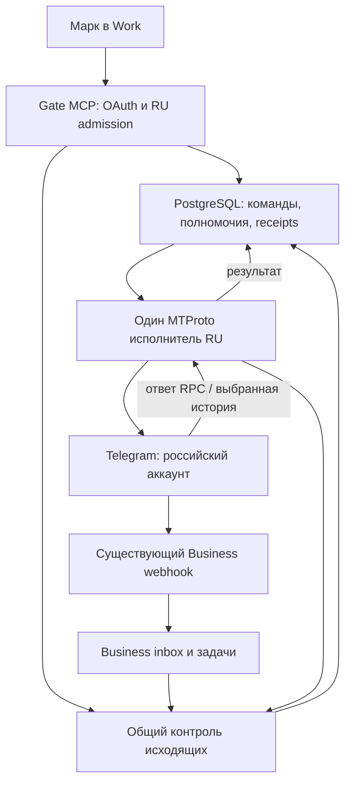

# MTProto RU: пересмотренное техническое задание и спринты v2

Дата исследования: 11 октября 2026, Europe/Minsk. Каноническая задача: [Gate #696](https://github.com/AlphaCenter/gate/issues/696). Документационный PR: [#759](https://github.com/AlphaCenter/gate/pull/759).

Статус: проектное решение после независимой ревизии; не реализованный и не принятый production. Документ заменяет прежний S0–S9-план из commit d29e73d199ed3c680912b42fa707f06959888c0d. Сравнение открытых проектов и доказательства — [MTPROTO_RU_OSS_REVIEW.md](MTPROTO_RU_OSS_REVIEW.md).

## 1. Решение

Расширить существующий Gate небольшим адаптером пользовательского MTProto на Telethon. Сохранить Business Bot API как существующий входящий маршрут и маршрут ответов. Добавить один облачный исполнитель команд российского аккаунта, устойчивый журнал операций и общую защиту исходящих действий.

Начать с двух законченных сценариев: написать первым по точному поручению; найти доступную группу и прочитать выбранный период. Оба работают из подключённого Gate в Work. Отправка не должна ждать реализации полной истории, медиа или администрирования.

Не строить до первого результата полный архив аккаунта, собственный движок Telegram updates, универсальную очередь задач, второй MCP gateway, новый OAuth-сервер или автоматический оркестратор AI. Переиспользовать Telethon, Gate PostgreSQL, существующие OAuth/MCP, форматирование, журналы и тестовые подходы. Нужная новая логика — правила Gate, которых нет в готовых Telegram-библиотеках.

Область: только российский аккаунт Марка. Белорусский аккаунт исключён из MTProto подключения, проверки сессий, чтения, отправки, настройки и live-приёмки. Общие изменения кода проверяются на синтетическом втором аккаунте; реальные BY данные и настройки не используются.

Базовый режим — команды владельца. Непрерывное наблюдение, полный индекс и автоматические ответы от нового MTProto маршрута не включаются. Windows и Telegram Web для ежедневной работы не нужны. Разовый вход делается на защищённой поверхности Gate с обычным приложением Telegram, только если действующая сессия не найдена.

## 2. Проверенная исходная точка

| Предмет | Проверенный факт | Что это не доказывает |
| --- | --- | --- |
| Gate main | 461088d68d047e4cd08c7a4f581300d591af241e | Наличие этого кода в production |
| Production status, 11.10.2026 около 18:23 Минск | commit afe0c6b85193; personal runtime_connected=false; send/create_group=false; local_session_not_bound | Отсутствие API application или RU session в защищённой конфигурации |
| PR #756 | Cloud session foundation merged; source tests/CI успешны по опубликованному receipt | Enrollment, работающий worker, новые Work tools или live Telegram |
| Существующая библиотека | Telethon==1.44.0 в personal-telegram и contact-sync extras | Поддержку новых методов из документации более нового TL layer |
| Текущий каталог MCP | Есть Business replies/documents, status и другие Gate инструменты | Полный пользовательский Telegram API |
| Наличие RU app/session | Не установлено защищённой target-specific inspection | Нельзя просить создать приложение/войти заново по догадке |

Историческую цепочку переиспользовать: #263/PR264 — transport/intent/random_id; #269–271 — enrollment/custody; #279–282 — read contracts; PR697 — offline preflight; PR699 — реальный text sender; PR701 — PostgreSQL fence; PR702 — private supergroup; PR703 — auth probe; PR756 — cloud source/status.

Нынешний sender уже правильно выставляет request_retries=0, connection_retries=0, auto_reconnect=False, flood_sleep_threshold=0. Это сохраняем. Проблема будущего постоянного worker — не потерять эти настройки и не спутать reconnect с безопасностью повтора.

## 3. Ревизия прежнего плана

| Находка | Изменение v2 |
| --- | --- |
| Верно выбраны RU-only, cloud, Telethon, один владелец сессии, standalone action, unknown | Сохраняются |
| Собственный полный Session backend и checkpoints до первой команды | Заменены built-in StringSession и тонким сохранением encrypted auth/DC в PostgreSQL |
| Приёмка restart в S1 зависела от реализации adapter в S2 | Persistence, login и single-owner acceptance сведены в один вертикальный этап V1 |
| First outbound ожидал полного S3 чтения | V2 требует только минимального resolver; V3 готовится параллельно после V1 |
| Shared fence рассматривался как уже общий для всех Business отправок | Требуется реестр всех RU writers и обязательный admission либо доказанный запрет непокрытого пути |
| Canonical Dialog/Message считались почти готовой общей идентичностью | Добавляется account + typed peer + message identity mapping; без массового переписывания canonical модели |
| Outgoing echo автоматически закрывает все задачи диалога | Вводится причинная связь ответа с покрываемыми task IDs; ad-hoc MTProto send сам по себе задачи не закрывает |
| confirmed=true и OAuth смешивались с доказательством user intent | Честное owner delegation + immutable operation; отдельное подтверждение вне делегирования |
| Файловый Work path проверялся поздно | Synthetic upload/download и discovery проверяются в V0 |
| Unknown мог навсегда остановить весь аккаунт | После доказанного завершения старого worker карантин ограничивается действием/затронутым peer |
| Полнота определялась словами «обычный Telegram» | Конечная матрица обязательных capabilities, со статусами и evidence |
| Финальная S9 выглядела первым этапом надёжности | Restart, redaction, rollback, replay и реальные Work checks входят в каждый живой выпуск |

## 4. Что брать готовым

Основной transport — Telethon 1.x. Для V0 рекомендуемый кандидат обновления: 1.45.0, опубликованный 10.09.2026, TL layer229; current Gate baseline1.44.0/layer227 остаётся до проверки. Обновлять оба extras одновременно, закрепить distribution hashes и compatibility evidence. Не ставить плавающий Codeberg HEAD/layer230 или v2 alpha.

TDLib — сильная резервная архитектура, если появится обоснованная необходимость полноценного offline client, непрерывной синхронизации или функций, которые Telethon не покрывает. Для текущего Python Gate переход добавляет native build, JSON bridge, отдельное управление БД/сессией и переписывание готового адаптера. Смена сейчас не обоснована.

Готовые telegram-mcp проекты использовать как каталог методов и примеры обработки peer/media. Их самостоятельный server не устанавливать рядом с Gate: это второй источник полномочий и отправок, который придётся заново соединять с RU grants, Business task semantics и общим журналом.

Очередь — состояние выполнения в собственной обязательной таблице операций, с уже используемым Gate SQLAlchemy/asyncpg и коротким FOR UPDATE SKIP LOCKED claim. Procrastinate — возможный будущий общий scheduler, но сейчас дублирует lifecycle и добавляет зависимости. Redis/Kafka/Taskiq не требуются.

Owner web setup использует существующий identity provider. Если готового browser OIDC клиента в принятом Gate коде нет, использовать проверенную интеграцию Authlib для Starlette/FastAPI; не писать OAuth протокол вручную. Gate PyJWT/JWKS validation остаётся на MCP API. Версия Authlib и зависимости фиксируются после совместимости с существующим httpx.

## 5. Целевая архитектура

Схема показывает ответственность, а не сетевой proxy: общий контроль исходящих исполняется до provider I/O, в Gate DB/admission, и используется обоими транспортами.

### 5.1 Runtime

Один долгоживущий Python process владеет одним TelegramClient и одним event loop. Логически это отдельный worker CLI из того же source/image, что Gate. Предпочтительное размещение — private worker service в существующем проекте/окружении. Возможность использовать уже оплаченный singleton process проверяется в V0; нельзя помещать независимый клиент в каждую ASGI replica.

Никакого публичного raw MTProto RPC. Команды читает worker из PostgreSQL. API получает redacted readiness/receipts без ключа сессии. Небольшой внутренний setup endpoint допускается только для owner login, с authentication, expiry и запретом журналирования тела.

Лимит один replica недостаточен: при развёртывании old/new процессы могут пересекаться. Lease не разрешает новый connect, пока старый владелец не завершён по принятому release/recovery протоколу. Второй процесс не «проверяет сессию» параллельным get_me.

### 5.2 Command-driven session

Использовать встроенный StringSession: он сохраняет авторизацию/DC, но не полный durable cache entities/updates. Обёртка сохраняет только encrypted versioned session bundle и гарантирует сохранение существенных изменений до готовности worker.

receive_updates=False и catch_up=False; выполнять прямые bounded методы для истории/поиска. Фоновая синхронизация PTS/seq/getDifference и общий message mirror не входят в этот продуктовый режим. Флаг не гарантирует, что Telegram вообще не пришлёт update; непрошенные сообщения не запускают AI, задачи, сохранение содержимого или расширение grants. Ошибки/служебные уведомления обрабатываются отдельно и безопасно.

QR login может временно требовать updateLoginToken/receive_updates=True в эксклюзивном enrollment lifecycle. После login клиент переходит в выбранный command-driven режим. Телефон/код — обязательный альтернативный сценарий для работы с одного телефона.

Тонкую обёртку проверить на реальной pinned версии: awaitable save/close/delete hooks; сериализация через StringSession.save(instance); изменения auth/DC; исключение временных media/DC clones из записи основной сессии; failure/cancel/crash. Нельзя вызывать asyncio.run внутри действующего loop или считать все Session методы строго синхронными: Telethon1.44 уже использует maybe_async в ряде hooks.

Async Session support upstream помечен experimental. Поэтому adapter изолируется и закрепляется версией; compatibility suite обязательна перед обновлением Telethon. Provider-free эксперимент на 1.44 проверил save/reload, реальный auth-key callback, transient clone и failure propagation, но не PostgreSQL, настоящий DC migration или production restart. V0 превращает этот узкий результат в воспроизводимый контракт и повторяет его на выбранном pin.

Это не новая реализация криптографии, протокола или session cache. Если потребуется непрерывный ingest, добавить отдельное ADR: полноценный стандартный SQLiteSession на защищённом persistent volume либо доказанный совместимый adapter, вместе с update recovery. Не выдавать StringSession-only за такой режим.

### 5.3 Custody и вход

Сначала проверяется наличие существующей RU привязки и защищённых параметров, наружу — только present/absent/invalid/version/redacted identity. Затем, по точному scope, проверяются authorization и get_me. Старое local_session_not_bound этого не заменяет.

Основной durable объект: encrypted session bundle в Gate PostgreSQL; encryption key только в защищённой конфигурации worker. В bundle допустимы необходимые app credentials и auth/DC, если они не остаются в worker-only protected environment. Нельзя хранить encryption key рядом с ciphertext в БД.

Существующий cloud source #756 — источник импорта, а не второй активный session owner. Импорт атомарно связывает expected RU account, app, owner, session generation, key version и checksum. Wrong owner не исправляется автоматической перепривязкой.

Web setup удостоверяет владельца через существующий IdP, использует short-lived server-side session, state/nonce/PKCE, CSRF/origin checks, fixed redirect allowlist, Secure/HttpOnly cookie. Общий admin bearer не попадает в страницу или URL. Login code/2FA password не сохраняются, не передаются AI и не попадают в analytics, traces или request logs. API hash не возвращается после ввода.

Отмена enrollment уничтожает временное состояние; auth_key revocation/logout не запускаются как побочный эффект обычного disconnect. Backup сессии проверяется offline; для live restore сначала подтверждается остановка исходного owner.

### 5.4 Минимальная модель данных

Имена проектные; окончательные SQL names и Alembic head фиксируются реализацией.

| Объект | Обязательные поля/инварианты |
| --- | --- |
| PersonalBinding | workspace, единственный RU Account UUID, expected Telegram owner, app ref, enabled capabilities, generation, health facts |
| EncryptedSession | binding, ciphertext, key_version, revision, custody_state; CAS update; key отсутствует в строке |
| PeerRef | binding/account, peer_type, provider_id, protected access_hash, identity/rights revision, label; opaque ref наружу |
| Delegation | owner subject, RU binding, client/purpose, permitted capabilities/targets/limits, expiry/revocation, evidence kind |
| Operation | immutable operation_id, actor, RU, typed target, kind, payload digest, delegation/approval, logical-action key, selected transport, status, available_at |
| Attempt | operation, ordinal, worker generation, effect boundary, provider random IDs, status, redacted error, provider receipt; durable before I/O |
| SessionLease | binding, process/boot/source, generation, renewal, drain/termination evidence |
| MessageIdentity/Observation | workspace + owner Account + typed peer + provider message ID; source refs Business/RPC/history; revisions/tombstone, optional legacy/canonical links |
| MediaObject | С V4: operation/account/source message, private object ref, actual size/hash/MIME, expiry, transfer state |

Очередь и operation journal — один durable lifecycle, не две независимые копии статуса. Operation может существовать до Dialog/Conversation/ReplyDraft. Для первой отправки не создавать фиктивного входящего, бота или reply task.

Legacy Message.bot_id не превращать массово в nullable. Общая identity mapping присоединяет существующие canonical/legacy записи; personal result может существовать самостоятельно. Не выполнять полный historical backfill RU/BY для запуска выбранного RU маршрута.

## 6. Совместимость с Business: обязательный контракт

### 6.1 Два транспорта одного аккаунта

Business connection ID — маршрут/поколение соединения, не идентичность Telegram-аккаунта или диалога. После reconnect он может измениться. Общий ключ — workspace + Account UUID + peer_type + peer_id; message identity добавляет provider message ID.

Для Business updates используется пространство message IDs подключённого пользователя, поэтому связь с MTProto допустима по account/peer/message ID. Совпавший текст, время или название — не доказательство одной операции.

Текущая canonical модель не включает account в Dialog/CanonicalMessage uniqueness. Простое добавление нового connector создаст два представления; использование старого connector без account binding может смешать аккаунты. Поэтому v2 использует additive identity/observation mapping и scoped read facade. Полная перестройка canonical storage не является prerequisite.

### 6.2 Admission всех отправителей

До RU MTProto write activation построить source/config inventory каждого Business-capable writer. Уже обнаружены отдельные modern reply sender, Universal Mayak sender и legacy admin/auto-reply маршруты; существующий PersonalTelegramSendFence их все не охватывает.

Для каждого достижимого RU пути обязателен один из вариантов:
1. Получать общую reservation/admission с immutable logical action, account/peer и причинным scope.
2. Для подключённого RU peer явно отказать до I/O и направить в поддержанный путь.
3. Доказать текущим scoped config/source receipt, что путь недостижим/default-off для выбранного rollout.

Глобальный send_enabled=false или список имён файлов не заменяет проверку фактического call path. Guard должен стоять и на конечной Business transport границе, чтобы новый/legacy call site не обошёл admission. Не менять поведение BY путей и не обследовать их payload.

Существующие права Business, окно ответа и ограничения paused/excluded chats сохраняются. MTProto не используется как скрытый fallback на Business отказ. Пользовательское поручение может явно выбрать MTProto там, где это разрешено аккаунту; оно не получает старое разрешение автоматически из Business draft.

Не переключать Telegram Business pause/connect settings при каждой MTProto команде. Для peer с активным автоматическим исполнителем Gate действует одна внутренняя политика владения: ad-hoc command либо конфликтует с активной action, либо получает явную handoff/admission; поздний auto-reply проверяет новую revision диалога. Нельзя иметь два независимых решателя ответа.

### 6.3 Дедупликация отправки

Prepare обязательно принимает стабильный request/intent key, закреплённый вызывающим клиентом до первого вызова. UNIQUE scope включает owner principal, client namespace и RU binding. Сервер атомарно создаёт operation_id и durable logical-action key: повтор key + того же immutable binding возвращает прежнюю operation; тот же key с другим binding даёт conflict. Потеря ответа prepare не разрешает генерировать новый key для повтора. Это проверяется в реальном Work flow; если клиент утратил key, сначала восстанавливается существующая операция, а не слепо создаётся следующая.

Старые reply drafts связываются с этим ключом через стабильную server-side draft/action identity. Смена endpoint/transport не создаёт новый logical action. Две намеренно независимые команды с одинаковым текстом получают разные request keys и остаются двумя допустимыми действиями; content hash используется для неизменности payload, не для вечного подавления одинаковых сообщений. Новый произвольный key сам по себе не доказывает новое намерение человека; обещание дедупликации ограничено сохранённой logical-action identity и её контрактом с клиентом.

Claim/reservation делаются атомарно. Короткая DB transaction заканчивается до provider I/O. Перед mutation сохраняются attempt и effect boundary. Replay возвращает имеющийся receipt или статус, а не новый dispatch.

Общий peer guard обязан видеть reserved/sending/unknown во всех журналах действующих Business writers: SendAttempt всех Conversations российского peer, старые business_connection_id, а также AgentSendAttemptModel/Mayak grants и legacy send evidence вне Conversation. Неопределённая связь старой активной попытки с выбранным RU peer запрещает новый effect до scoped resolution. Новые операции не обходят unresolved старую отправку через другой journal или conversation.

Надёжность формулируется точно: Gate не выдаёт повторное разрешение на тот же logical action из-за replay, crash, concurrency или другого транспорта. Universal exactly-once для всех методов Telegram не обещается.

### 6.4 Outgoing echo и задачи

Нынешний Business projector при outbound вызывает закрытие всех NEEDS_REPLY tasks conversation. Нынешний modern sender отдельно сохраняет covered_task_ids и умеет оставить более новый inbound. Нужна единая причинная семантика:

- ACK sender и Business webhook echo связываются с одним message identity и operation независимо от порядка прихода.
- Ad-hoc MTProto send без связи с reply task не закрывает задачи автоматически.
- Ответ, подготовленный к набору task IDs, закрывает только этот набор при соблюдении snapshot/revision.
- Поздний echo не закрывает новый inbound, не уменьшает last_message_at и не создаёт новый reply task.
- Неизвестный внешний outgoing, включая ручную отправку в другом Telegram-клиенте, фиксируется как observation; отсутствие operation link не даёт закрыть все задачи.
- Текстовый sender и webhook не создают два legacy Message для одного provider ID. Новая mapping связывает существующие записи без удаления истории.
- Ошибка или edit в одном источнике не воскрешают удалённый текст из старого кэша.

Это обязательная часть V2, а не финальная косметическая проверка.

## 7. Полномочия и интерфейс Work

### 7.1 RU admission

На каждом tool/API/job/cursor/file/status пути вычислять пересечение verified OAuth subject/workspace, конкретного RU binding, capabilities и действующего delegation. Не доверять account label, номеру страны или аргументу модели.

Существующий generic workspace resolver при неполных claims может собрать все readable accounts. MTProto не использует этот fallback как основание расширения доступа: RU intersection обязателен даже при broad OAuth или отсутствии project claim. Workspace fallback не заполняет MTProto account за владельца.

Новые scopes отделяются от Business messages:send; их название и публикация едины в schemas, tools/list, metadata, IdP grants и tests. Registered Gate M refresh проверяется в реальном Work.

### 7.2 Честная модель согласия

OAuth доказывает identity/scopes, digest — точный payload, confirmed=true — только входной аргумент. Ни одно из них не доказывает, что человек прочитал и утвердил именно эту операцию.

Рекомендуемая UX-модель: владелец на защищённом setup предоставляет ограниченные полномочия своему AI выполнять выбранные классы команд российского аккаунта. Сервер соблюдает target/action/limit/expiry и фиксирует evidence_kind=owner_delegation. Внутри этих границ точная команда в Work не вызывает второе искусственное подтверждение Gate. Настройки подтверждений самого Work продолжают действовать.

Для действий вне делегирования, неоднозначного адресата, нового состава участников, destructive scope или стоимости — показать готовый immutable preview и получить недостающее решение через защищённый owner path. Если frontend реально предоставляет проверяемое свидетельство, его можно использовать после теста; не изобретать signed user-turn claim.

Telegram text, filenames, forwarded content и tool outputs считаются данными. Они не создают delegation, не выбирают другой аккаунт и не разрешают новую отправку. Prompt-injection tests проверяют server containment; текстовая инструкция AI не заменяет механизм.

### 7.3 Контракт команд

Двухфазный контракт prepare → execute полезен для изменений: идемпотентный prepare с request key из §6.3 сохраняет server operation, цель, effect и digest; execute принимает operation ref, проверяет действующее полномочие и неизменность. В разрешённом делегированном режиме AI может выполнить обе фазы последовательно без ещё одного вопроса человеку.

Результат содержит operation_id, state, effect (read/sent/scheduled/created/etc.), transport, RU label, target ref, timestamps, provider refs при подтверждённом результате, warnings/partial_reason и retry policy. Queued/running не называются sent.

Для длинной операции — durable job ID, get/status/cancel и progress. Использовать обычные tools; не требовать экспериментальной поддержки MCP Tasks конкретным клиентом. Составные поручения сначала выполняет AI через существующие typed tools; общий workflow engine не добавлять.

### 7.4 Файлы из Work

До V4, в V0, доказать передачу synthetic файла в обе стороны. У текущих OpenAI plugins есть fileParams/download_url/file_id и optional widget helpers; их наличие в документации не доказывает поддержку установленным Gate M и Android Work.

Backend принимает файл через поддержанный host file input или проверенный private upload endpoint. Download URL считается ограниченным bearer capability: allowlisted origin, DNS/IP/redirect checks, no internal addresses, byte/time limits, short retention и отсутствие в журнале. File ID, имя и MIME сами по себе не доказывают содержимое — Gate считает hash и проверяет actual bytes.

Исходящий файл из Telegram возвращается в реальном supported frontend file/resource формате либо через owner-authenticated download. Нельзя просто отдать внутренний server path или ссылку, требующую неизвестный клиенту bearer. Feature detection и фактический download в Work входят в приёмку; secrets/setup не идут через MCP file upload.

## 8. Ошибки, очередь, повторы и восстановление

Operation state: prepared → authorized → queued → running → succeeded / rejected / cancelled / expired / unknown. Deferred_until — время повторной eligibility после доказанного no-effect отказа. Статус соединения и статус отдельной операции различны.

| Класс | Политика |
| --- | --- |
| Scope/peer/payload/capability rejected до I/O | rejected, provider calls0 |
| Не удалось connect/auth до mutation boundary | unavailable/rejected; нет ложного «сообщение, возможно, отправлено» |
| Подтверждённый privacy/rights/paid RPC rejection | typed rejected, без смены аккаунта/обхода оплаты |
| FloodWait/slow mode с доказанным отсутствием effect | deferred_until; заново проверить delegation и deadline перед повтором |
| Timeout/disconnect/500 после mutation dispatch | unknown; не объявлять failed/sent и не делать новый random_id |
| Read RPC failure | bounded retry с тем же RU/peer/window и ещё действующим grant |
| AUTH_KEY_DUPLICATED | terminal session incident; остановить owner, затем protected re-enrollment; не retry-loop |
| Grant revoked/job cancelled | остановить queued/future steps; in-flight может остаться unknown |
| DB/lease loss | новые effects запрещены; завершить/остановить старого owner по recovery протоколу |

Telethon transport reconnect может повторно поставить pending requests в очередь независимо от request_retries. Сохранить current Gate auto_reconnect=False и выполнять reconnect на уровне supervisor после фиксации in-flight состояния. Низкоуровневые протокольные retransmissions анализируются отдельно; счётчик вызовов Python не равен числу сетевых пакетов.

Для sendMessage/sendMedia/forward/album сохранять immutable per-message random_id и mapping. Telegram документирует provider dedup по account/peer/random_id; это полезный инструмент восстановления, но не гарантия общего Gate workflow, Business Bot API или create-group.

В V2 обычный replay не посылает RPC снова. Явный reconcile_exact_send можно добавить в том же bounded этапе только после доказанного same-request/same-random_id поведения на pinned layer, действующего разрешения и остановки старой попытки. Он не генерирует новую операцию и не переносится на методы без такой гарантии. Без достаточного доказательства результат остаётся unknown; совпавший текст истории его не разрешает.

Один mutation одновременно на RU peer; первоначально один общий mutation executor на RU с малым ограниченным параллелизмом safe reads/media. Rate limits берутся из реальных RPC ответов, а не из обещания фиксированных «N сообщений в секунду». Дедлайны/срок grant ограничивают суммарное ожидание. Повторные ошибки session/protocol переводят worker в pause.

Журнал обязателен, но expired lease не доказывает смерть процесса: новый owner ждёт подтверждённый drain/termination. После него можно обслуживать независимые peers; исторический unknown сохраняет карантин действия/peer, а не автоматически всего аккаунта. Новый worker не получает право повторить неизвестную попытку.

Native scheduled send — уже поручение Telegram выполнить будущий effect. Локальная отмена job после scheduling и отзыв Gate grant сами не удаляют его на сервере Telegram; отдельная cancel-scheduled operation должна подтвердить remote cancellation.

## 9. Чтение, адресаты и данные

Resolver принимает exact username/link, selected dialog/contact или известный opaque peer ref. Имя без уникального совпадения возвращает кандидатов. Username может сменить владельца: prepare pin связывает фактический typed peer, display snapshot и identity revision. Изменение цели требует новой подготовки.

Discovery различает свои dialogs, public username/search и invite preview. Нахождение приватной недоступной группы не обещается. Preview/join request/join — разные эффекты; ссылка-приглашение не означает автоматическое вступление. Phone resolution учитывает privacy; contact import не используется как скрытый read.

История: requested window, UTC values с отображением Europe/Minsk, fixed upper boundary, typed peer, cursor/signature, cumulative budget, returned range, complete/partial_reason. Новые сообщения не сдвигают страницу назад; дубли удаляются по message identity. Пропуск ID не означает пропущенный текст: удаление/скрытая или слишком старая история могут быть недоступны. Snapshot всей прошлой истории не гарантируется.

On-demand чтение не создаёт Business reply tasks. Кэш результата не выдаётся за актуальный Telegram: перед повторным показом после истечения короткой freshness/revision проверки перечитать выбранные ID либо вернуть stale/refresh-required. Без update subscription нельзя обещать мгновенное обнаружение всех edits/deletes.

Read-state — отдельный явно описанный effect. getHistory и mark-read различаются; выбранное нормальное клиентское поведение отражается в tool metadata и результате. Mark-read до max_id может пометить диапазон целиком; mark-unread не отменяет уже отправленный read receipt. Ghost mode/self-destruct retention не реализуются.

Минимизация: сохранять нужные peer pins/operation facts, не зеркалировать весь аккаунт. Предлагаемые ограничения пилота: provider page≤100, Work response≤50 сообщений и отдельный byte/token cap; batch budgets всегда явны. Временный content/media cache — до24ч только при необходимости, redacted receipts90дней; unresolved/idempotency evidence хранить по отдельной политике. Это проектные defaults, не изменение действующего retention Gate и не обещание удалить уже показанные данные из Work.

Telegram API Terms и Content Licensing содержат широкие ограничения AI-use и контекстные условия возможных исключений; документация Business одновременно прямо упоминает AI assistants. Из этих текстов нельзя самостоятельно вывести ни безусловное разрешение любого owner assistant, ни запрет всей интеграции. До live AI-read зафиксировать конкретный допустимый режим/контекст. Согласие владельца аккаунта не заменяет права других авторов; synthetic fixtures вне платформы не блокируются. Для channel content отдельно учесть sponsored-message требования. Ответственность за проверку применимости остаётся у исполнителя/владельца продукта, а не у произвольного checkbox «согласен».

## 10. Конечный каталог обязательного выпуска

Каждая строка с несколькими verbs разворачивается в отдельные typed capability records в V0. Они имеют ID, peer types, method/layer, scope, limits, state, sprint, code/test/runtime/Work evidence. «Planned» не выдаётся как «supported». Права Telegram дают allowed/rights-required/provider-limited, а не универсальную доступность.

| ID/family | Обязательные операции | Этап |
| --- | --- | --- |
| C01 setup | inspect, protected login/cancel, bind RU, status | V0–V1 |
| C02 lifecycle | reconnect, pause/resume, disconnect; explicit local grant revoke | V1 |
| C03 jobs | status/result/cancel, progress/deferred/unknown | V1 и каждый этап |
| C04 recipient | resolve username/link/selected peer, ambiguity selection, self/Saved Messages | V2 |
| C05 text | standalone send, plain/rich entities, link-preview policy, deterministic chunks | V2; rich/chunks V4 |
| C06 replies | reply/quote по выбранным message refs и topic/thread | V4 |
| C07 dialogs | list/search own dialogs, constrained public discovery, invite preview | V3 |
| C08 history | selected messages, paginated date history, text/media search, thread/replies | V3 |
| C09 read state | явные read/mark-unread с cumulative semantics | V3/V6 |
| C10 files | receive Work file, send/download document, checksum/private download | V4 |
| C11 media | photo/video/audio/voice send/download, caption/entities, album/order | V4 |
| C12 message changes | edit text/caption, forward, delete selected (у меня/у всех) | V5 |
| C13 interaction | free reaction set/remove, pin/unpin | V5 |
| C14 native extras | send sticker, create poll, vote/retract vote/stop poll где разрешено | V5 |
| C15 schedule | native schedule/list/cancel, receipt scheduled vs sent | V5 |
| C16 groups | create private supergroup, create channel, title/about/photo | V6 |
| C17 membership | join/leave, selected invite, member lookup, rights preflight | V6 |
| C18 administration | selected role/permission changes, invite-link create/revoke, join-request approve/decline | V6 |
| C19 topics | list/read/send/reply in existing forum topic; create/rename/close/reopen topic по правам | V6 |
| C20 contacts | selected list/search/import/update/delete; никакой полной address-book sync по умолчанию | V6 |
| C21 organization | folders list/update, archive/unarchive, draft save/clear, mute/unmute | V6 |
| C22 composition | read→prepare→execute, bounded batch plan, partial results/cancel | Уже базовые tools; итог V7 |
| C23 operations | redacted health, backup/restore/drain/rollback/rotation/runbook/cost | V1 и итог V7 |

Обязательная медиа-приёмка: document byte-for-byte; photo/video/voice — правильные native semantics/attributes и проверенная передача, с учётом разрешённой преобразующей обработки. Нельзя обещать одинаковый hash оригинала и Telegram-compressed photo. Transcription/AI analysis — отдельный существующий model route с его pinned policy, не новый поставщик в MTProto worker.

Не включены в v2: Secret Chats, звонки, Stories/live streams, платежи/Stars/paid reactions, полный экспорт аккаунта, смена телефона/2FA, удаление аккаунта, mass-invite/broadcast campaigns, произвольный bot callback/raw RPC. Video notes/GIF/contact/location cards/block-unblock и новые Telegram features получают explicit backlog/unsupported status, пока не включены отдельной ревизией. Это не отменяет обязательные строки таблицы.

Первое исходящее возможно только в пределах privacy/anti-spam/прав получателя; API не гарантирует доставку любому человеку. Платные сообщения/join не включают allow_paid_stars или paid floodskip автоматически.

## 11. Пересобранные спринты V0–V7

Нумерация V отделяет новое ТЗ от старого S-плана. Это результаты, не обещания недель. Каждый функциональный этап включает backend, scopes/schema, зарегистрированный Work tool, tests и реальный user flow. Надёжность внедряется до живого effect.

### V0 — Закрыть неизвестные интерфейсы до большой разработки

Зависимость: эта ревизия. Исследовательский документ и узкий provider-free Session experiment подготовлены; полный набор исполняемых proofs V0 ещё не выполнен.

- Зафиксировать capability records C01–C23, decisions и method/layer inventory.
- Проверить Telethon1.44→1.45 adapter compatibility, digest distributions; выбрать окончательный pin.
- Provider-free proof session save/reload/DC/clone/failure; no update-mirror.
- Synthetic Work discovery/auth/delegation preview/job/result и file upload/download spike, включая текущий Android/front.
- Зафиксировать все Business RU writers/admission и echo race fixtures.
- Подготовить reviewed Gate-owned MTProto inspect/configure/enroll/worker/migrate/drain/rollback contract, cost proposal и schema.
- Не заменять отсутствующий Ops контракт provider UI или Gate745 credentials.

Выход: executable contracts/proofs и понятный первый deploy package. Приёмка: каждый неопределённый интерфейс имеет подтверждённый путь либо конкретный blocker; нет выдуманного user-intent proof. От Марка сейчас ничего не требуется.

### V1 — Подключить устойчивый RU command runtime

Зависимость: V0 contracts; synthetic работа не ждёт login.

- Additive binding/session/lease/operation/attempt/delegation schema и worker CLI.
- Protected redacted inspection; импорт подходящей существующей RU session, иначе готовый owner login.
- Реальная проверка владельца, encrypted persistence, restart, single owner, stale lease/drain и redacted status.
- Minimal Work status/job/cancel; permission controls.
- Exact approved source/config/schema deployment и rollback без потери журнала.

Приёмка: тот же RU после restart; второй worker не подключается; key/missing/revoked/wrong-owner/DB loss различаются; optional MTProto не ломает Business/API health. Конкретные новые расходы показаны до provisioning.
От Марка: условно login/2FA/app parameters через setup, только если действительно не найдены; решение по конкретной новой стоимости, если она есть.

### V2 — Первое личное исходящее с Business совместимостью

Зависимость: V1 + minimal resolver. Не зависит от полного V3, AI-read чужой переписки или large media.

- Standalone immutable plain-text command, exact RU/user/Saved Messages peer pin.
- Общая reservation/logical-action key и coverage всех активных RU Business writers.
- Historical unknown bridge, connection rotation, per-peer ownership/snapshot admission.
- ACK/echo identity reconciliation и причинное закрытие только covered tasks.
- Typed errors, same operation replay, actual sent receipt; no implicit fallback.
- Work prepare/execute/result и optional exact reconciliation после доказанного provider contract.

Приёмка: первый исходящий без inbound/task, один фактический effect выбранному target; T05–T15 и T28 ниже проходят до первого live-send; второй транспорт не создаёт вторую попытку. Новая команда с тем же текстом не подавляется навсегда.
От Марка: точный recipient/text для живого внешнего теста, если не были заданы; сначала собственные disposable test objects в принятом режиме.

### V3 — Найти группу и прочитать выбранное

Зависимость: V1/resolver; разработка возможна параллельно V2. Выпуск не включает отправку или управление сообщениями. Явно авторизованный read-state effect допускается через тот же operation journal и mutation admission; чтение не маскирует mark-read/mark-unread как отсутствие изменений.

- Свои dialogs/public resolve/invite preview, disambiguation.
- Bounded history/search/threads, cursors, доступный диапазон и partial_reason.
- On-demand personal read facade, без создания Business задач и global ingest.
- Read-state и permitted AI content path; typed read tools реально видны в Work.

Приёмка: выбранная группа/период, несколько страниц с устойчивой границей, ссылки/ref и даты; недоступные данные названы; истёкший/другой peer/account cursor отвергнут. После V2+V3 оба первоначальных сценария работают.
От Марка: конкретный чат и период перед live-read, если не известны. Применимость условий AI-use должна быть установлена для этого контекста.

### V4 — Форматирование и файлы

Зависимость: V2/V3 interfaces и ранний file spike.

- Переиспользовать Gate text compiler, Unicode/entity validation; адаптировать Bot API entities к MTProto.
- Reply/quote/topic, immutable chunk plan с отдельным receipt каждого фрагмента.
- Private staging и независимые от ReplyTask медиа операции; streaming, limits, MIME/hash, TTL.
- Telethon upload/download, native photo/video/audio/voice/albums; expired file_reference refresh только в том же grant.
- Upload file parts отделены от единственного разрешённого final send; partial album receipts сохраняются.
- Практический baseline8MiB использует текущие ограничения Gate; расширение размера требует доказанного transport/storage и стоимости, не догадки по максимуму Telegram.

Приёмка: файл действительно прикрепляется/скачивается из Work; документы сохраняют bytes/hash, медиа корректный тип/caption/order; разрыв upload не вызывает повтор final send. Без публичных секретных ссылок и unbounded base64.
От Марка: optional типичные размеры файлов; при новом ресурсе конкретный budget choice.

### V5 — Управлять выбранными сообщениями

Зависимость: V2 operation core; media-specific функции после V4.

- Edit/forward/delete с expected revision и explicit revoke scope.
- Reactions/pins/stickers/polls, native scheduled send/list/cancel.
- Методы без provider idempotency имеют отдельную retry/reconcile policy.
- Schedule не называется sent; cancel подтверждается отдельно.

Приёмка: disposable выбранные сообщения, конфликт revision/rights, protected forwarding rejection, scheduled/cancel truth, unknown без второго эффекта; отсутствие paid side effects.
От Марка: только недостающий scope для конкретных тестовых объектов/действий за пределами делегирования.

### V6 — Группы, контакты и организация

Зависимость: V1–V3 command/peer contracts; отдельные семьи можно готовить параллельно V4/V5.

- Перенести готовый private-group executor/journal в cloud operation core.
- Channel/group settings, selected invitations/admin/join requests/invite links; existing/new forum topics.
- Contacts selected operations через того же owner; отдельный contact-sync не открывает ту же RU session.
- Folders/archive/drafts/mute/read states с effect previews.
- Одно создание private group не подразумевает приглашения или публикацию.

Приёмка: private/creator/rights доказаны; неизвестное создание не повторяется; участники меняются только по выбранному действию; контакты не импортируются при обычном поиске.
От Марка: имя тестовой группы и конкретные участники лишь для проверки соответствующих действий.

### V7 — Полная приёмка и эксплуатация

Зависимость: mandatory capabilities V1–V6; не первый момент публикации tools или recovery.

- Завершить evidence matrix C01–C23: code/tests/deployed runtime/actual Work.
- Compound commands через typed tools, limits, partial success, progress/cancel и injection tests.
- Проверить old/new Work, refresh scopes/catalog, mobile file/result display.
- Crash/restart/drain, backup restore, key/session revoke, rollback, journal retention, resource caps и измеренная стоимость.
- Исправить user-facing descriptions, runbook и короткую инструкцию восстановления.
- Устранить missing mandatory evidence до закрытия #696.

Приёмка владельцем — на конкретных выполненных сценариях; CI/merge сами по себе не закрывают задачу. Если внешнее ограничение делает обязательную функцию недоступной, явно согласовать изменение каталога, а не молча объявить полный выпуск.

### Связь со старым S0–S9

| Старый | Куда перенесён | Причина |
| --- | --- | --- |
| S0 | Эта ревизия + executable V0 | Исследование не заменяет proofs |
| S1 + S2 | V0 contracts + V1 runtime | Убрать круговую зависимость persistence/login |
| S3 | V3; minimal resolver раньше в V2 | First send не ждёт всей истории |
| S4 | V2 + rich/replies V4 | Раньше получить исходный результат |
| S5 | V0 file spike + V4 | Найти frontend blocker заранее |
| S6 | V5 | Независимые typed message mutations |
| S7 | V6 | Переиспользовать group/contact foundation |
| S8 | В каждом V + итог V7 | MCP не откладывается в конец; без нового orchestration engine |
| S9 | В каждом live release + V7 | Надёжность обязательна с первой отправки |

Критический путь: V0 → V1 → V2/V3 → V4/V5/V6 → V7. Параллельная подготовка допустима на раздельных файлах/контрактах; одна RU session всё равно имеет одного владельца. Срок оценивается после V0 по доказанным blockers и bounded PR packages. Число спринтов не переводится автоматически в недели.

## 12. Матрица обязательной приёмки

| ID | Сценарий | Ожидаемое доказательство |
| --- | --- | --- |
| T01 | OAuth RU claim, project claim missing, synthetic workspace RU+other | Любой MTProto путь остаётся RU-only |
| T02 | Wrong owner/session/key, forged peer/cursor/file ref | Отказ до чужих I/O, секреты не раскрыты |
| T03 | Session save/DC change/clone/restart | Основной encrypted record корректен; clone не перезаписывает его |
| T04 | Второй worker, deploy overlap, DB loss/lease expiry | Нет двух main Telegram sessions; old owner termination перед новым connect |
| T05 | Два concurrent вызова одной операции | Один admission/attempt, другой получает existing receipt/status |
| T06 | Тот же logical action через Business и MTProto | Нет второй provider отправки |
| T07 | Непокрытый legacy/admin/Mayak Business writer RU | Явный deny либо общий admission; не обход |
| T08 | Business connection ID изменился; старый unknown | Новый connection не обходит peer quarantine |
| T09 | ACK→echo и echo→ACK; оба replay | Один message fact/compatible projection |
| T10 | MT ad-hoc send при NEEDS_REPLY | Без самовольного закрытия task |
| T11 | Новый inbound появился до позднего outgoing echo | Новый task остаётся; timestamps/revision не откатываются |
| T12 | Две разные команды с одинаковым текстом | Две независимые разрешённые операции, не content-hash дедуп |
| T13 | Crash до intent, после boundary, после Telegram до DB receipt | Предсказуемые queued/unknown/succeeded; нет blind resend |
| T14 | Timeout/500/FloodWait/auth revoked | Разные error/retry classes; неизвестность не маскируется |
| T15 | Unknown и доказанное завершение старого process | Action/peer quarantined; независимый peer доступен по policy |
| T16 | Username reassigned, ambiguous name, changed rights | Старый pin не меняется молча; prepare conflict |
| T17 | History: новые/edit/delete между страницами, старый/закрытый диапазон | Cursor scoped, no fabricated text, partial_reason |
| T18 | Telegram content пытается управлять AI | Server grants/account/targets не расширяются |
| T19 | Rich Unicode/emoji/entities/reply/chunks | Preview соответствует final payload и каждому receipt |
| T20 | Upload interruption, expired ref, album partial | Hash/limits, safe refresh, no duplicate final send |
| T21 | Work file ingress и реальный download на текущем фронте | Человек получает файл, не только server checksum |
| T22 | Selected delete/forward/pin/poll/schedule | Rights/revision/effect и remote cancellation доказаны |
| T23 | Private create unknown/invite/admin/topic | Нет повторного create/неожиданных участников/публичности |
| T24 | Pause/cancel/revoke во время job и native schedule | Будущие Gate steps остановлены; уже внешний effect показан честно |
| T25 | Backup/restore/rollback | Нет второго owner, journal не потерян, старые grants не ожили |
| T26 | Retention/log redaction/cost/load/backpressure | Проверенные TTL/caps/метрики, отсутствуют secrets/content leaks |
| T27 | Все capabilities: source/runtime/Work | Ни один обязательный planned пункт не назван supported без evidence |
| T28 | Concurrent prepare и timeout после commit до ответа | Same request key/binding возвращает ту же operation; changed binding даёт conflict; Work retry сохраняет key |

Tests используют fake transport, synthetic accounts и существующие PostgreSQL integration fixtures. Не писать сотни тестов, повторяющих implementation; проверять реальные boundary/race/failure invariants. Telegram test server допустим как отдельный явно разрешённый эксперимент, но не доказывает production privacy/Business parity и не должен использовать RU auth key.

Live checks сначала ограничены disposable собственными RU объектами и принятым режимом данных, затем конкретными recipient/chat/media. Ни один живой тест не выбирает случайного контакта.

## 13. Пакеты реализации и рабочие области

| Пакет | Existing paths / новые области | Обязательная совместимость |
| --- | --- | --- |
| Pin/session/worker | pyproject.toml; app/personal_telegram; новый worker entrypoint; cloud status | 1.44 baseline, contact-sync pin, existing CLI contract |
| Identity/grants/MCP | app/core/mcp_oauth.py; app/api/mcp_routes.py, mcp_schemas.py, mcp_metadata_routes.py; dedicated personal routes | Existing Business tools, RU containment, no broad fallback |
| Operation/queue | Новый personal operation model/repository; reuse infrastructure/telegram_processing claim pattern | Не смешивать inbound TelegramReceipt и исходящие mutation retries |
| Business bridge | infrastructure/reply_sends.py, telegram_business_text_inbox.py, personal_telegram_fence.py; остальные writers inventory | Legacy unknown, connection rotation, covered tasks, no BY behavior change |
| Projection | models/canonical.py interfaces + additive identity mapping/read facade | Без fake bot, full mirror или обязательного global backfill |
| Media | document_formats/formatting reuse; dedicated personal media/staging | Existing ReplyDocument task requirement не переносится |
| Setup/Ops | protected owner routes + reviewed Gate-owned Ops client/worker config | Existing IdP; fixed target; no AQUB/Gate745 authority reuse |
| Evidence | tests, registry capability records, runbook, issue receipts | Exact-head source != runtime acceptance |

Один bounded PR на завершённый пакет; не делить ради указателей и не создавать дубли #696. Перед каждым пакетным merge перечитать main/Alembic heads/active leases и совместимость чужих работ. Не присваивать #745 или общий cutover; использовать только принятый интерфейс либо оформить зависимость.

## 14. Release, стоимость и rollback

- Проверить current Gate-only Operations contract. Basic ops-deploy #751 не разрешает новую custody/worker/migration; нужен отдельный reviewed target contract.
- Один migration owner/phase. Нынешний railway.toml запускает alembic upgrade head перед deploy; worker service не должен запускать его второй раз неявно.
- Enable stages: synthetic/disabled → protected auth/status → selected RU send/read → declared media/manage capabilities. Global enable-all отсутствует.
- Release receipt: exact API/worker source/image, configuration version, schema head, old owner drain/termination, session generation, supported catalog, current checks.
- Rollback: запрет новых personal admissions, drain, сохранить unknown/receipts, вернуть совместимый binary/config. Не удалять сессию, таблицы, сообщения или группы автоматически.
- Хранить last-known-good runtime; additive schema должна читать старые receipts при возврате кода. Backup restore не восстанавливает автоматически истёкшее разрешение или право на повтор.
- Новая стоимость рассчитывается как worker CPU/RAM runtime + DB growth + private media storage/egress + CI, с baseline и месячным ceiling. Уже оплаченный ресурс может не требовать нового тарифа, но delta не считать нулевой без измерения.
- Один worker, существующий PostgreSQL, bounded polling, TTL и file cap — начальная оптимизация. Новый broker, vector DB, архив всех сообщений или отдельный LLM не создаются.
- Stop conditions: wrong owner/source, uncovered RU writer, duplicate delivery, session split, secret leak, new unexplained cost, corrupted journal или невозможность безопасного rollback.

## 15. Что потребуется от Марка

| Решение/действие | Когда реально потребуется |
| --- | --- |
| Аккаунт | Уже решено: российский; повторного выбора нет |
| Вход/код/2FA | Только после проверки, если подходящая RU session отсутствует; готовая защищённая страница |
| API application parameters | Только если не найдены; существующее приложение, не новое по умолчанию |
| Границы делегирования | Один понятный экран классов действий/ограничений перед activation; без выбора технической архитектуры |
| Первый recipient и текст | Перед конкретной внешней отправкой, если ещё не заданы |
| Первая группа/период | Перед live-read; допустимый режим данных устанавливается для этого сценария |
| Test group/участник | Только для соответствующего group/invite теста |
| Размер файлов | Optional; до ответа действует опубликованный пилотный лимит |
| Дополнительные расходы | Только после конкретного расчёта и готового resource proposal |
| Итог | Принять фактические сценарии и остаточные ограничения |

Не требуется передавать секреты в чат, устанавливать Windows/Telethon, вручную управлять CI/PR или многократно разрешать уже охваченную делегированием точную команду. Отсутствие ответа на optional вопрос не блокирует независимую разработку. Ожидание человека не считается его согласием.

## 16. Definition of Done

1. Реально связан и восстановим только RU, подтверждён exact owner.
2. Cloud source/runtime/health и new Work tool discovery проверены.
3. Первое исходящее работает без прежнего inbound/ReplyTask/Business window, в пределах Telegram permissions.
4. Поиск/чтение выбранной доступной группы работает в установленном режиме данных с честной полнотой.
5. Все обязательные C01–C23 имеют source/test/runtime/frontend evidence либо явно принятую scope revision.
6. Каждый активный RU writer участвует в общем admission; старый путь не обходит новый.
7. ACK/echo/history не создают duplicate facts и не закрывают новые tasks.
8. Replay/concurrency/crash не создают новое разрешение на тот же action; unknown сохраняется и разрешается только доказательством.
9. Persistence/clone/DC, single-owner/deploy, cancel/revoke/recovery/rollback проверены.
10. Файлы реально передаются в обе стороны в объявленных limits.
11. Полномочия, prompt injection, paid effects, logs/retention/cost controls проверены.
12. Пользовательская приёмка подтверждена конкретными результатами. До этого #696 открыт.

Исследование не выполняло Telegram login/чтение/отправку, не меняло config/секреты/БД и не разворачивало production. Следующий практический пакет — V0 proofs/контракты и подготовка V1, а не немедленная live-активация всей матрицы.

